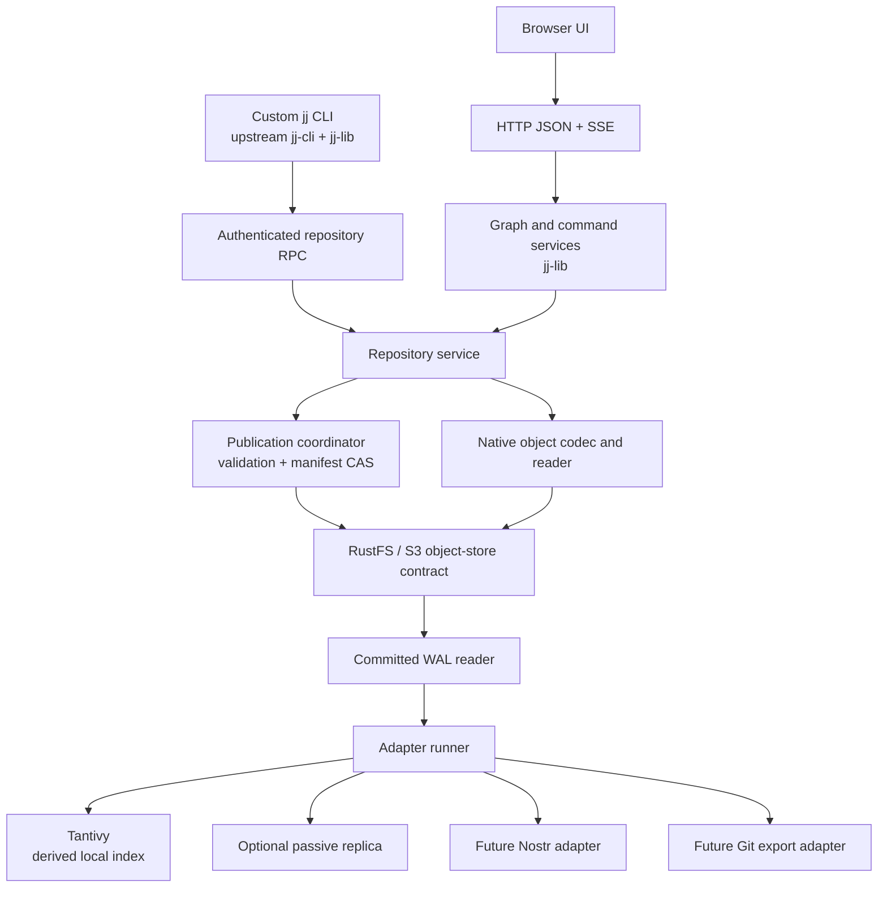

# Native JJ Store: agent implementation plan
**Prepared:** 26 September 2026  
**Status:** Proposed implementation specification, with upstream reference points and illustrative code.  
**Primary deliverable:** a custom JJ CLI, a server using `jj-lib`, RustFS-backed authoritative storage, structured read/mutation APIs, and a Tantivy adapter.  
**Working names:** `jj-store` (server), `jj` (custom CLI), `jj-store-core` (library). Adapt names to the actual repository after inspection.
This is a self-contained handoff for an implementation agent. Read the complete plan before changing code. Source repositories are reference material, not instructions that override this project's requirements. The code examples are integration scaffolding, not a completed server; compile and adapt them against the versions pinned in milestone M0.
## 1. Decision and scope
Build a **native, centrally authoritative JJ repository service**. The authoritative service can run on the same machine as the CLI or on a shared server. RustFS stores native repository objects, publication records, repository manifests, durable adapter state and replication checkpoints. No SQL database is required for repository correctness.
The custom CLI reuses upstream `jj-cli` and `jj-lib`; it registers remote storage implementations rather than reimplementing JJ. The server also uses `jj-lib`, with in-process implementations of those same stores. A browser API exposes structured repository data and typed mutations. Server and client therefore operate on the same native JJ model, not a separately inferred Git/Nostr graph.
Borrow the **integration shape** from the Google-sponsored Commit Cloud proof of concept and the **publication/consumer design** from WalGit. Neither repository should be adopted wholesale without an audit. The Commit Cloud project explicitly describes itself as experimental; it is not published Google production infrastructure. [R01–R07]
This replaces the primary-storage role of the current Git-carrier synchronization design. Git mirrors and Nostr projections remain possible adapters, but neither is required for a repository to function. Do not introduce a hidden Git remote, carrier branch, Turso database, or relay dependency into the new core.
### 1.1 Required first release
- A local-only deployment and a shared-server deployment using the same storage format.
- Native JJ commit, tree, file, operation, view and operation-head storage, including all additional object variants required by the pinned `Backend` contract.
- Manifest-CAS publication, committed WAL traversal, crash recovery and repeatable object-store contract tests.
- A custom CLI able to run the supported normal JJ commands against that server.
- Structured `jj log`, `jj op log`, `jj evolog`, object, tree, file and diff APIs.
- Typed server mutations for abandon and conflict resolution, plus foundational describe/new/bookmark operations.
- A minimal browser UI served by the server: three graph views, object/diff inspection, mutation previews and confirmations, conflict editor and search.
- A generic post-commit adapter interface, with Tantivy as the first production adapter.
- Optional read-only remote replication through the adapter framework, implemented after core correctness. The architecture and failure tests must accommodate it from the start.
### 1.2 Explicit exclusions from v1
No active-active repositories across disconnected object stores; automatic failover; arbitrary remote shell execution; arbitrary CLI argument execution; server-side invocation of untrusted editors or merge tools; transparent Git command support on a non-Git backend; dynamic native plugin loading; automatic history deletion; or offline writes to a disconnected shared server.
These exclusions do not remove local-only operation: localhost `jj-store` plus localhost RustFS is fully local. Losing an optional replication destination must not affect local writes. Losing the **authoritative** local server/object store does affect commands requiring it.
### 1.3 Existing integration requirements to preserve at the boundary
Inspect the existing `jj-nostr` / `jj-nostrd` code before planning migration. Retain reusable identity, authentication, agent-session, checkpoint/mark and workspace-materialization concepts where applicable. Logical workspace state is not a physical checkout. A later materializer may retain the established default `~/.jj-nostr/workspaces`, explicit path overrides and duplicate-safe behavior. Agent annotations and Nostr projections must reference native IDs, not invent a second change-ID scheme.
Do not silently migrate or delete an existing repository. The new architecture is a deliberate change of storage backend, not a configuration flip of the old synchronizer.
## 2. Corrections and hard boundaries from the design discussion
These details prevent appealing simplifications from becoming data-loss bugs.
**The POC is a starter, not the persistence specification.** Its operation/view hashing differs from the normal `SimpleOpStore` inspected during preparation. Its protobuf coverage and backend methods must be compared field-by-field with the pinned JJ release. Do not copy its hash routines and promise identical imported operation IDs. [R07, R10]
**There are four different histories.** Commit-parent ancestry powers `jj log`; operation-parent ancestry powers `jj op log`; predecessor/evolution relationships power `jj evolog`; the storage WAL records the order of accepted server publications. They are related, not interchangeable. [R09, R12–R15]
**Ordinary serialization is not necessarily lossless.** The inspected JJ `Operation` has fields excluded from its generic Serde representation, including `view_id` and `commit_predecessors`. A convenience `serde_json::to_vec(operation)` is not an authoritative persistence codec. [R09]
**Reads must not accidentally mutate.** The inspected `RepoLoader::load_at_head()` can reconcile divergent operation heads. Read-only HTTP handlers must pin an explicit operation and use `load_at()`, rather than blindly call `load_at_head()`. Reconciliation is an authorized mutation. [R11]
**A WAL cannot compensate for a broken CAS primitive.** RustFS documents selected S3 behavior rather than universal compatibility. A reported cross-endpoint conditional-PUT race is closed but remains useful test evidence; its status is not proof that an arbitrary deployed build meets our contract. The exact deployment must pass our concurrent conditional-write tests. [R25–R27]
**Do not address competing log candidates only by sequence number.** WalGit's publisher handles orphaned sequence slots and ambiguous manifest-write outcomes. This plan borrows the invariant, but uses attempt-unique log object keys to avoid sharing an immutable key between competing candidates. [R21]
**“One mutable object” means one repository publication pointer.** Adapter cursors, credentials/configuration, optional leases and index-snapshot pointers may also be mutable. They must never be an alternate authority for JJ repository state.
**Removing SQL does not remove coordination.** We are implementing a deliberately small publication protocol, not obtaining multi-object transactions from S3. Object uploads become visible as repository state only through the manifest.
## 3. Architecture

The remote CLI implements `Backend`, `OpStore` and `OpHeadsStore` using RPC. The server implements them using its object reader and publication coordinator. **The server must not call its own RPC endpoint to use `jj-lib`.** Share an in-process library.
There are two client surfaces:
1. **Native repository RPC:** low-level object methods and operation publication, used by the custom CLI's storage traits.
2. **Application API:** structured graph queries, search, previews and typed mutations, used by the UI and external agents.
Both converge on the same authentication, authorization, codecs, repository model and publication path. An operation submitted through low-level RPC must not bypass policy checks enforced on an HTTP mutation.
### 3.1 Proposed crate boundaries
```text
crates/
  jj-store-model/          Project wire types, object envelopes, WAL schemas
  jj-store-object/         S3 contract, RustFS adapter, memory test implementation
  jj-store-codec/          Versioned native JJ codecs and content identities
  jj-store-wal/            Manifest, candidates, publication, replay, checkpoints
  jj-store-jj/             Pinned jj-lib Backend/OpStore/OpHeadsStore implementations
  jj-store-service/        Repository session, graph queries, typed mutations/policy
  jj-store-rpc/            Authenticated native transport and wire conversions
  jj-store-http/           HTTP API, SSE, OpenAPI, static UI serving
  jj-store-adapters/       Committed log reader, runner, cursor and checkpoint contracts
  jj-store-tantivy/        First adapter; search and index snapshots
  jj-store-cli/            Thin upstream jj-cli integration; connection/init commands
  jj-store-server/         Process configuration and composition
  jj-store-testkit/        Fake storage, fault injection, fixtures, parity tests
web/                      Minimal UI; reuse Svelte if the repository already uses it
```
These are responsibility boundaries, not a requirement for twelve tiny crates on day one. Co-locate modules initially where that reduces build complexity, but prevent dependency cycles. `model/object/wal` must not depend on the UI, Tantivy or Nostr. Put unstable upstream JJ integration behind `jj-store-jj` and `jj-store-service`.
### 3.2 Data ownership
| Data | Authority | Rebuildable? |
|---|---|---|
| Native commits, trees, files and other backend objects | RustFS | No, except from a complete replica/backup |
| Native operations and views | RustFS | No |
| Published operation heads and publication sequence | Manifest + referenced WAL/checkpoints in RustFS | Reconstructable from retained published records |
| JJ graph/revset index | Local server/client cache | Yes, from retained native objects |
| Tantivy index | Local adapter cache; optional snapshot in RustFS | Yes |
| Signed outbound Nostr events pending delivery | Adapter namespace in RustFS | Must survive retry if exact event identity matters |
| Physical working-directory files and checkout bookkeeping | Each client | Not automatically shared |
| Workspace-to-commit mappings | Native JJ views in RustFS | Part of repository history |
## 4. Reference strategy and version pinning
At M0, clone the public references and the actual target repository. Record exact SHAs in `docs/upstream-lock.md` and commit a Cargo lockfile. Reference links in this plan were inspected as moving branches/documentation during preparation; they are not immutable version pins.
Keep `jj-cli` and `jj-lib` on the **same tested upstream revision**. Compile the upstream custom-backend example and a minimal POC client/server before designing around their signatures. Inspect `StoreFactories`, repository initialization, trait signatures, authentication insertion points, prefix resolution, GC and index APIs. [R02–R06, R08–R11, R18]
Reuse from Commit Cloud:
- CLI factory registration and independent store initialization.
- RPC adapter organization and object conversion tests.
- Separation between commit backend, operation store and operation heads.
Replace or audit:
- In-memory authority, incomplete persistence and error handling.
- Hashing/serialization, unsupported object variants and missing methods.
- Unbounded buffers and one-request-per-object latency patterns.
- Identity, access control, idempotency, conditional publication and restart recovery.
Borrow from WalGit:
- Immutable data before manifest publication; readers follow committed references.
- CAS conflicts versus unknown write outcomes; durable consumers after commit.
- Checkpoint plus log tail, cold-start recovery, fault-injection/contract tests.
- Explicit cache limits and request/round-trip budgets.
Do not import its Git protocol/pack/ref business logic, broad infrastructure, or repository-specific agent instructions. Our payloads are native JJ objects. The proposed unique candidate keys are an intentional difference from WalGit's sequence-slot algorithm. [R19–R24]
Review upstream licenses and retain required attribution in copied/adapted source. The illustrative code below is project scaffolding, not a source dump or an assertion that upstream interfaces are stable.
## 5. Identity and lossless native codecs
### 5.1 Distinguish identities
Use separate types for `RepoId`, `CommitId`, `ChangeId`, `TreeId`, `FileId`, `OperationId`, `ViewId`, `ObjectDigest`, `PublicationId` and `RequestId`. Never use a WAL sequence as a JJ ID. Never use a Nostr event ID as a JJ change ID.
Codec upgrades use new immutable representation keys/catalogs, never overwrite old object bytes in place. Historical references remain readable.
A physical envelope has two identities:
```text
semantic_id: the native ID returned through the relevant JJ trait
payload_digest: hash of the exact versioned storage envelope bytes
```
They need not be the same. A native operation hash is over JJ's content-hash representation, not necessarily its protobuf bytes. Use a separate payload checksum to detect physical corruption.
For upstream operations/views, reuse the pinned JJ content-hash behavior, including special root IDs. The inspected `SimpleOpStore` uses BLAKE2b-512 for non-root operation/view IDs and special root handling. Preserve field meaning and ordering; do not sort parent lists or merge terms just to make an encoding “canonical.” [R10]
For **new native-backend repositories**, define and freeze an explicit backend identity profile during M0: ID lengths, domain-separated object hashing, canonical encodings, root commit/change/empty-tree IDs and version-upgrade rules. Prefer reusing an appropriate pinned upstream backend codec over inventing hashes. Audit the POC before using its Git-compatible hash routines. Being physically stored in RustFS does not force any particular logical hash algorithm.
**Migration is a separate gate.** Preserve `ChangeId` exactly. Existing `CommitId`, `TreeId`, `OperationId` and `ViewId` can only all remain identical when the corresponding identity algorithms and referenced IDs remain compatible. Do not silently claim exact preservation while rehashing commits into another backend format. Implement a verified lossless import profile or reject the import and leave the old repository untouched. Do not introduce identity remapping as a hidden fallback.
### 5.2 Coverage checklist
Generate a field-by-field codec matrix from the pinned definitions. It must include:
- Commit parents, change ID, root merged-tree representation, author/committer timestamps and offsets, description, signatures, conflict metadata and pinned-version extras.
- File bytes and executable flags where modeled; trees; symlinks; submodule/gitlink entries; copy/rename records and associated lookup methods where required by the pinned `Backend`.
- Views: visible heads, workspace commits, local and remote bookmarks/tags, conflicted ref targets, tracking state, Git compatibility fields where present.
- Operations: view ID, parents, full metadata, snapshot marker, workspace identifier, attributes and `commit_predecessors`, including **None versus an empty mapping**.
- Intermediate predecessor commits created/rebased within one transaction, even when they never became a visible final head.
- Root and empty objects, absent values, conflict terms, non-text blobs and legal repository-path encodings.
The inspected Backend contract has more than files/trees/commits: it includes symlinks, copy records, identity parameters, concurrency and GC. Do not implement only the happy-path methods and label the backend complete. [R08–R10]
Use a versioned explicit persistence schema and validation, not Rust debug output or a generic JSON serialization of JJ structs. Unknown schema versions must fail closed. DTOs returned to browsers are a separate representation and must not be written back as native objects.
### 5.3 Tests before storing user data
Round-trip every variant and compare native values. Verify stable hashes against golden fixtures and the selected upstream implementation. Test corrupted payloads, malformed IDs, timestamp offsets, multi-sided conflicts, conflicted bookmarks, copy records, special roots, and predecessor chains containing intermediate invisible commits. Serialization parity is a release gate for `evolog`, not a later polish task.
## 6. RustFS object layout and storage contract
Proposed namespace; exact protobuf fields are project-owned:
```text
repos/<repo-id>/
  manifest.pb                           # authoritative CAS publication pointer
  objects/<codec>/<kind>/<native-id>.bin # immutable, versioned native envelope
  inventories/<digest>.pb               # immutable dependency/inventory chunks
  wal/<attempt-id>/<digest>.pb           # immutable candidate or committed segment
  checkpoints/<digest>.pb               # immutable folded publication state
  catalogs/<digest>.pb                  # immutable historical log/object directories
  receipts/<digest>.pb                  # immutable mutation result selected by WAL
  requests/<digest>.pb                  # optional immutable canonical request body
  snapshots/<digest>.pb                 # optional immutable storage export descriptors
  adapters/<adapter>/<version>/
    cursor.pb                           # conditional adapter-owned control object
    outbox/<delivery-id>.bin             # stable delivery bytes/metadata
    snapshots/<digest>/...              # optional rebuild acceleration
```
Root repository creation is a conditional create of `manifest.pb`, after uploading root dependencies. Repository settings, policy changes and active configuration affecting semantics must be published through the repository manifest/WAL or remain immutable deployment configuration. Do not create mutable side tables that silently change what a historical snapshot means.
### 6.1 Required object-store operations
```text
GET(key) -> bytes/stream + opaque version token
HEAD(key) -> length + opaque version token
CREATE(key, bytes) -> Created(version) | AlreadyExists | Unknown
CAS(key, expected_version, bytes) -> Applied(version) | PreconditionFailed | Unknown
GET_RANGE(key, range)
LIST(prefix, continuation)            # admin/bootstrap/GC, not normal graph reads
DELETE_IF_VERSION(key, version)       # restricted maintenance, disabled for core v1
```
A network timeout is **Unknown**, not `PreconditionFailed`. Preserve this distinction through S3, RPC and application errors. Treat version tokens/ETags as opaque equality tokens, not sortable counters or content hashes. [R27]
`CREATE` on a native object key must verify an existing object is semantically identical. A key collision with different native content is corruption. Upload length/checksum verification is mandatory; enforce streaming limits rather than loading arbitrary blobs into RAM.
### 6.2 RustFS conformance suite
Test against the exact container image/digest and intended topology, not merely an in-memory fake:
1. Concurrent `If-None-Match: *` writes have exactly one winner.
2. Concurrent `If-Match` updates from the same token have exactly one winner.
3. Repeat across different endpoints/nodes behind the intended load balancer.
4. Read after successful create/update returns the acknowledged bytes/token through supported routes.
5. Delayed/lost responses, retry, process crashes and restart preserve outcome classification.
6. Reject unconditional overwrite of protected immutable objects and unauthorized manifest writes.
7. Conditional delete cannot remove a newer object incarnation.
8. Large/range reads, checksums, partial uploads and unsupported operations have explicit errors.
Start with one server writer per repository, but still use CAS and test restart fencing. A process mutex alone does not fence an old writer during failover. **Do not enable multiple writers or automated promotion on an unverified CAS implementation.** If the storage contract fails, stop rollout or pin a passing build/topology; do not silently replace CAS with GET-then-PUT.
## 7. Publication WAL: proposed semantics
### 7.1 Manifest
```text
RepositoryManifest {
  format_version,
  repo_id,
  repository_epoch,
  revision,                 // every manifest transition
  published_seq,            // logical published transaction position
  operation_heads[],        // non-empty native operation-head set
  checkpoint_ref?,
  committed_tail_refs[],    // exact keys + digests + sequence ranges
  history_catalog_root?,
  inventory_root?,
  receipt_catalog_root?,
  settings_and_policy_ref
}
```
The manifest is bounded. Fold old segment references into an immutable catalog/checkpoint, without deleting retained history. Keep `revision` separate from logical sequence: compaction may change representation without producing a new JJ operation. `repository_epoch` distinguishes authority lineages after a controlled promotion/cutover.
### 7.2 WAL transaction
```text
PublishedTransaction {
  format_version,
  repo_id, epoch, sequence,
  publication_id, attempt_id,
  request_id?, request_digest?, authenticated_actor,
  previous_position, previous_manifest_digest,
  operation_heads_before[], operation_heads_after[],
  published_operations[],
  dependency_inventory_ref,
  mutation_result_ref?,
  semantic_kind,             // OperationPublished, HeadsNormalized, SettingsChanged...
  committed_at
}
```
A publication may change heads without creating a new native operation, or publish a reconciliation operation. Model both; do not force “one WAL record = one newly written JJ operation.” Raw object writes and unsuccessful transactions do not each become public repository events.
The inventory describes all newly required durable objects and inventory chunks relative to a known committed base, including operations, views and evolution-only dependencies. It must support deterministic replication and bootstrap. A best-effort list of “objects written by this process” is insufficient: a transaction may reference previously staged objects written elsewhere.
### 7.3 Candidate addressing
Use `wal/<random-attempt-id>/<content-digest>.pb`. Sequence numbers live **inside** the immutable record. Two writers proposing sequence 42 therefore never overwrite each other's log object.
A reader follows only exact log references selected by the manifest/catalog. It must never infer commitment from `LIST wal/`, a timestamp, the existence of an object, or “all files with sequence <= published_seq.” Unselected candidates remain harmless garbage until a future safe GC.
WalGit's implementation has its own sequence-slot claim/burn/retry protocol. We borrow its publication contract, not a simplified, unsafe `PUT log/42` imitation. [R21–R22]
### 7.4 Commit sequence
```mermaid
sequenceDiagram
    participant J as JJ client / command service
    participant S as Native store
    participant O as RustFS
    J->>S: Write immutable files/trees/commits/view/operation
    S->>O: Create and verify native objects
    J->>S: Publish head transition + request context
    S->>O: Read authoritative manifest/version
    S->>S: Validate dependencies, permissions, snapshot, receipt
    S->>O: Create inventory, result receipt, unique WAL candidate
    S->>O: CAS manifest selecting candidate
    alt CAS succeeds
        O-->>S: Applied
        S-->>J: Published snapshot + receipt
    else Precondition failed
        S->>S: Re-read and revalidate; retry or reject stale intent
    else Acknowledgement lost
        S->>O: Resolve publication/request in committed history
        S-->>J: Committed result or explicit outcome-unknown
    end
```
Dependencies may upload in parallel. All required uploads must be acknowledged and integrity-checked before publication. Validation can be incremental against a certified committed inventory; it must not require a full repository traversal for every operation.
If CAS fails, do not rewrite JJ semantics by hand. For a normal native `OpHeadsStore` update, apply the trait's remove-old/add-new behavior to the freshly read head set, preserving concurrent siblings. For a strict UI mutation, re-check the user's exact expected snapshot and return a stale-snapshot response rather than silently applying it to a different graph.
### 7.5 Native head updates and idempotency
The core native rule is conceptually `(heads - old_ids) ∪ {new_id}`, with special handling defined by the pinned trait when new appears in old. A non-empty set is required. Multiple heads are legal. [R09]
That rule alone is **not** sufficient for retry safety. A very late duplicate must not resurrect an already superseded operation as a head. Bind a stable publication identity to a request and record its result in the committed WAL/receipt catalog. On retry, find that committed result before applying the transition again.
Use a stable operation-publication ID for a CLI transaction and `(repo, principal, request_id)` for HTTP commands. Same request ID plus a different canonical request digest is a conflict. A second intentional undo/restore is a different request even if its target is familiar.
The immutable mutation-result payload is written before publication and selected by the **same** manifest transition as the operation. It must not contain the future log record's own digest: that would create a circular hash dependency. The returned receipt DTO combines that result with the accepted log position after publication. Likewise, a log record does not include its own payload digest; its enclosing manifest/reference supplies it.
A receipt file's existence does not prove success. After compaction, retain an authoritative receipt lookup structure or a replayable receipt history for the documented retention period. A local receipt cache is only an accelerator.
### 7.6 Unknown outcomes
After timeout, inspect selected log segments, history catalog/checkpoint and request receipt state. A later manifest may have advanced beyond our candidate, so checking only the latest segment is insufficient.
If a receipt proves the request committed, return that result. If it proves a competing digest owns the key, reject. If the outcome cannot yet be determined, return `OUTCOME_UNKNOWN` with a status endpoint and the original request ID. Do not execute a new mutation with a fresh request ID on behalf of the caller. Do not delete candidate data while commitment is uncertain.
## 8. Checkpoints, replay, replication and GC
A checkpoint is a **storage replay accelerator**, not a JJ operation and not permission to delete JJ history. It contains the folded publication state, operation heads, inventory/catalog roots and receipt index state at a verified position. Upload it immutably; select it with manifest CAS while preserving newer log entries. Readers reconstruct checkpoint + committed tail. Never replace a newer tail with a checkpoint built from an older snapshot.
Initial implementation: retain all published logs and native objects, create bounded checkpoints/catalogs, and disable destructive GC. Later GC must retain objects needed by operation history, predecessor/evolution chains, historical views, protected snapshots, active staging sessions, replica bootstrap and adapter replay. An abandoned commit can still be required by `evolog` or an old operation.
### 8.1 Passive remote replication
Use the adapter interface, but give replication an explicit completeness contract:
1. Capture a committed source position `(repo, epoch, seq, segment_digest)`.
2. Bootstrap from a checkpoint plus its complete inventory, not just current visible commit heads.
3. Copy verified missing native objects, inventory pages, receipts, checkpoints/catalogs and committed logs.
4. Publish the destination's **applied manifest** only once dependencies through that position are available.
5. Persist an applied cursor after destination publication; retry safely after interruption.
Never expose a raw asynchronously copied source manifest as the destination's serving manifest. Native bucket replication can pre-transfer immutable data, but application publication must still be ordered. The destination starts read-only. Promotion requires fencing/revoking the old writer's access, verifying the applied position and establishing a new authority epoch; changing an epoch value alone does not fence an old writer.
No independent writes to both copies in v1. Multiple frontends using one authoritative RustFS namespace are different from two independently writable replicas. Asynchronous replication has a nonzero acknowledged-write loss window if the entire primary is lost before transfer; report its lag and do not call it synchronous durability.
## 9. JJ integration and repository sessions
### 9.1 Custom CLI
Use upstream `CliRunner` and factory registration, as demonstrated by the custom-backend example and Commit Cloud. Register remote `Backend`, `OpStore` and `OpHeadsStore` implementations. Keep normal client working-copy handling and the appropriate JJ index/submodule implementations. Persist server URL, repository identity, storage format and logical workspace identity locally; store credentials in an appropriate credential facility, not the repository. [R02–R06, R18]
Proposed commands, to be fitted to the actual CLI extension API:
```text
jj store init --server <url> --name <name>
jj store attach --server <url> --repo <repo-id> --workspace <unique-name>
jj store status
jj store capabilities
jj store serve-local
```
These are proposed project commands, not commands provided by upstream JJ. A first `serve-local` implementation may launch the configured local server; never silently launch an unauthenticated public listener.
Keep normal command spelling where supported: `jj log`, `jj op log`, `jj evolog`, `jj new`, `jj describe`, `jj abandon`, `jj rebase`, `jj squash`, `jj undo`, etc. Advertise a tested capability matrix. Git-specific commands and local-editor/working-copy commands are not automatically server operations merely because the CLI links `jj-lib`.
### 9.2 Server-side native stores
Implement project adapters for the exact pinned traits. The server constructs a repository loader with in-process object, operation and head stores plus a derived local JJ index. Separate small persistent connection metadata from rebuildable caches. An empty server cache must not mean an empty repository.
The native `Backend` writes immutable objects immediately; `OpStore` writes immutable operations/views. **Only `OpHeadsStore` publication advances the authoritative repository manifest.** This aligns with JJ's transaction write/publish split. [R16]
A request-scoped publication context carries principal, request ID/digest, exact expected snapshot where applicable, optional workspace, and mutation result data. Bind this context to the request's store/transaction facade rather than a global mutable variable. Both CLI publication RPCs and HTTP mutations use the same coordinator. Do not call `tx.commit()` into one authority and then separately append an application WAL transaction.
### 9.3 Two kinds of session
**Read session:** pin manifest position and an explicit native operation. Load via `RepoLoader::load_at()`. All graph nodes, file/diff results and pagination belong to that snapshot. Require a workspace identifier only for expressions whose meaning depends on a workspace, such as `@`. The server has no universal current working-copy commit.
**Mutation session:** authenticate, authorize, bind request identity, resolve and pin exact targets, start a `jj-lib` transaction, run the typed command, complete descendant rewrites and normalize state, write the unpublished operation, then publish through the guarded `OpHeadsStore`/coordinator. Add audit attributes without replacing the authenticated principal with caller-supplied commit author text.
A conceptual flow is:
```rust
// Control-flow illustration; integrate actual signatures in jj-store-jj.
let session = service.begin_mutation(auth, request_context).await?;
let mut tx = session.repo().start_transaction();
command.apply(&mut tx, &session).await?;
service.finish_rewrites_and_validate(&mut tx, &session).await?;
let pending = tx.write(command.description()).await?;
// This publish is routed to the request-scoped guarded OpHeadsStore.
let result = session.publish(pending, command.result()).await?;
```
The project helper names above are proposed, not claims about upstream API names. The important invariant is one native transaction and one publication boundary.
### 9.4 Concurrent operation heads
Never choose the “latest timestamp” as the winner. Return the head set. A read at one head is explicit; a multi-head overview can show each branch. To get a single merged repository view, expose an authenticated `ReconcileOperations` command using JJ's native operation-merge logic. It may create a new operation and therefore requires write permission.
The custom CLI may legitimately trigger native reconciliation while opening a mutable repository, as upstream JJ does. The web server must not perform that side effect in a GET. Test the difference. [R11]
### 9.5 Remaining native integration details
Implement operation-ID prefix resolution from a bounded/rebuildable native operation index or catalog, including root handling. Do not issue an unbounded bucket LIST for every abbreviated ID. Cache absence cautiously: new publications can invalidate a negative prefix lookup.
Map object/RPC failures into appropriate JJ errors without turning corruption into an empty graph. Keep GC explicitly disabled/no-op where the pinned trait permits until retention is implemented, and report that capability honestly. Do not delete objects merely because a CLI maintenance command requested ordinary local-Git GC behavior.
Avoid nested runtimes or blocking an async executor while driving JJ futures. Some graph traversals or pinned helper contexts may not be `Send`; isolate them behind a compatible bounded executor/worker and return owned DTOs. Verify this in the compiled query spike rather than adding unsafe wrappers. Large tree/diff/index jobs require cancellation and memory budgets.
### 9.6 Physical workspaces
Give each machine/agent workspace a distinct logical identity. Several CLI processes may share a repository, but unrelated machines must not accidentally share one mutable working-copy pointer.
A server mutation can move a workspace's desired commit in a view; it cannot overwrite a disconnected laptop's files. The client retains the record of what it actually checked out. On next use, apply JJ's normal stale-workspace detection/update behavior, preserving unsnapshotted local edits. Automatic live checkout of someone else's edit is not a required feature.
External-agent mark/checkpoint and materialize flows can be layered on the same service later. Do not advertise passive capture of arbitrary unsnapshotted file edits unless a watcher/snapshot mechanism is actually implemented.
## 10. Structured read API and UI
Use versioned DTOs and generate an OpenAPI document and client types. Do not run `jj log` in a shell and parse terminal output. Reuse JJ's library algorithms; port the CLI's orchestration only where needed. CLI command functions are not a stable public dispatcher API. [R12–R17]
### 10.1 Snapshot contract
Every result includes:
```json
{
  "snapshot": {
    "repo_id": "repo-1",
    "epoch": "authority-1",
    "published_seq": 812,
    "manifest_revision": 829,
    "operation_id": "full-native-operation-id",
    "workspace_id": "laptop"
  },
  "data": {},
  "next_cursor": null
}
```
Expose full native IDs, with optional display-shortening fields. Opaque signed cursors bind repository, authority epoch, operation, query, sort order and traversal continuation. A moving `latest` pointer must not change the graph halfway through pagination. Do not use raw database offsets for a DAG.
A request without an operation may resolve to a single current head. With multiple heads, return an explicit head-selection response rather than quietly choosing one. Historical operation requests must not require a physical working copy.
### 10.2 Endpoint inventory
| Endpoint | Purpose |
|---|---|
| `GET /v1/repos/{repo}/capabilities` | Formats, supported commands, limits, auth requirements |
| `GET /v1/repos/{repo}/snapshot` | Current manifest position and native operation-head set |
| `GET /v1/repos/{repo}/objects/{kind}/{id}` | Validated native-object DTO; raw bytes through a separate typed media endpoint |
| `GET /v1/repos/{repo}/log?at_op=…&revset=…&workspace=…` | Commit graph using JJ revset semantics |
| `GET /v1/repos/{repo}/operations?heads=…` | Native operation graph |
| `GET /v1/repos/{repo}/operations/{op}` | Operation metadata, view and predecessor information |
| `GET /v1/repos/{repo}/operations/{op}/diff?parent=…` | Difference from a selected parent operation |
| `GET /v1/repos/{repo}/evolution?commit=…&at_op=…` | Evolution from an exact commit in an explicit repository view |
| `GET /v1/repos/{repo}/commits/{commit}` | Commit plus native identity, parents, tree and state flags |
| `GET /v1/repos/{repo}/commits/{commit}/tree?path=…` | Paged tree entries |
| `GET /v1/repos/{repo}/files/{file}` | Streamed bytes/range; safe content disposition |
| `GET /v1/repos/{repo}/diff?from=…&to=…&path=…` | Structured file changes and bounded content diff |
| `GET /v1/repos/{repo}/commits/{commit}/conflicts` | Native conflict descriptors, terms and fingerprints |
| `GET /v1/repos/{repo}/events?after=…` | Resumable SSE over committed WAL publications |
| `GET /v1/repos/{repo}/search?q=…&scope=…` | Tantivy projection with explicit index position |
Raw object routes are repository-authorized even when content-addressed. Knowledge of a hash is not authorization. Prevent cross-repository object access and accidental public access to staging or historical content. Content may contain HTML/scripts; never render it unsanitized in the application origin.
### 10.3 Three graph implementations
**Commit graph / `jj log`:** load an explicit view, evaluate bounded revsets using the JJ index, preserve direct/indirect/missing edges appropriate to filtered graphs, annotate bookmarks/workspaces/conflicts/divergence/visibility. Do not draw all stored commits as active graph nodes. This avoids the abandoned-empty-change problem in the earlier relay view. Inspect the CLI's revset context and configuration requirements, including workspace-specific aliases. [R12]
**Operation graph / `jj op log`:** traverse native operation parents using JJ operation-walk helpers. Include merge operations and per-parent operation diff selection. Expose WAL position separately; sort order is not parentage. [R13]
**Evolution graph / `jj evolog`:** start from an exact commit or an explicitly resolved set of divergent commits, and call the pinned evolution traversal. Preserve predecessor edges that cross change IDs through split/squash operations, and include incomplete-history indicators where predecessor data is absent. A change ID may map to several commits; never pick one silently. [R14–R15]
The default repository log and historical evolution have different visibility/retention needs. Abandoned or rewritten commits can be hidden from the current log yet visible in historical/evolution views.
### 10.4 Indexes and resource limits
Use the compatible JJ index as a derived server cache. Do not use Tantivy to answer ancestor/revset queries. Version index directories by JJ revision, backend identity profile and repository epoch; rebuild on incompatible changes.
Bound graph page size, traversal work, diff bytes, loaded objects, revset complexity, wall time and memory. Long cold-index rebuilds return an explicit task/status rather than hanging a request. Cache immutable objects by `(repo, codec, kind, ID)`; cache graph results by snapshot/query, not just repository name.
### 10.5 Live behavior
After manifest publication, wake local SSE consumers; each process also refreshes/tails the manifest so writes through another server are observed. An in-process broadcast alone is insufficient for multi-instance serving.
Use resumable event IDs containing epoch and committed position. An expired/compacted cursor returns an explicit reset/bootstrap response. Publish “repository changed at position X”, then fetch a coherent new snapshot; do not patch a client graph from an uncommitted operation upload. Slow browsers are disconnected with resumable positions, not allowed to block repository publication.
### 10.6 Minimal UI acceptance
Serve static application assets from the server. Reuse the project's existing frontend stack; prefer Svelte for continuity if present. First release needs a repository selector, snapshot/operation indicator, three graph tabs, file/diff pane, conflict pane, search and mutation preview/result states. Show pending/stale index state and multiple operation heads visibly.
No particular DAG layout library is mandated. Keep rendering separate from semantic graph traversal so a frontend choice cannot change ancestry or visibility rules.
## 11. Server mutations: a typed version of the CLI
### 11.1 Do not expose arbitrary command execution
Provide a `CommandService` with an explicit capability registry. A general endpoint may accept a tagged **typed command enum**, not an arbitrary string, argument list, shell command or executable path.
| Family | Initial commands | Important semantics |
|---|---|---|
| Basic change operations | New, Describe | Exact parents/targets, authorship policy, native IDs |
| Graph rewriting | Abandon, Rebase, Squash | Descendant rewrites, immutable/protected revisions, bookmarks |
| Conflict handling | List, PreviewResolution, ApplyResolution | Exact native conflict terms and snapshot preconditions |
| Refs | BookmarkCreate/Move/Delete | Conflicted target handling, expected old target |
| Operation history | ReconcileOperations; later Undo/Restore | Explicit base/head context; audit trail |
| Workspace metadata | Register, Forget, Materialize descriptor | Physical checkout remains a client concern |
Implement abandon and conflict resolution as first-class server features, not deferred placeholders. Rebase/squash/undo can follow after parity fixtures establish the base pipeline. Advertise unsupported commands honestly.
### 11.2 Request/preview/result contract
```json
{
  "request_id": "random-client-generated-id",
  "expected_snapshot": {
    "epoch": "authority-1",
    "operation_heads": ["exact-operation-id"]
  },
  "workspace_id": "web-review",
  "command": {
    "type": "abandon",
    "commit_ids": ["exact-commit-id"],
    "retain_bookmarks": false,
    "restore_descendants": false
  }
}
```
`POST /v1/repos/{repo}/mutations/preview` resolves targets and produces a bounded impact report: direct targets, descendants likely rewritten, affected bookmarks/workspaces, immutable violations, expected conflicts and a request digest. A preview may create temporary immutable candidates but must not publish an operation.
`POST /v1/repos/{repo}/mutations` executes a canonical typed request with snapshot preconditions and an idempotency key. The server recomputes validation; a preview is not authorization. Expensive previews use expiring server-signed tokens binding actor, request digest and snapshot.
Return the durable receipt:
```json
{
  "request_id": "…",
  "status": "committed",
  "published_seq": 813,
  "operation_id": "new-native-op-id",
  "heads": ["new-native-op-id"],
  "rewrites": [{"old_commit": "old", "new_commit": "new", "change_id": "stable"}],
  "abandoned_commits": ["target"],
  "remaining_conflicts": [],
  "affected_workspaces": ["laptop"],
  "warnings": []
}
```
Bound large results or return a paged immutable result object. Use `GET /v1/repos/{repo}/mutations/{request_id}` to resolve lost acknowledgements. Status must distinguish committed, rejected, unknown and not yet known; “not found” does not automatically prove that a timed-out in-flight operation cannot commit.
### 11.3 Abandon implementation
Use the pinned upstream command as a semantic reference, not a callable public server function. The inspected command filters hidden targets, checks rewritability, transforms descendants, abandons selected commits, and rebases or reparents descendants according to options. Bookmark retention changes behavior. [R17]
Required behavior:
1. Authenticate and check repository mutation permission.
2. Validate the exact snapshot and resolve full target commit IDs.
3. Reject protected/root/immutable targets consistently with server policy and selected JJ semantics.
4. Use JJ's descendant-transform/rewriter facilities; do not just remove a node from `View.head_ids`.
5. Apply bookmark/workspace behavior and complete descendant rewrites.
6. Preserve predecessor information and emit a native operation.
7. Publish once, through the guarded coordinator, and return the receipt.
Objects are not deleted. Historical log/operation/evolution queries remain usable. Abandoning a working-copy commit can require a new empty working-copy change; tests must cover it. Requests by change ID alone must resolve divergence explicitly before confirmation.
### 11.4 Conflict resolution implementation
A web conflict editor does not run upstream `jj resolve`'s external merge tool on the server. It uses native merged-tree information and submits a typed resolution. The inspected CLI eventually rewrites a commit with a new tree; the server implements that semantic step with explicit validation and without editor/process invocation. [R18a]
Conflict reads return:
```text
commit_id, change_id, path, tree/conflict fingerprint,
ordered removed/base terms, ordered added terms,
each term's kind and object ID, executable/symlink information,
whether a simple two-sided text editor is supported
```
JJ conflicts may be multi-sided, binary, structural, delete/modify, executable-mode or symlink/file conflicts. Do not reduce all of them to `{base, ours, theirs}`. For v1 the browser can edit supported text conflicts and offer explicit term selection/deletion where safe; unsupported kinds receive a typed explanation rather than being silently flattened.
Resolution request:
```json
{
  "request_id": "…",
  "expected_snapshot": {"epoch": "…", "operation_heads": ["…"]},
  "command": {
    "type": "resolve_conflicts",
    "commit_id": "exact-commit-id",
    "paths": [{
      "path": "src/auth.rs",
      "expected_conflict_fingerprint": "digest-of-native-conflict-terms",
      "resolution": {"type": "file", "uploaded_file_id": "…", "executable": false}
    }]
  }
}
```
Use a separate bounded blob-upload endpoint for large resolution content. The server owns the resulting native file ID. Verify the uploaded object belongs to the authorized staging context and contains the referenced bytes.
Validate all paths/fingerprints before publication. Apply replacements through JJ's merged-tree builder, preserve unresolved paths, rewrite the exact commit (normally retaining its change ID), rebase descendants and commit one operation. Partial resolution of selected paths is allowed and reported; partially applying a failed multi-path request is not. Conflict markers appearing as literal file text must not be treated as the sole test for resolution correctness.
Return old/new commit IDs, affected descendants, remaining conflicts and workspace updates. A concurrent rewrite after the user opened the editor returns `STALE_SNAPSHOT`/`STALE_CONFLICT`; never overwrite unseen work.
### 11.5 Errors and security policy
Define stable machine-readable errors: `NOT_FOUND`, `FORBIDDEN`, `AMBIGUOUS_REVISION`, `MULTIPLE_OP_HEADS`, `STALE_SNAPSHOT`, `STALE_CONFLICT`, `IMMUTABLE_REVISION`, `UNSUPPORTED_CONFLICT`, `RESOURCE_LIMIT`, `IDEMPOTENCY_CONFLICT`, `OUTCOME_UNKNOWN`, `CORRUPT_OBJECT`, `STORAGE_UNAVAILABLE`, `INDEX_LAG` and `UNSUPPORTED_CAPABILITY`.
Caller-supplied author/committer data is not authentication. Server policy covers protected revisions/bookmarks and semantic mutations, including low-level operation publication. Strict semantic protection requires verifying the proposed old/new view and affected commit graph; checking only an RPC permission bit is insufficient.
## 12. Adapter framework
The WAL is the durable source for adapters. No dual-write outbox is needed in SQL. The runner reads only **manifest-selected committed publications**. It delivers ordered batches per repository, allows parallelism across repositories and persists adapter-owned checkpoints.
### 12.1 Adapter contract
```text
Adapter.identity() -> name + implementation version + projection schema + config digest
Adapter.bootstrap(snapshot, object_reader) -> durable adapter checkpoint
Adapter.apply(committed_batch, object_reader) -> durable applied checkpoint
Adapter.health() -> applied position, lag, last error, degraded status
```
The runner provides repo authorization/configuration, scoped object access, committed sequence navigation, retries/backoff, cancellation and resource budgets. The adapter transforms native state into a projection. It never mutates the repository by directly writing an op-head object.
The cursor is `(repo_id, epoch, committed_position, segment_digest, adapter_identity)`, not just a numeric counter. A source replica promotion, schema change or configuration change requires explicit compatibility/rebuild handling. Do not assume WAL sequence numbers are filenames or that every integer corresponds to a stored object.
### 12.2 Delivery guarantee
Delivery is **at least once**, with deterministic projection identities. An adapter reports success only after its own effects are durable. A crash between the destination effect and cursor advancement causes replay. Design every adapter to tolerate that replay.
One adapter instance owns a given mutable local projection writer. A lease can prevent redundant workers, but cursor CAS alone cannot make non-idempotent external side effects exactly once. External destinations require their own idempotency keys, fencing or equivalent. V1 runs one runner owner per repo/adapter; distributed ownership is a separately tested extension.
A batch application failure must not advance its checkpoint or skip the record. Report a poison record and pause or retry according to policy. Repository writes continue. Expose enough lag/error information for an operator to notice broken indexing rather than silently returning incomplete results as current.
### 12.3 Bootstrap and retention
An adapter starting today cannot assume the WAL begins at sequence 1. It bootstraps from a consistent checkpoint/native snapshot and then follows the committed tail. Retention policies must either retain required log history until durable consumers pass it or force a documented full rebuild.
An adapter checkpoint must identify both the consumed source position and the durable projection artifact it describes. A RustFS cursor saying “indexed 900” is not sufficient after an ephemeral server loses its Tantivy files. Restore a compatible index snapshot or rebuild; do not skip to 901 into an empty index.
### 12.4 Future adapters
**Nostr:** project repository/change/operation/head events from committed records. Use stable delivery identities, persist exact signed bytes before sending, retry the same event, and record relay acknowledgements according to the configured delivery policy. Publish pointers/metadata rather than arbitrary large code blobs; exporting code is an explicit authorized policy. A service signer proves the service's publication, not a user signature. Keep native JJ IDs and provenance in tags/payloads. Nostr's event identity model supports replaying exact events; relay acknowledgement is not perpetual retention. [R31]
**Git export:** explicit interoperability/mirror adapter. Non-Git native storage does not automatically support `jj git push`; export compatibility and identity behavior must be tested. No Git mirror failure can fail repository publication.
**Passive replica:** follows the completeness/publish-last contract in section 8, not simply a webhook.
**Webhooks/notifications:** deliver committed receipt/publication IDs with replay-safe destination keys and per-sink cursors.
## 13. Tantivy: first adapter implementation
Tantivy is a Rust search library, not the repository database or a substitute for the JJ graph index. Its API supports buffered additions/deletions, commits and prepared-commit payloads; use the payload to associate a durable index generation with a source position. [R28–R30, R32]
### 13.1 Initial searchable content
| Class | Deterministic identity | Search fields |
|---|---|---|
| Operation | `op/<operation-id>` | Description, authenticated audit actor, native user/host metadata, workspace, attributes, timestamp, predecessor-related IDs |
| Commit | `commit/<commit-id>` | Description, author/committer, change ID, parents, conflict indicators, originating operation where known |
| Source file in an indexed scope | `file/<scope-id>/<normalized-path>` | Path, language hint, searchable text, native file ID, exact indexed commit/view |
Use one index per repository initially. Repository-level authorization is checked before querying it. A later multi-repo search must authorize every participating index before querying, including counts, suggestions and snippets.
Full-history metadata can be indexed without treating all historical commits as currently visible. For source code, v1 indexes **explicit configured scopes**, such as a resolved `main` bookmark or a named workspace. Do not automatically index every file of every historical commit. Show each scope's exact indexed commit and operation. Allow source indexing to be disabled or filtered; generated/binary/oversized/private paths can be excluded by policy.
A scope that resolves to multiple conflicted targets must expose that condition. Do not index an arbitrary winner as “main.” Either pause that scope or index explicitly named alternatives with separate scope identities.
### 13.2 Schema and tokenizer
```text
key                  STRING + STORED
kind                 STRING + STORED
repo_id              STRING + STORED
scope_id             STRING + STORED
commit_id            STRING + STORED
change_id            STRING + STORED
operation_id         STRING + STORED
file_id              STRING + STORED
path                 STRING + STORED
path_tokens          TEXT
title                TEXT + STORED
body                 TEXT              # optionally fetch content by native file ID
actor                 STRING + STORED
author                TEXT + STORED
workspace             STRING + STORED
language              STRING + STORED
has_conflict          indexed boolean
source_sequence       numeric + FAST + STORED
timestamp_millis      numeric + FAST + STORED
```
Start with well-understood text tokenization and exact ID/path fields. Add a versioned code-aware tokenizer later for camelCase, snake_case and path segments; changing a tokenizer requires a new projection schema and rebuild. Bound file size and distinguish UTF-8 text from binary data. Avoid extracting content from arbitrary binary formats in v1.
### 13.3 Update algorithm
For each committed batch:
1. Validate continuity from the adapter's existing source position.
2. Read introduced native operations and their predecessor information.
3. Upsert operation/commit metadata using exact deterministic keys.
4. For each configured source scope, resolve its old/new snapshot and compute a native tree diff with `jj-lib`.
5. Delete deterministic file-document keys for removed paths; replace keys for modified/new paths. Treat a rename as delete+add initially unless pinned copy metadata offers a clear optimization.
6. Re-evaluate scope visibility/configuration changes even if no new file object was uploaded.
7. Prepare a Tantivy commit; attach a payload with repo, epoch, source position, segment digest, schema/config digest and scope snapshots.
8. Commit the index; reload/publish the reader generation; return the durable adapter checkpoint.
9. The runner conditionally updates its RustFS progress record after that checkpoint is durable.
### 13.4 Crash cases
- **Crash before Tantivy commit:** source cursor is not advanced; discard/rollback writer state and replay.
- **Crash after Tantivy commit before RustFS cursor:** read the index commit payload at startup; replaying deterministic delete+add updates is also safe.
- **Index files lost but cursor survives:** rebuild from a matching snapshot/checkpoint, not from the cursor alone.
- **Index snapshot exists at 500, cursor says 550:** restore 500 and replay 501–550 through committed references.
- **Commit succeeded but reload failed:** durable index state and reader visibility differ. Mark the adapter degraded, recover/reload and report which generation is actually served.
- **Configuration/schema changed:** rebuild into a new directory; atomically switch serving generation after the new projection catches up. Keep the old generation for in-flight readers until released.
Do not use Tantivy's internal `Opstamp` as the JJ sequence number. They are different clocks. No generic runner should claim exactly-once destination effects merely because the source WAL is ordered.
### 13.5 Search semantics and freshness
Return `repository_position`, `indexed_position`, `index_generation`, `scope_snapshots`, `is_stale`, `next_cursor` and results. Search pagination is pinned to one index generation. A default search may be eventually consistent; callers can request a minimum indexed position with a bounded wait or receive `INDEX_LAG`.
Current-visible commit search must filter using the selected native JJ view, or a complete visibility projection tied to it. Do not store one global `abandoned=true` flag and assume it is valid for every historical view. V1 can fetch candidate IDs from Tantivy and check visibility with `jj-lib`, continuing until a bounded page is filled; report when work limits truncate the page. Historical search is explicit.
Use a fresh authorization check per request even if the index is stale. Revoking repository access must not wait for indexing. Search indexes contain source content: protect their local files and snapshots accordingly. Secret-redaction policies may affect projections, but never silently alter authoritative source bytes or native IDs.
### 13.6 Snapshotting a local index
Do not mount RustFS as a writable Tantivy directory. Keep the active index on local disk. A snapshot copies the exact files referenced by a successfully committed index generation, with file length/checksum metadata, while protecting that generation from local cleanup. Upload immutable files and an index-snapshot descriptor; update a small adapter snapshot pointer after all files are present.
The snapshot is optional acceleration. Deleting every Tantivy index and snapshot must not lose repository data. Rebuild cost is measurable, not proof that the search index is primary storage.
## 14. API and storage performance design
A native remote backend can otherwise create too many network round trips. Batch small object reads, share connection pools, support concurrent bounded blob requests, stream large files and cache immutable objects on both client and server. Upload metadata in batches when allowed by the JJ transaction flow. Keep the trait-level API correct even if the transport batches internally.
Do not promise a performance level from architecture alone. Add benchmark scenarios and counters for:
- Warm/cold `jj log` over a bounded revset and graph page.
- Initial repo attach, empty-cache server restart and index rebuild.
- Editing one small file, an incremental snapshot, a rebase of 100 descendants and a large binary upload.
- Concurrent agents writing independent changes and racing on the same operation heads.
- Conflict resolution with a large affected descendant set.
- Tantivy indexing lag and throughput while normal writes continue.
- Single-manifest contention and the benefit/cost of a bounded group-commit window.
Track object requests per command, bytes transferred, native object cache hits, manifest CAS retries, unknown outcomes, queued mutations, graph traversal work, adapter lag and corruption errors. Group commit is an optimization after single-publication correctness; preserve each request's validation and receipt.
Small-object storage is operationally simple but can be expensive in request count. Defer packing/compression until measured. Object packing, if added, is a physical representation change with an immutable lookup catalog; it must not change native IDs or require Git packfiles.
## 15. Security, configuration and deployment
### 15.1 Authentication and authorization
Support authenticated RPC and HTTP through one principal model. Reuse existing Nostr/OIDC/token authentication if available, but do not require Nostr for repository availability. Local unauthenticated mode is permitted only on a restricted local socket/loopback under an explicit development setting.
Keep RustFS credentials server-side. Browsers and ordinary CLI users must not receive credentials allowing arbitrary manifest writes or object deletes. Direct presigned uploads/downloads are optional, scoped, time-limited and never publication authority.
Permissions include repository read, history read if separately configured, mutation, protected-ref administration, adapter export configuration and backup/promotion administration. Validate resource limits and permissions on native object RPC as well as high-level commands.
Treat repository paths as structured repository paths. Reject traversal, absolute paths, NULs, invalid encodings for the selected profile and attempts to escape through symlinks when materializing. Do not execute repository hooks, config-specified programs, merge tools or template extensions in the server. Shell-free server commands are a deliberate boundary.
### 15.2 Configuration sketch
This is a proposed config format, not a current CLI specification:
```toml
[server]
listen = "127.0.0.1:7443"
public_url = "https://jj.example.invalid"
cache_dir = "./cache"
max_concurrent_mutations_per_repo = 1
[object_store]
provider = "s3"
endpoint = "http://127.0.0.1:9000"
region = "us-east-1"
bucket = "jj-store"
force_path_style = true
# Credentials come from environment/credential provider; never commit them.
[publication]
require_verified_cas = true
max_retry_attempts = 8
checkpoint_tail_limit = 256
allow_multi_writer = false
[retention]
destructive_gc = false
retain_published_history = true
[adapters.tantivy]
enabled = true
index_dir = "./cache/search"
schema_version = "1"
index_source = true
max_text_file_bytes = 1048576
source_scopes = ["bookmark:main"]
[adapters.replica]
enabled = false
# Destination, credentials and promotion controls are separate configuration.
```
Values are initial engineering defaults, not benchmarked limits. The agent must document how every key is validated and override deployment-specific endpoints, image versions and authentication details.
### 15.3 Local and shared deployment
**Local:** custom CLI → localhost `jj-store` → local RustFS. An optional replica can be unreachable indefinitely without blocking local operation.
**Shared:** several CLI workspaces/UI users → authenticated `jj-store` → one authoritative RustFS namespace. A disconnected client can edit already checked-out files, but repository operations needing the server fail clearly; do not silently create a second authority.
Ship container/compose examples only after the exact RustFS image, CLI/server binary and health checks pass integration tests. Bind storage/admin ports privately. Distinguish liveness, authoritative storage readiness, degraded search and replication lag. Search failure alone must not fail repository readiness.
### 15.4 Recovery procedures
Document and test cache loss, server restart, RustFS restart, corrupted object, missing dependency, unknown publication result, full rebuild of JJ/Tantivy indexes, lagging consumer, passive replica bootstrap and manual promotion. Never repair a corrupted repository by silently omitting inaccessible graph nodes.
Operational backups include configuration and required keys as well as object data. Store versioning and storage-level redundancy are not substitutes for a tested restore.
## 16. Test plan and acceptance matrix
### 16.1 Native semantic parity
Create fixtures with linear work, merges, conflicting merges, concurrent operations, divergent same-change commits, split, squash, rebase, abandon, bookmark moves/conflicts, multiple workspaces, symlinks, executable files, copies, binary content and historical operations.
For each, compare custom CLI and structured server results at the same explicit operation. Where appropriate compare the new backend against the pinned upstream reference backend. Assert graph nodes/edges, visibility, native change IDs, operation metadata, conflict terms and evolution, not terminal formatting alone.
### 16.2 Storage fault matrix
| Failure point | Required result |
|---|---|
| During any object upload | No publication references incomplete data |
| After objects, before WAL candidate | Orphans allowed; no visible operation |
| After candidate, before manifest CAS | Candidate is invisible to readers/adapters |
| CAS precondition failure | No lost sibling; revalidate or reject stale request |
| CAS applied, response dropped | Same request resolves to one committed receipt |
| Process killed after publish, before local cache update | Restart recovers acknowledged state from RustFS |
| Late duplicate after newer publications | No reintroduced obsolete head or repeated mutation |
| Two candidates propose same sequence | No object overwrite; only selected candidate committed |
| Replica metadata arrives before dependencies | Replica serving pointer does not advance |
| Adapter succeeds, cursor update fails | Replay has equivalent projection effects |
| Index deleted, remote cursor retained | Rebuild/restore, never silently skip old documents |
| Corrupted checksum/native encoding | Typed corruption error, never partial graph masquerading as complete |
### 16.3 Mutation tests
Abandon a leaf, an ancestor, a merge, a working-copy commit, a protected revision, an already hidden revision and a divergent change. Assert descendant behavior, bookmarks, workspaces, historical retention and `evolog`.
Resolve text, delete/modify, executable-bit, binary and multi-sided conflicts according to the supported capability set. Assert stale fingerprint rejection, retained unresolved paths, no partial publication on invalid input, preserved change IDs and descendant rewrite/evolution records.
Replay identical mutation requests before/after restart and after unrelated writes. Submit a conflicting digest under the same idempotency key. Race low-level CLI publication against HTTP mutation. Check that a protected-history rule cannot be bypassed by a crafted view through RPC.
### 16.4 API/UI tests
Test pinned pagination under concurrent writes, explicit multi-head handling, missing workspace for `@`, bounded revset queries, operation diff parent selection, absent evolution history, authorization before search/snippets, XSS-safe source display, SSE reconnect/reset and stale conflict-editor submissions.
Count manifest updates around GET requests: read-only traffic must produce **zero** repository mutations, including when multiple heads exist.
### 16.5 Property and model tests
Use randomized state-machine testing for publication order, exactly one selected candidate per transition, dependency completeness, replay equivalence, receipt uniqueness, late retries and checkpoint equivalence. Implement equivalent Rust property tests against both a fault-injecting fake and real RustFS.
Minimum executable model scenarios:
1. Staged objects do not become published history.
2. A crash after candidate upload does not publish the candidate.
3. Competing candidates use distinct immutable keys.
4. A native CAS loser can retry while preserving sibling heads.
5. A stale strict mutation is rejected.
6. A missing transitive dependency blocks publication.
7. Lost acknowledgement resolves to the original committed receipt.
8. A late duplicate cannot resurrect an obsolete head.
9. Same request ID with different intent is rejected.
10. A duplicate after checkpointing finds the original receipt.
11. Checkpoint compaction changes representation, not native history.
12. Restart with no server cache recovers durable authority.
13. Immutable native key collisions are rejected.
14. Epoch mismatch is rejected.
15. Independent concurrent writers preserve all accepted operations.
16. Randomized retries/checkpoints agree with full replay.
17. Adapter crash after destination commit is replay-safe.
18. Lost projection files require rebuild despite an advanced external cursor.
Formal model checking can be added for publication/fencing once the protocol stabilizes; do not confuse a passing small model with a proof of the real deployment.
## 17. Milestone implementation sequence
### M0 — Audit, pin and prove the extension boundary
**Work:** inspect current project; record upstream SHAs, licenses and trait/schema differences; select a native identity profile; compile an upstream custom CLI/POC smoke test; define unsupported capabilities; run initial RustFS conditional-write tests.
**Gate:** a written compatibility matrix, identity golden fixtures and verified storage contract. No irreversible migration. If CAS or the identity profile fails requirements, resolve that before building UI features.
### M1 — Model, codecs and object store
**Work:** typed IDs, envelopes, native codecs, S3 interface, memory fake, streamed object storage, integrity validation and pinned Backend variants.
**Gate:** lossless round trips and ID tests, actual RustFS create/read/range/CAS tests, no silent stubs for required methods. Expose deliberate unsupported capabilities where permitted, not `unimplemented!()` on normal paths.
### M2 — WAL and publication coordinator
**Work:** unique candidates, dependency inventories, manifest transitions, receipt idempotency, unknown-outcome recovery, exact committed log reader, checkpoint/catalog format and restart recovery.
**Gate:** fault matrix passes; one acknowledged publication survives deleting server caches; two writers cannot overwrite candidate bytes; late retries do not resurrect heads. Multi-writer serving stays disabled until its additional tests pass.
### M3 — Native JJ server and custom CLI vertical slice
**Work:** in-process and RPC stores, repository creation/attach, request-scoped publication context, native transactions, default indexes and physical workspace handling.
**Gate:** create → edit → describe → log → restart → op log → evolog on the new backend. Multiple workspaces and concurrent operations work without a Git remote, Nostr relay or SQL database.
### M4 — Structured read service and basic UI
**Work:** snapshot/object APIs, commit/op/evolution graphs, revsets, trees/files/diffs, historical operation loading, SSE, static UI assets and capability reporting.
**Gate:** CLI/API semantic parity at fixed operations; empty-cache recovery; no GET-induced reconciliation; live multi-instance refresh tested; bounded and authenticated queries.
### M5 — Server command service
**Work:** preview/apply/status APIs, request receipts, New/Describe/bookmarks, full abandon and conflict-resolution pipelines. Implement policy checks on all publication paths. Add rebase/squash/undo once the shared helper boundary is stable.
**Gate:** server-produced operations appear correctly in all three graph views and normal CLI use. Abandon/resolve work without cloning a working copy on the server. Stale and duplicate requests meet the documented contract.
### M6 — Adapter framework and Tantivy
**Work:** committed batch reader, checkpointed runner, bootstrap, local Tantivy projection, deterministic upsert, commit payload, search endpoints, lag display and index snapshot/rebuild.
**Gate:** index reproduces the same document set after replay; crashes at each index/cursor boundary are safe; losing the index cannot lose repository data; revoked access never leaks through stale search.
### M7 — Passive replication and export seams
**Work:** bootstrap inventory, copy-and-verify, destination publish-last, lag metrics, documented manual promotion/fencing. Add a dry-run Nostr adapter contract test and example projection mappings; live Nostr/Git adapters remain independently deployable work.
**Gate:** replica serves a complete pinned history/evolution after primary shutdown, through its reported applied position. Deliberately delayed object transfer cannot expose a dangling operation head.
### M8 — Hardening and controlled migration
**Work:** compatibility profiles/import rehearsal, performance tests, operational docs, restore drills, secure configuration and release packaging. Consider log compaction, native object packing and destructive GC only with dedicated proofs/tests.
**Gate:** no source repository modified by a failed migration; precise native-identity guarantees documented and verified; release artifacts pinned; storage failure modes and support limits published.
## 18. Suggested first engineering tasks
Implement and test one repository end-to-end before creating all adapters:
```text
1. Write docs/upstream-lock.md and docs/codec-coverage.md.
2. Implement FakeObjectStore and real RustFS conditional-write conformance tests.
3. Implement typed native envelopes and root repository initialization.
4. Implement candidate -> manifest CAS -> receipt, with crash injection.
5. Load the published operation through an actual jj-lib RepoLoader.
6. Add the custom CLI and a structured operation GET endpoint.
7. Add commit-log and evolution fixture parity.
8. Implement typed abandon and conflict-resolution mutations.
9. Add committed-WAL adapter runner and Tantivy bootstrap/replay.
10. Add UI, passive replication and operational hardening.
```
Update the plan only with explicit rationale and test evidence. Do not substitute a simpler-but-lossy format, a fake `evolog`, a mutable global latest commit, or a SQL database because an integration detail is inconvenient.
Keep an implementation ledger with changed files, tests actually run, upstream SHAs, remaining failures, storage/API format changes, and evidence for each milestone. Never mark a milestone complete from screenshots, happy-path demos, or compilation alone.
## 19. Reference-code status
Appendices in this Markdown file provide:
- Project-owned object-store and adapter interfaces.
- Publication control flow and idempotency requirements.
- Typed mutation requests and native conflict-resolution terms.
- Read-only `jj-lib` operation/evolution query examples.
- A Tantivy deterministic-upsert and commit-payload example.
These snippets are integration scaffolding, not a completed crate or server. They have not been compiled as part of this Markdown attachment. Exact dependency versions and upstream signatures must be pinned and compiled in M0. Run the complete semantic, model and storage tests specified above; code examples are not evidence of production correctness.
## 20. Definition of done
The first release is complete when a user can run a local or shared server with RustFS, use the custom CLI to produce native JJ history, inspect the same history and evolution in a served UI, abandon and resolve conflicts through authenticated typed endpoints, search a rebuildable Tantivy projection, restart with empty server caches without losing acknowledged data, and demonstrate the documented fault/retry guarantees.
The absence of Git carrier branches, SQL authority and required relay synchronization is a design requirement. It does not justify weakening native JJ semantics, ignoring incomplete dependency graphs, or claiming offline writes to a disconnected shared authority.
## 21. References and inspection map
These are primary sources and source entry points. Moving branch links are convenient for inspection; replace them with pinned commit permalinks in the engineering ledger. Some links describe a broader project than the specific mechanism borrowed here.
| ID | Reference | Inspect for |
|---|---|---|
| R01 | [JJ Commit Cloud POC README](https://github.com/jj-vcs/jj-commit-cloud-poc) | Experimental status; Google sponsorship; project layout |
| R02 | [POC custom CLI](https://github.com/jj-vcs/jj-commit-cloud-poc/blob/main/cli/src/main.rs) | Upstream CLI composition and registration |
| R03 | [POC store factories](https://github.com/jj-vcs/jj-commit-cloud-poc/blob/main/lib/src/repo.rs) | Independent backend/op-store/op-head factories |
| R04 | [POC init command](https://github.com/jj-vcs/jj-commit-cloud-poc/blob/main/cli/src/commands/init.rs) | Default local index/working-copy integration |
| R05 | [POC server Store trait](https://github.com/jj-vcs/jj-commit-cloud-poc/blob/main/server/src/store/mod.rs) | Logical server storage boundary |
| R06 | [POC backend protobuf](https://github.com/jj-vcs/jj-commit-cloud-poc/blob/main/common/proto/backend.proto) | RPC object representation; audit completeness |
| R07 | [POC hashing](https://github.com/jj-vcs/jj-commit-cloud-poc/blob/main/server/src/hash_utils.rs) | Why copying POC hashes is not an identity-preserving migration |
| R08 | [JJ Backend trait](https://docs.rs/jj-lib/latest/jj_lib/backend/trait.Backend.html) | Required methods, object variants, ID lengths |
| R09 | [JJ OpStore](https://github.com/jj-vcs/jj/blob/main/lib/src/op_store.rs) and [OpHeadsStore](https://github.com/jj-vcs/jj/blob/main/lib/src/op_heads_store.rs) | Native views, operations, predecessor fields, head-set contract |
| R10 | [JJ SimpleOpStore](https://github.com/jj-vcs/jj/blob/main/lib/src/simple_op_store.rs) | Native codecs, hashes, roots, GC, prefix lookup |
| R11 | [JJ RepoLoader / repositories](https://github.com/jj-vcs/jj/blob/main/lib/src/repo.rs) | `load_at`, `load_at_head`, native mutation/rewrite facilities |
| R12 | [JJ log command](https://github.com/jj-vcs/jj/blob/main/cli/src/commands/log.rs) | Revsets, graph traversal and rendering boundary |
| R13 | [JJ operation log command](https://github.com/jj-vcs/jj/blob/main/cli/src/commands/operation/log.rs) | Operation parents and operation diffs |
| R14 | [JJ evolog command](https://github.com/jj-vcs/jj/blob/main/cli/src/commands/evolog.rs) | Evolution query and display orchestration |
| R15 | [JJ evolution library](https://github.com/jj-vcs/jj/blob/main/lib/src/evolution.rs) | `walk_predecessors`, incomplete predecessor history |
| R16 | [JJ transactions](https://github.com/jj-vcs/jj/blob/main/lib/src/transaction.rs) | Write versus publish; complete rewrites before commit |
| R17 | [JJ abandon command](https://github.com/jj-vcs/jj/blob/main/cli/src/commands/abandon.rs) | Descendant transformation and bookmark behavior |
| R18 | [JJ custom backend example](https://github.com/jj-vcs/jj/blob/main/cli/examples/custom-backend/main.rs) | Supported custom-CLI integration pattern |
| R18a | [JJ resolve command](https://github.com/jj-vcs/jj/blob/main/cli/src/commands/resolve.rs) | Tree rewrite semantics and external-editor boundary |
| R19 | [WalGit architecture manual](https://github.com/tobi/walgit/blob/main/AGENTS.md) | Bucket authority, publication, cache and WAL principles |
| R20 | [WalGit events](https://github.com/tobi/walgit/blob/main/docs/EVENTS.md) | Downstream event-consumer design |
| R21 | [WalGit publisher](https://github.com/tobi/walgit/blob/main/crates/walgit-wal/src/publish.rs) | Candidate slots, orphan handling, CAS retries, unknown outcomes |
| R22 | [WalGit WAL protobuf](https://github.com/tobi/walgit/blob/main/crates/walgit-proto/proto/walgit/v1/wal.proto) | Manifest, segment and checkpoint references |
| R23 | [WalGit object-store contract tests](https://github.com/tobi/walgit/blob/main/crates/walgit-store/tests/contract.rs) | Conditional-write test patterns |
| R24 | [WalGit round-trip design](https://github.com/tobi/walgit/blob/main/docs/ROUNDTRIPS.md) | Request budgets and failure-path versus hot-path work |
| R25 | [RustFS S3 compatibility matrix](https://github.com/rustfs/rustfs/blob/main/docs/architecture/s3-compatibility-matrix.md) | Supported-feature claims and executable test sources |
| R26 | [RustFS conditional-PUT issue 1659](https://github.com/rustfs/rustfs/issues/1659) | Cross-endpoint regression scenario; not proof about an untested release |
| R27 | [AWS conditional writes](https://docs.aws.amazon.com/AmazonS3/latest/userguide/conditional-writes.html) | Intended S3 `If-Match` / `If-None-Match` semantics |
| R28 | [Tantivy](https://github.com/quickwit-oss/tantivy) | Search-library scope and project overview |
| R29 | [Tantivy IndexWriter](https://github.com/quickwit-oss/tantivy/blob/main/src/indexer/index_writer.rs) | Add/delete/commit/recovery behavior |
| R30 | [Tantivy PreparedCommit](https://github.com/quickwit-oss/tantivy/blob/main/src/indexer/prepared_commit.rs) | Commit payload tied to durable source position |
| R31 | [Nostr NIP-01](https://github.com/nostr-protocol/nips/blob/master/01.md) | Signed-event identity and relay protocol for later adapter |
| R32 | [Tantivy basic search example](https://github.com/quickwit-oss/tantivy/blob/main/examples/basic_search.rs) | Schema, writer, reader and query integration |
| R33 | [JJ architecture](https://github.com/jj-vcs/jj/blob/main/docs/technical/architecture.md) | Independent stores, jj-lib reuse and index/working-copy split |
| R34 | [POC operation protobuf](https://github.com/jj-vcs/jj-commit-cloud-poc/blob/main/common/proto/op_store.proto) | Operation/view wire-format audit |
| R35 | [POC operation-store client](https://github.com/jj-vcs/jj-commit-cloud-poc/blob/main/lib/src/cc_op_store.rs) | Existing conversion/RPC structure; do not assume full parity |
| R36 | [POC library dependencies](https://github.com/jj-vcs/jj-commit-cloud-poc/blob/main/lib/Cargo.toml) | Determine compatible upstream version before reuse |
### Questions M0 must answer in code, not by assumption
Which pinned JJ backend codec can preserve the selected identity profile? Which operation/view fields are absent from the POC? Which CLI command helpers are private or workspace-dependent? Which JJ indexes can be rebuilt entirely from retained objects? Which RustFS build/topology passes conditional writes? How are request metadata and publication preconditions threaded through the native CLI's `OpHeadsStore` calls? What is the supported policy-validation boundary for client-computed operations?
Resolve these with small compiled spikes and fixtures before expanding the server. They are integration decisions with concrete tests, not reasons to replace the agreed storage architecture.
## Appendix A. Proposed storage and adapter interfaces
The following are project-owned interfaces, not upstream JJ trait definitions. Dependencies and error types must be integrated into the workspace selected in M0. Keep streaming large blobs separate from small control-object methods.
```rust
use std::sync::Arc;
use async_trait::async_trait;
use bytes::Bytes;
use serde::{Deserialize, Serialize};
pub type Result<T> = std::result::Result<T, StoreError>;
#[derive(Debug)]
pub enum StoreError {
    NotFound,
    Forbidden,
    StaleSnapshot,
    IdempotencyConflict,
    OutcomeUnknown,
    Corrupt(String),
    Unavailable(String),
}
#[derive(Clone, Debug)]
pub struct VersionToken(pub String); // Opaque equality token, not a counter.
#[derive(Clone, Debug, Serialize, Deserialize)]
pub struct StoredRef {
    pub key: String,
    pub payload_sha256: [u8; 32],
    pub length: u64,
}
#[derive(Clone, Debug, Serialize, Deserialize)]
pub struct Position {
    pub repo_id: String,
    pub epoch: String,
    pub sequence: u64,
    pub record_digest: [u8; 32],
}
pub enum CreateOutcome {
    Created(VersionToken),
    Exists(VersionToken),
    Unknown,
}
pub enum CasOutcome {
    Applied(VersionToken),
    PreconditionFailed,
    Unknown,
}
#[async_trait]
pub trait SmallObjectStore: Send + Sync {
    async fn get(&self, key: &str) -> Result<(Bytes, VersionToken)>;
    async fn create(&self, key: &str, data: Bytes) -> Result<CreateOutcome>;
    async fn compare_exchange(
        &self,
        key: &str,
        expected: &VersionToken,
        data: Bytes,
    ) -> Result<CasOutcome>;
}
#[derive(Clone, Debug, Serialize, Deserialize)]
pub struct AdapterIdentity {
    pub name: String,
    pub implementation_version: String,
    pub schema_version: String,
    pub configuration_digest: [u8; 32],
}
#[derive(Clone, Debug, Serialize, Deserialize)]
pub struct AdapterCheckpoint {
    pub adapter: AdapterIdentity,
    pub applied: Position,
    // A cursor alone is not enough after the local index disappears.
    pub artifact_identity: String,
    pub snapshot: Option<StoredRef>,
}
#[derive(Clone, Debug)]
pub struct BootstrapSnapshot {
    pub at: Position,
    pub checkpoint: StoredRef,
    pub complete_inventory: StoredRef,
}
#[derive(Clone, Debug)]
pub struct CommittedRecord {
    pub position: Position,
    pub object: StoredRef,
    pub dependency_inventory: StoredRef,
}
// Constructed only by the validated committed-log reader, not bucket LIST.
#[derive(Clone, Debug)]
pub struct CommittedBatch {
    pub after: Option<Position>,
    pub through: Position,
    pub records: Vec<CommittedRecord>,
}
#[async_trait]
pub trait ScopedObjectReader: Send + Sync {
    async fn read_small(&self, repo: &str, object: &StoredRef) -> Result<Bytes>;
}
pub struct AdapterContext {
    pub objects: Arc<dyn ScopedObjectReader>,
    pub max_batch_bytes: u64,
}
#[async_trait]
pub trait WalAdapter: Send {
    fn identity(&self) -> AdapterIdentity;
    async fn bootstrap(
        &mut self,
        snapshot: &BootstrapSnapshot,
        context: &AdapterContext,
    ) -> Result<AdapterCheckpoint>;
    // At-least-once input. Report only durable effects; replay must be safe.
    async fn apply(
        &mut self,
        batch: &CommittedBatch,
        context: &AdapterContext,
    ) -> Result<AdapterCheckpoint>;
}
```
Runner control flow:
```text
load adapter identity + durable projection generation
validate remote cursor against actual projection artifact
bootstrap/restore/rebuild if necessary
loop:
    batch = committed_reader.next_after(checkpoint.position)
    applied = adapter.apply(batch, scoped_object_reader)
    verify applied checkpoint matches batch and durable artifact
    conditionally update adapter cursor
```
A crash after `apply` but before cursor update causes replay. A local artifact disappearing causes restore/rebuild. Neither situation permits silently skipping records.
## Appendix B. Publication algorithm and typed mutations
### B.1 Publication pseudocode
```text
publish(intent):
    validate authenticated principal and canonical request digest
    repeat with bounded retries:
        manifest, version = read_manifest()
        prior = find_committed_receipt(manifest, principal, request_id)
        if prior exists:
            reject if its request digest differs
            return prior
        validate epoch and request-specific expected snapshot
        validate permissions against current policy
        validate native operation, view and complete dependency inventory
        next_heads = native_head_transition(manifest.heads, intent)
        result_object = create_immutable_mutation_result_without_log_digest()
        record = build_record(
            unique_attempt_id,
            manifest.published_seq + 1,
            previous_committed_position,
            next_heads,
            dependency_inventory,
            result_object
        )
        record_ref = create_immutable_record_at_attempt_unique_key(record)
        candidate_manifest = select(record_ref, next_heads, manifest)
        match CAS(manifest_key, version, candidate_manifest):
            Applied:
                return receipt_assembled_from_selected_record_and_result
            PreconditionFailed:
                continue, rechecking receipt, snapshot and permissions
            Unknown:
                search committed history/catalog for this request
                return committed receipt if found
                otherwise return OUTCOME_UNKNOWN with original request id
    return bounded-contention error
```
A request's canonical digest represents the original intent. Do not include newly generated server timestamps or a different target chosen on every retry. For an unknown outcome, never automatically issue a second mutation under a new request ID.
### B.2 Typed command DTO sketch
```rust
use serde::{Deserialize, Serialize};
#[derive(Clone, Debug, Serialize, Deserialize)]
#[serde(deny_unknown_fields)]
pub struct ExpectedSnapshot {
    pub epoch: String,
    pub operation_heads: Vec<String>,
}
#[derive(Clone, Debug, Serialize, Deserialize)]
#[serde(deny_unknown_fields)]
pub struct MutationRequest {
    pub request_id: String,
    pub expected_snapshot: ExpectedSnapshot,
    pub workspace_id: Option<String>,
    pub command: Command,
    // Principal comes from authentication, never this request body.
}
#[derive(Clone, Debug, Serialize, Deserialize)]
#[serde(tag = "type", rename_all = "snake_case", deny_unknown_fields)]
pub enum Command {
    Abandon {
        commit_ids: Vec<String>,
        retain_bookmarks: bool,
        restore_descendants: bool,
    },
    Describe {
        commit_id: String,
        description: String,
    },
    New {
        parent_commit_ids: Vec<String>,
        description: String,
    },
    ResolveConflicts {
        commit_id: String,
        paths: Vec<PathResolution>,
    },
    ReconcileOperations {
        operation_ids: Vec<String>,
    },
}
#[derive(Clone, Debug, Serialize, Deserialize)]
#[serde(deny_unknown_fields)]
pub struct PathResolution {
    pub path: String,
    pub expected_conflict_fingerprint: String,
    pub resolution: Resolution,
}
#[derive(Clone, Debug, Serialize, Deserialize)]
#[serde(tag = "type", rename_all = "snake_case", deny_unknown_fields)]
pub enum Resolution {
    File {
        uploaded_file_id: String,
        executable: bool,
    },
    // Select an exact native term from the fingerprinted conflict descriptor.
    SelectTerm {
        term_id: String,
    },
    Delete,
}
```
Validate wire-format strings into typed native IDs and repository paths immediately. The production model should not carry arbitrary strings deep into the storage or command layer.
## Appendix C. Read-only `jj-lib` query examples
The following illustrates inspected `jj-lib` interfaces. Pin `jj-lib`, `futures` and `serde`, then adapt any changed signatures in M0. Authentication, resource budgets and opaque pagination belong around these helpers.
```rust
use std::{error::Error, sync::Arc};
use futures::{StreamExt, TryStreamExt};
use jj_lib::{
    backend::CommitId,
    evolution,
    object_id::ObjectId as _,
    op_store::OperationId,
    op_walk,
    repo::{ReadonlyRepo, RepoLoader},
};
use serde::Serialize;
type Result<T> = std::result::Result<T, Box<dyn Error + Send + Sync>>;
#[derive(Debug, Serialize)]
pub struct Page<T> {
    pub rows: Vec<T>,
    pub has_more: bool,
    // Production adds a snapshot-bound opaque continuation token.
}
#[derive(Debug, Serialize)]
pub struct OperationRow {
    pub operation_id: String,
    pub parent_operation_ids: Vec<String>,
    pub description: String,
}
#[derive(Debug, Serialize)]
pub struct EvolutionRow {
    pub commit_id: String,
    pub change_id: String,
    pub description: String,
    pub operation_id: Option<String>,
    pub predecessor_commit_ids: Vec<String>,
}
pub async fn load_explicit_operation(
    loader: &RepoLoader,
    operation_id: &OperationId,
) -> Result<Arc<ReadonlyRepo>> {
    let operation = loader.load_operation(operation_id).await?;
    // Never use load_at_head() in a read-only HTTP handler.
    Ok(loader.load_at(&operation).await?)
}
pub async fn operation_page(
    loader: &RepoLoader,
    start: &OperationId,
    requested_limit: usize,
) -> Result<Page<OperationRow>> {
    let limit = requested_limit.clamp(1, 200);
    let heads = vec![loader.load_operation(start).await?];
    let operations: Vec<_> = op_walk::walk_ancestors(&heads)
        .take(limit + 1)
        .try_collect()
        .await?;
    let has_more = operations.len() > limit;
    let rows = operations.into_iter().take(limit).map(|op| OperationRow {
        operation_id: op.id().hex(),
        parent_operation_ids: op.parent_ids().iter().map(|p| p.hex()).collect(),
        description: op.metadata().description.clone(),
    }).collect();
    Ok(Page { rows, has_more })
}
pub async fn evolution_page(
    pinned_repo: &ReadonlyRepo,
    exact_start_commits: &[CommitId],
    requested_limit: usize,
) -> Result<Page<EvolutionRow>> {
    let limit = requested_limit.clamp(1, 200);
    let entries: Vec<_> = evolution::walk_predecessors(pinned_repo, exact_start_commits)
        .take(limit + 1)
        .try_collect()
        .await?;
    let has_more = entries.len() > limit;
    let rows = entries.into_iter().take(limit).map(|entry| {
        let predecessors = entry.predecessor_ids().iter().map(|p| p.hex()).collect();
        EvolutionRow {
            commit_id: entry.commit.id().hex(),
            change_id: entry.commit.change_id().hex(),
            description: entry.commit.description().to_owned(),
            operation_id: entry.operation.as_ref().map(|op| op.id().hex()),
            predecessor_commit_ids: predecessors,
        }
    }).collect();
    Ok(Page { rows, has_more })
}
```
A missing originating operation or predecessor history is an explicit incomplete-history condition, not permission to guess from author timestamps or matching change IDs. Extend the DTOs with edge kinds and metadata required by the UI after semantic parity tests pass.
## Appendix D. Tantivy deterministic-upsert example
This illustrates destination mechanics, not the complete native-state-to-document projection. Compile against the chosen Tantivy version. Use a dedicated blocking worker for indexing and one writer owner per repository/projection generation.
```rust
use std::{error::Error, path::Path};
use tantivy::{
    doc,
    schema::{Field, Schema, STORED, STRING, TEXT},
    Index, IndexReader, IndexWriter, TantivyDocument, Term,
};
type Result<T> = std::result::Result<T, Box<dyn Error + Send + Sync>>;
pub struct SearchDocument {
    pub key: String,
    pub kind: String,
    pub title: String,
    pub body: String,
    pub source_sequence: u64,
}
pub enum Update {
    Upsert(SearchDocument),
    Delete { key: String },
}
#[derive(Clone, Copy)]
pub struct Fields {
    key: Field,
    kind: Field,
    title: Field,
    body: Field,
    source_sequence: Field,
}
pub struct Projection {
    pub index: Index,
    pub reader: IndexReader,
    writer: IndexWriter<TantivyDocument>,
    fields: Fields,
}
impl Projection {
    pub fn create_new(path: &Path, memory_budget_bytes: usize) -> Result<Self> {
        let mut builder = Schema::builder();
        let fields = Fields {
            key: builder.add_text_field("key", STRING | STORED),
            kind: builder.add_text_field("kind", STRING | STORED),
            title: builder.add_text_field("title", TEXT | STORED),
            body: builder.add_text_field("body", TEXT),
            source_sequence: builder.add_u64_field("source_sequence", STORED),
        };
        let index = Index::create_in_dir(path, builder.build())?;
        let reader = index.reader()?;
        let writer = index.writer(memory_budget_bytes)?;
        Ok(Self { index, reader, writer, fields })
    }
    pub fn apply_batch(
        &mut self,
        updates: Vec<Update>,
        checkpoint_json: &str,
    ) -> Result<u64> {
        // Validate checkpoint before changing writer state. The full adapter
        // also validates source continuity, schema/config, epoch and byte limits.
        let _: serde_json::Value = serde_json::from_str(checkpoint_json)?;
        for update in updates {
            match update {
                Update::Delete { key } => {
                    self.writer.delete_term(Term::from_field_text(self.fields.key, &key));
                }
                Update::Upsert(d) => {
                    self.writer.delete_term(Term::from_field_text(self.fields.key, &d.key));
                    self.writer.add_document(doc!(
                        self.fields.key => d.key,
                        self.fields.kind => d.kind,
                        self.fields.title => d.title,
                        self.fields.body => d.body,
                        self.fields.source_sequence => d.source_sequence,
                    ))?;
                }
            }
        }
        let mut prepared = self.writer.prepare_commit()?;
        prepared.set_payload(checkpoint_json);
        let opstamp = prepared.commit()?;
        self.reader.reload()?;
        Ok(opstamp)
    }
}
```
Recovery must open an existing compatible index and inspect its commit payload, never blindly recreate it. The returned opstamp is Tantivy's internal value, not the source WAL sequence. If commit or reader reload fails ambiguously, reopen/recover and replay idempotently; do not advance the external cursor merely because `apply_batch` was called.
## Final instructions to the implementation agent
Start by inspecting the actual target codebase, pinning dependencies and proving the storage/codec contracts. Implement a complete vertical slice before expanding the API. Keep each milestone's tests and evidence in the repository. Preserve the separation between native JJ semantics, authoritative publication, physical object storage and rebuildable adapters throughout the implementation.
