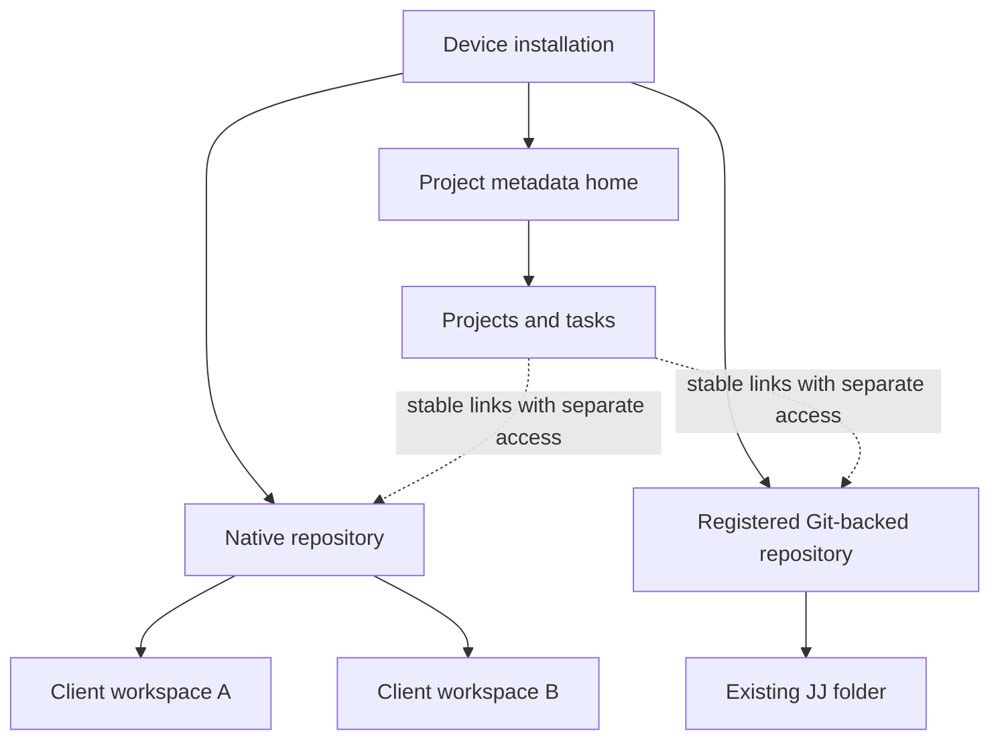

# Installations, repositories and workspaces

An **installation** is a device-owned service configuration, identity and set of
registered repositories. It also owns operational settings and derived local
state. A **repository** has durable identity and authoritative history. A
**workspace** is a logical JJ workspace plus a physical client directory. These
objects are related, but none can substitute for another.

The installation catalog is discovery metadata. It cannot turn an object ID into
readable authority: access is checked again against the selected repository.
Registering native authority verifies its manifest before adding it to
discovery. Registering a filesystem folder verifies the admitted local binding
and profile.

## Physical files are client state

Native server storage contains immutable repository objects and selected roots,
not a checkout of every workspace. A client's files can be newer than its last
snapshot, and another workspace can publish without updating those files.
Opening a browser page does not reconcile operation heads or snapshot a folder.

The local profile has a physical repository, but browser reads still pin exact
operation and companion selections. Save, code snapshot and collaboration
publication are separate actions. This distinction matters when a file edit is
visible in an editor but not yet represented in immutable code history.

## Identity versus labels

Names help people navigate. Full repository, operation, commit, change and
request IDs identify durable objects or commands. A commit ID and a change ID
are different; an operation ID selects repository state rather than a single
commit. Git-backed and native commit IDs have different profile-specific
representations. Do not truncate IDs in automation or infer profile from a
friendly repository label.

Workspace links and endpoint approval are device-local. Project repository links
are shared metadata. Removing a device registration is not deletion of
repository authority, and linking code to a project does not grant access.
