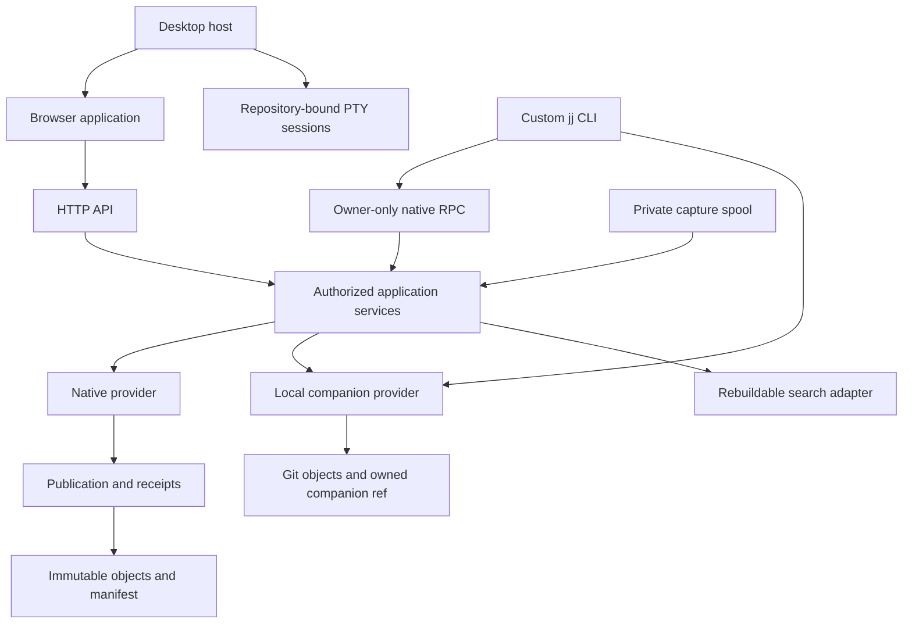

# Architecture

jj-store has two repository providers behind shared application services. Native
repositories publish immutable objects through a manifest. Existing Git-backed
JJ folders keep their code authority and select application metadata through a
companion Git ref. The browser, desktop host and custom CLI expose the
capabilities of the selected provider.

## Ownership boundaries

The model crates own identities, canonical records and pure domain rules. They
do not open browser sessions or run agent tools. `jj-store-object` owns bounded
object-store operations. `jj-store-wal` owns dependency inventories, selected
state, durable receipts and publication. Only the provider can select a new
repository state.

`jj-store-jj` adapts the pinned upstream JJ types and local Git storage.
Upstream JJ imports stay there and in `jj-store-cli`; services consume owned
interfaces. `jj-store-service` authorizes reads and applies typed commands. HTTP
and RPC translate those contracts and retain the same semantic policy.

The Svelte application owns navigation, selections, drafts and request
lifetimes. It does not infer commitment from a successful upload. Committed
responses and refresh events lead to a new selected snapshot. Historical
selections remain pinned until the user changes them.

The read service separates interactive requests from explicitly bounded index
preparation. Verified immutable generations retain the exact operation and
current authorization checks. One preparation worker preserves interactive
capacity; shared disk reservations and resident-index estimates are disposable
resource controls. They do not replace manifest or source-operation authority.
See [reads and refresh](reads.md) for the supported endpoints and remaining
large-repository qualification limits.

## What is authoritative?

| State                         | Authority                                       | Rebuildable or device-local data        |
| ----------------------------- | ----------------------------------------------- | --------------------------------------- |
| Native code and collaboration | Manifest-selected immutable closure             | Search indexes and disposable Git cache |
| Local code                    | Existing JJ operation and Git-backed repository | Browser file listings                   |
| Local application metadata    | Owned companion Git ref                         | Device folder registry                  |
| Device installation           | Private installation identity and configuration | Window layout and session notifications |

The desktop host owns process lifetime and a private installation. It uses the
same HTTP application and bundled documentation as the browser. Its local
terminal bridge owns repository-bound shells separately from repository APIs;
terminal commands are not server mutations. See
[process lifecycle](lifecycle.md).

A metadata home may link to code in another repository. That link does not grant
access, copy code or combine their transactions. See
[projects](../concepts/projects.md).

## Application freshness

One authorization-session QueryClient and transport registry share independent
read leases. Exact immutable snapshots remain cached; events invalidate live
aliases and affected domain families. A single application SSE feed observes
committed native metadata, local heads and companion references, plus accepted
state-owner settlements. Refcounted monitors coalesce filesystem hints and use
bounded metadata checks to cover missed notifications. They do not walk history
or poll storage statistics. Witnesses are hints; every reopened read retains
current authorization and its original pin. Terminal output uses its own stream.

Canceling a read releases that caller's lease before an identical retry starts.
Other active callers retain their shared transport. Targeted reaction
invalidation uses the request arguments independently of snapshot-epoch keys.

## Stacks contract foundation

The service owns versioned local stacks intent, exact file/hunk selection,
preparation and receipt records. These distinguish code publication, device
selection and physical checkout completion. They currently define validated
contracts, with no executable stack commands or HTTP mutation capability.
Recoverable checkout and named-combination execution remain qualification work;
opening a view does not create or snapshot a combination.

The operation-pinned stack read owner projects real parents and graph
annotations without loading file details with history. Net file summaries and
selected patches compare explicit tree boundaries. It retains unloaded and
unavailable content plus file modes and ordered rename/conflict source terms.
Caller cancellation and view disposal release their own reads. Presentation hunk
IDs grant no execution authority. Production controller injection and the
recoverable command executor remain separate integration work.
