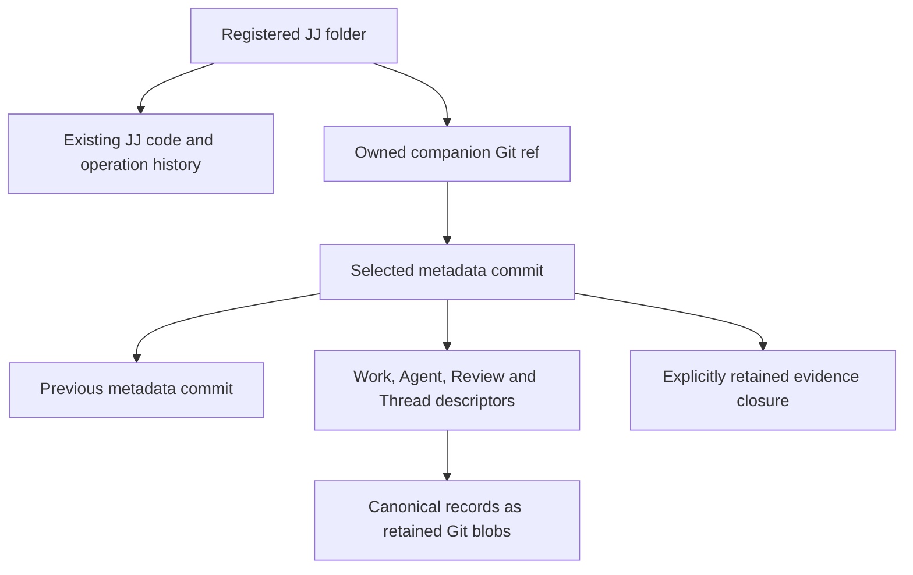

# Local companion metadata

An explicitly registered Git-backed JJ folder can host application collaboration
without converting its code into native object storage. Its existing JJ
operation log and Git backend remain the code authority. An owned companion ref
selects immutable application metadata.

## Selection and retention

The companion ref lives outside ordinary branches, tags and upstream `refs/jj`.
Its commits retain predecessors through parent edges. Domain records and
evidence have real Git tree entries; object IDs in JSON alone are insufficient
to retain data through Git garbage collection. Readers audit the selected
inventory and closure. Staged blobs remain unavailable until the ref selects
their candidate.

Local commands use expected-old-value ref publication, stable request identities
and durable receipts. A race re-evaluates typed intent against the current
selection. A publication error may remain unknown until receipt lookup resolves
it. Updating one metadata domain preserves the others.

## Code and metadata are separate

A filesystem Save writes the selected working file. It does not snapshot code or
publish companion metadata. Likewise, creating a task does not commit the linked
code. Ordinary JJ code undo does not rewind collaboration. There is no atomic
transaction spanning the JJ operation log and companion ref.

Read-only commands do not initialize absent metadata or actor state. Local
project, task and supported collaboration CLI commands can run without the
native service. Browser access still requires the application server to admit
the device folder and supply authorized, pinned reads.

## Read-only code browsing

Metadata, bookmark/workspace windows and selected directory/file/comparison
reads use scoped operation-pinned access. They do not rebuild the source index,
import missing extra metadata or walk all Git history before dispatch. Detailed
commits, log and evolution use a separately prepared generation with
selected-view visibility and exact conflict-aware reference annotations. Its
read-only decoder and preparation outputs are owned by the application, outside
source repository authority. Query admission and current device registration
remain independent from preparation admission.

The local query contract also supports bounded stack history from an exact head.
A supplied base excludes its ancestors; omitting the base reads target history.
The response retains graph parents and annotations at the selected operation.
Continue with the opaque query-bound cursor. Comparing the boundary and head
trees gives the net changed paths, including removal of changes later reverted.
These are read APIs; they do not apply stacks, snapshot disk edits or change
checkout files.

Private working-tree helpers also read the named workspace's exact
operation-pinned baseline and compare raw file/link digests with bounded
physical observations. They retain ignored/untracked checkout obstacles and use
JJ's ignore matcher on captured bytes. These helpers add no browser/API route
and do not establish an active combination's Unstaged work. A current provider
also reads existing checkout metadata with explicit byte/entry bounds, proves
its selected operation and tree, and captures sparse scope plus actual global
and repository-exclude rules. The service observes these witnesses before and
after the physical scan and rejects metadata/policy changes or revoked access.
It never initializes missing state. Canceled scans retain admission until their
worker exits. The registered `working-tree/observe` transport takes an exact
operation and expected binding generation, resolves the folder on the server,
and returns bounded change summaries and read fingerprints. It excludes raw
contents and private policy bytes/paths. Active-combination assignment and
production UI integration remain separate steps before these physical reads
populate Unstaged.

## Portability and limits

Stack preparation retention uses a separate reserved
`refs/lapis/stacks/prepared/v1` namespace. An immutable slot binds the exact
repository, physical workspace, principal, request, intent and preparation to
archived operation/view and code evidence. The retainer links actual code
commits, trees and blobs before selecting the ref, so the archive survives Git
GC and loss of source operation/index files. Exact retry verifies and syncs the
original loose or packed ref. A selection failure can remain unknown; an
existing conflicting or malformed slot is never overwritten.

Read lookup does not create a slot or companion state. These refs are outside
user branches and ordinary selected push and are retained without automatic
deletion. This is an archival primitive: it does not recreate source operation
ancestry, generate production commands, publish operation heads or coordinate
checkout. Writable Stacks capabilities remain unavailable until those execution
and recovery gates qualify.

Private foreground coordination now takes the same working-copy lock used by the
pinned stock JJ CLI. Acquisition is nonblocking: a held lock reports Busy. The
lease rechecks the exact authorized checkout, operation heads, ignore/sparse
inputs and directory/lock identity. Cancellation or process loss releases the
kernel lock without altering checkout files or bookkeeping. Unsafe or replaced
lock entries are rejected, and release never removes a replacement file.

This is a metadata coordination primitive. External editors do not use this
lock, so apply and checkout still need fresh physical-byte guards. No runtime
write capability, operation publication or checkout recovery is enabled by the
lease alone.

Device paths, access grants, credentials and active execution journals are not
portable repository records. Ordinary Git/JJ network commands do not transfer
the owned companion ref. Do not assume a normal code push backs up
collaboration.

Repository-wide review persistence is available. Portable code/agent anchors,
indexed local search, recoverable browser code commands and broader cold
full-flow qualification have separate gates. The UI and CLI must reject
unsupported targets rather than manufacture a repository anchor. Consult the
[current capability table](../reference/capabilities.md) for the exact boundary.

## Independent conversion

[Conversion](../guides/conversion.md) pins a committed code operation and the
selected metadata, audits their bounded history and exact evidence, and creates
a new repository identity. The destination receives a fresh operation log and an
explicit identity mapping report. Project links keep their original repository
IDs. Source settings, credentials, grants and active execution journals are not
destination authority.

Native destinations stage and verify their closure before manifest publication;
local destinations publish only to a new folder using a no-replace rename. A
private installation journal retains the original source archive and report
across restart. Reading status cannot create a new staging attempt. Unsupported
evidence, signing, code conflicts and non-placeholder copy IDs fail preflight
instead of being discarded. The source and its working files remain unchanged.
