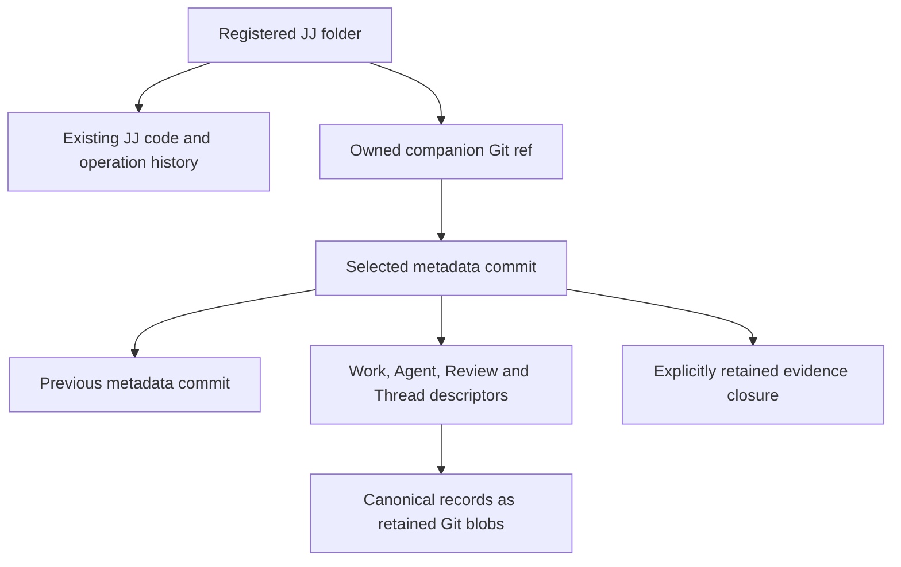

# Local companion metadata

An explicitly registered Git-backed JJ folder can host application collaboration
without converting its code into native object storage. Its existing JJ
operation log and Git backend remain the code authority. An owned companion ref
selects immutable application metadata.

## Selection and retention

The companion ref lives outside ordinary branches, tags and upstream `refs/jj`.
Its commits retain predecessors through parent edges. Domain records and
evidence have real Git tree entries; object IDs in JSON alone are insufficient
to retain data through Git garbage collection. Readers audit the selected
inventory and closure. Staged blobs remain unavailable until the ref selects
their candidate.

Local commands use expected-old-value ref publication, stable request identities
and durable receipts. A race re-evaluates typed intent against the current
selection. A publication error may remain unknown until receipt lookup resolves
it. Updating one metadata domain preserves the others.

## Code and metadata are separate

A filesystem Save writes the selected working file. It does not snapshot code or
publish companion metadata. Likewise, creating a task does not commit the linked
code. Ordinary JJ code undo does not rewind collaboration. There is no atomic
transaction spanning the JJ operation log and companion ref.

Read-only commands do not initialize absent metadata or actor state. Local
project, task and supported collaboration CLI commands can run without the
native service. Browser access still requires the application server to admit
the device folder and supply authorized, pinned reads.

## Read-only code browsing

Metadata, bookmark/workspace windows and selected directory/file/comparison
reads use scoped operation-pinned access. They do not rebuild the source index,
import missing extra metadata or walk all Git history before dispatch. Detailed
commits, log and evolution use a separately prepared generation with
selected-view visibility and exact conflict-aware reference annotations. Its
read-only decoder and preparation outputs are owned by the application, outside
source repository authority. Query admission and current device registration
remain independent from preparation admission.

The local query contract also supports bounded stack history from an exact head.
A supplied base excludes its ancestors; omitting the base reads target history.
The response retains graph parents and annotations at the selected operation.
Continue with the opaque query-bound cursor. Comparing the boundary and head
trees gives the net changed paths, including removal of changes later reverted.
These are read APIs; they do not apply stacks, snapshot disk edits or change
checkout files.

Private working-tree helpers also read the named workspace's exact
operation-pinned baseline and compare raw file/link digests with bounded
physical observations. They retain ignored/untracked checkout obstacles and use
JJ's ignore matcher on captured bytes. These helpers add no browser/API route
and do not establish an active combination's Unstaged work. A current provider
also reads existing checkout metadata with explicit byte/entry bounds, proves
its selected operation and tree, and captures sparse scope plus actual global
and repository-exclude rules. The service observes these witnesses before and
after the physical scan and rejects metadata/policy changes or revoked access.
It never initializes missing state. Canceled scans retain admission until their
worker exits. The registered `working-tree/observe` transport takes an exact
operation and expected binding generation, resolves the folder on the server,
and returns bounded change summaries and read fingerprints. It excludes raw
contents and private policy bytes/paths. Active-combination assignment and
production UI integration remain separate steps before these physical reads
populate Unstaged.

## Portability and limits

Stack preparation retention uses a separate reserved
`refs/lapis/stacks/prepared/v1` namespace. An immutable slot binds the exact
repository, physical workspace, principal, request, intent and preparation to
archived operation/view and code evidence. The retainer links actual code
commits, trees and blobs before selecting the ref, so the archive survives Git
GC and loss of source operation/index files. Exact retry verifies and syncs the
original loose or packed ref. A selection failure can remain unknown; an
existing conflicting or malformed slot is never overwritten.

Read lookup does not create a slot or companion state. These refs are outside
user branches and ordinary selected push and are retained without automatic
deletion. This is an archival primitive: it does not recreate source operation
ancestry, generate production commands, publish operation heads or coordinate
checkout. Writable Stacks capabilities remain unavailable until those execution
and recovery gates qualify.

Private foreground coordination now takes the same working-copy lock used by the
pinned stock JJ CLI. Acquisition is nonblocking: a held lock reports Busy. The
lease rechecks the exact authorized checkout, operation heads, ignore/sparse
inputs and directory/lock identity. Cancellation or process loss releases the
kernel lock without altering checkout files or bookkeeping. Unsafe or replaced
lock entries are rejected, and release never removes a replacement file.

This is a metadata coordination primitive. External editors do not use this
lock, so apply and checkout still need fresh physical-byte guards. No runtime
write capability, operation publication or checkout recovery is enabled by the
lease alone.

The private reword provider now writes real unpublished candidates at the
lease's exact operation. It checks visible parent ancestry, retains stable
change and author identity, completes descendant rewrites and reports exact
local bookmark terms. Source admission uses the bounded evidence archive; this
initial unsigned, resolved-tree profile permits at most 4096 source commit
records, 1024 local bookmarks and a 64-KiB message, with a 30-second preparation
deadline. It requires the named checkout tree to remain unchanged. Root, hidden
or unsupported inputs remain unavailable, and no client patch or physical
snapshot is involved.

The lease and worker remain owned until candidate work exits after cancellation.
Authorization loss withholds the candidate result. Source/prepared archives are
compatible with reserved-ref retention, but preparation does not select a ref,
journal record, head or checkout metadata. Server intent and policy composition,
operation-ancestry recovery, publication and checkout gates are still
unfinished; the application continues to advertise no Stacks write capability.

Recoverable preparations now have a complete bounded operation-ancestry archive,
including every historical view and its code/evolution dependencies. Capture
uses no-follow operation/view reads and the owned read-only Git decoder, so it
neither creates an index nor imports missing extras or no-GC refs. Admission
permits at most 4096 operations, 100,000 code records and 16 MiB of archive
data, with a 30-second deadline and support for stricter limits. Missing
ancestry or unsupported/malformed records fail without partial selection. Lost
original extra records also fail; recovery never substitutes a synthetic change
identity or imports replacement extras.

A version-2 record in the same reserved preparation namespace retains this
history alongside the unchanged selected capsule. Existing capsule-only
version-1 slots remain readable and cannot be upgraded or overwritten. Real
historical code has Git reachability even when it no longer belongs to the
selected view. Lookup and exact loose/packed-ref replay verify the whole archive
after source metadata loss and Git GC. Upstream operation/view writes and reads
in a private disposable cache prove exact reconstruction; source metadata is not
implicitly recreated. Server policy/journal composition, source restoration,
publication and guarded checkout remain unfinished.

Real reword preparation uses strict source-history capture before candidate work
and returns the full candidate archive with its effect report. It checks that
every original operation, view and code record remains unchanged. Missing
original extras now fail before any upstream import or candidate write. The
result can feed version-2 retention directly; source repair and runtime
execution are still separate gates.

Explicit source-history recovery can now restore missing immutable operation and
view records after source operation-store and derived-index loss. Before
execution, the foreground provider captures a version-1 private recovery witness
with a bounded canonical encoding, domain-separated digest, original checkout
and operation/view identities, current policy/heads and physical Git binding.
The server must retain it with the original authenticated request; it is not a
client-supplied recovery path or permission.

Recovery revalidates that witness and acquires the normal nonblocking JJ lock
before reading the matching reserved preparation. It checks all existing native
records for conflicts and unsafe links before creating any missing source
record. Synced create-only rename restores exact unpublished records, including
the original operation-store profile marker. Identical existing records retain
their bytes, and exact retry verifies and syncs them. The provider keeps its
worker and lock until canceled work exits; process-loss retry uses the saved
witness and same retention key.

This does not recreate a derived index or lost Git extras, publish a head,
change companion state, update checkout metadata or touch physical working
files. External editors still need separate physical-byte guards. Original
journal/policy composition, extra/index recovery, head publication and guarded
checkout remain required before enabling Stacks mutations.

A separate explicit recovery step can restore missing GitBackend extra metadata
from that same acknowledged archive. It holds the foreground lease and acquires
the upstream extra-table lock without waiting. Existing complete commit fields
must match the archive before any missing segment or head is selected. Private
upstream serialization checks canonical records; source writes are synced and
create-only. Existing bytes, native change IDs, predecessor history and conflict
terms remain intact. The bound is 4 MiB per segment, 16 MiB aggregate, 128
segments and 64 heads. A missing coordination lock may be created during
preflight; it does not select metadata.

Interrupted writes can leave exact immutable segments without head markers.
Saved-request retry verifies them and completes the remaining records. Tests
cover cancellation, process loss, replaced locks, authorization loss, unsafe
links, oversized files and conflicting original/orphan records. This explicit
repair never imports Git refs, synthesizes change identities, creates a derived
index, publishes an operation or writes physical checkout state. It does not
enable application mutations.

Explicit index restoration uses the same saved archive, independently of
extra-metadata repair. The existing bounded disk-backed builder supplies
separate indexes for the original and candidate operations. It never reads
source commits, imports missing extras or rebuilds source indexes through a
latest operation. Private framing/hash checks precede native decoding with
fallback operation/view traversal denied. Complete indexed change IDs and parent
edges are checked against the archive; the original operation cannot acquire
future candidate visibility. Valid existing CLI indexes retain their bytes even
when their segment layout differs from reconstruction.

Source writes create missing immutable segments before selecting their operation
associations. Cancellation or process loss after one association reuses the
original request and completes the other without replacement. Unsafe links,
unsupported or conflicting mappings, authorization loss and directory
replacement stop selection. The bound is 128 commit segments, 4096 associations,
4 MiB per segment, 16 MiB aggregate and 128 MiB private scratch under the
30-second worker deadline. This does not publish an operation head or write
companion/checkout state; application mutations remain unavailable.

An explicit retained-head publication step now uses the original request's saved
witness and acknowledged candidate. It keeps ordinary history restoration
strict, but separately proves current operation ancestry for publication. Source
operation/view, extra metadata and original/candidate indexes must be complete
before any head is selected; publication does not silently repair them. The
original foreground lease and actual upstream head-store lock stay held through
selection. Native decoding verifies operation identities without loading a
latest repository, reconciling heads or importing extras.

The candidate marker is durable before only the saved original marker is
removed. Concurrent CLI sibling heads survive, including when a sibling has
already consumed the original. If later heads already include the candidate,
retry acknowledges it without announcing the old candidate again or rewinding
current state. Cancellation or process loss after candidate selection can leave
both markers; the same saved request completes the transition after reopen.
Changed checkout/policy or a replaced source directory cannot be acknowledged.

The ancestry bound is 4096 operations, 64 parents each, 4 MiB per source record
and 16 MiB aggregate within the existing 30-second worker deadline. Head scans
admit 64 markers and 128 total entries; only safe empty native locks and exact
recovery staging names are ignored. Original physical files, checkout
bookkeeping and companion state remain unchanged. The returned proof attests
code publication only. Guarded checkout, durable runtime receipts and command
transport remain required before application writes are available.

An unchanged-tree retained reword can now complete only the native checkout
operation pointer. The candidate must preserve exact workspace tree terms and
conflict labels. A trusted complete physical inventory includes dirty, ignored
and untracked content, modes, links and directory identity; current registration
and authorization remain required. The private service guard shares observation
admission and cancels actual worker work before releasing its permit.

The provider captures a bounded canonical checkout witness without writes.
Installation composition must save it with the original request before pointer
completion. Under the original foreground lease and native head lock, completion
rechecks source, extras, indexes, metadata and physical inputs, synchronizes a
single deterministic staging file and atomically selects exact native bytes.
Interrupted staging can resume only an exact prefix; links, replacement and
corruption stop selection. Physical files and native tree-state bytes stay
unchanged. Exact retry accepts original metadata or already selected intended
bytes; a later CLI checkout or external file edit requires explicit recovery.
Cancellation/process loss after selection resumes the saved witness rather than
generating a new operation. This qualifies a provider pointer boundary only;
durable runtime witness/journal composition, tree-changing checkout and command
transport still precede writable controls.

Private server preparation now saves the exact real reword preview, original
request identity, recovery witness and full candidate archive before reserved
retention. A retry resumes that saved archive instead of preparing a replacement
operation. This also works after process loss before retention or before its
acknowledgement, source operation/index loss and Git GC. Retention
acknowledgement keeps the selected commit and archive digest while removing the
pending archive body from private journal state. Pending records cannot proceed
to publication.

The journal admits at most 128 records and 8 MiB, including pending archives and
reserved receipt-growth capacity. It never evicts original requests to admit
another command. Legacy metadata-only records keep their original bytes and
cannot be upgraded to execution evidence. Cancellation and authority loss after
selection preserve the original recovery input. These tests use real local JJ
candidates with fixture-supplied authority and combination/physical selection;
installed registration policy and durable combination authority are unfinished.
No command transport, operation publication or checkout change is enabled by
this composition. Source-extra/index recovery, publication and guarded checkout
still precede writable controls.

Registered preparation context now checks the configured LocalTrusted Admin
principal and resolves the folder and generation through current device
registration. It observes real physical changes with the same bounded observer
as the read API. Active combination and immutable heads come from an independent
trusted owner at the observed physical/JJ workspace; a missing combination never
creates one. Reword protects each immutable head and its ancestors before
candidate writes.

The real CLI folder provider and private device registry qualify this adapter's
registration, physical-read and revocation checks. Original retained replay
still precedes live context, and pending archive retention can resume without a
physical scan after source operation/index loss. The combination owner in these
tests is an isolated fixture; production durable combination ownership, command
transport, source-extra/index repair, publication and guarded checkout remain
unfinished. This adapter enables no writable control by itself.

Device paths, access grants, credentials and active execution journals are not
portable repository records. Ordinary Git/JJ network commands do not transfer
the owned companion ref. Do not assume a normal code push backs up
collaboration.

Repository-wide review persistence is available. Portable code/agent anchors,
indexed local search, recoverable browser code commands and broader cold
full-flow qualification have separate gates. The UI and CLI must reject
unsupported targets rather than manufacture a repository anchor. Consult the
[current capability table](../reference/capabilities.md) for the exact boundary.

## Independent conversion

[Conversion](../guides/conversion.md) pins a committed code operation and the
selected metadata, audits their bounded history and exact evidence, and creates
a new repository identity. The destination receives a fresh operation log and an
explicit identity mapping report. Project links keep their original repository
IDs. Source settings, credentials, grants and active execution journals are not
destination authority.

Native destinations stage and verify their closure before manifest publication;
local destinations publish only to a new folder using a no-replace rename. A
private installation journal retains the original source archive and report
across restart. Reading status cannot create a new staging attempt. Unsupported
evidence, signing, code conflicts and non-placeholder copy IDs fail preflight
instead of being discarded. The source and its working files remain unchanged.

Named combination metadata is installation-private and scoped to one repository,
physical workspace, JJ workspace and configured principal. Explicit creation
starts empty; viewing Stacks cannot create first-use setup. Each selected entry
retains its target, immutable boundaries, ordered stack references, merge/WIP
identities and code archive anchor. Changed entries require membership in the
new exact retained archive and increasing generations; unchanged combinations
retain their original anchors. Actual command generation and checkout remain
separate prerequisites. External code operations that no longer match the stored
combination selection require explicit recovery or repair rather than silently
adopting the new physical state.

## Private tree-changing checkout plan

The provider can capture and revalidate an exact checkout plan for an original
retained tree-changing operation. It records the source/candidate workspace
commits and trees, native checkout/tree-state bytes and fingerprints, affected
file content/mode identities and no-follow parent-directory identities. Real
retained Git objects supply the proposed effects; client patches and current
latest history are not execution input. Preparation writes no physical files or
checkout metadata and does not publish code.

This initial preparation profile supports full sparse coverage and resolved
regular/executable files, including binary bytes, additions and deletions.
Symlinks/submodules, conflicts, Unicode/case aliases, file/directory
transitions, dirty affected files and existing untracked/ignored addition
targets are unavailable. Unrelated dirty and ignored files remain intact.
Replacing a file or directory with identical content invalidates its saved plan.

Canonical plan reopening, including after a killed worker, proves only the
provider's original-input preflight. The private server now has an explicitly
created, scoped plan catalog with 128 records, 32 MiB per canonical plan and 64
MiB aggregate. It syncs the original input before the journal selects a
version-4 digest/length reference, under journal-then-plan lock order. Legacy
journals keep their existing bytes and limits. Exact replay cannot replace an
input, reset a terminal receipt or initialize missing storage. Tree-changing
publication admission requires its saved reference, and loading verifies all
original retention/effect identities before future provider revalidation.

Neither saved input nor a journal reference is a completion proof. The private
file installer below handles interrupted physical effects; native tree-state
selection and complete command after-state remain required. Production Stacks
remains read-only.

The scanner can now capture a complete original `PhysicalInventoryV1` for future
interrupted-installation guards. Sorted file fingerprints and directory stamps
reproduce the unchanged scope-bound physical fingerprint, including ignored
files, symlinks and empty directories. The canonical data is bounded to 4097
total records and 8 MiB and contains no file contents or absolute folder path.
Capture uses the registered physical guard's existing authorization, deadline
and shared admission; validation-only guards reject this optional capability.
Provider-owned installation progress governs any later physical writes.
Inventory data cannot authorize normalization of later editor changes or attest
a completed checkout.

The existing private plan catalog now retains the exact original inventory next
to its immutable plan. Journal authentication and complete recovery binding
checks precede catalog access. The body is synced before a reference containing
its digest, byte length and plan digest is selected under journal-then-plan lock
order. Orphan body selection can be resumed only through the original Prepared
request; missing already-referenced data cannot be reconstructed from caller
input. Exact replay retains the original bytes even after new editor work,
without claiming that current physical state is valid.

Inventory-bearing plan catalogs use version 2 and journal catalogs use
version 5. Inventory-free legacy catalogs keep their canonical representation.
The existing 128-plan and 64-MiB aggregate budget includes saved inventories;
the journal still stores only bounded references. New changed-tree publication
admission requires both plan and inventory references. Terminal records cannot
gain new input. These saved references prove durable preparation. The separate
physical-file installer returns its own sealed result; native
tree-state/checkout completion uses the separate provider described below.
Production Stacks stays read-only until complete durable execution is qualified.

## Private retained tree-file installation

The provider can install resolved full-sparse regular/executable effects from
the original saved plan and inventory after exact head publication. It keeps the
native foreground lease, revalidates access/metadata/retained objects and bounds
both the original and maximum intermediate namespace to 4097 records. This does
not preserve dirty affected WIP; the later combination engine owns that work.

Version-1 canonical progress, bounded to 32 MiB, binds the plan/inventory and a
private `.jj/working_copy` staging directory identity. Candidate files and
missing parents are prepared privately. Every move has a synced prior intent.
Originals move to retained backups; candidates then move into empty targets
using atomic no-replace operations. Editor-created targets block without
replacement. No backup is deleted and cross-device effects fail before
working-file writes.

Interrupted replay accepts only exact known source/destination identities,
content, size, mode and modification time. Rename-induced file ctime alone may
change; touched directory timestamps/size are normalized only on exact known
parents while the complete namespace is checked. Unaffected, ignored/untracked
files and backups remain guarded. Partial staging and initial progress writes
resume only exact retained prefixes. Completed replay keeps the installed
inodes. The existing 30-second/64-MiB worker budget can stop an invocation with
saved progress; retry uses that progress without preparing another candidate.

`InstalledTreeFiles` proves physical effects only and retains the original
native checkout/tree-state bytes. The next provider boundary completes native
metadata. Durable combination after-state and journal/transport composition
remain separate required gates. No production writable capability or installed
command is introduced.

## Private native tree-checkout completion

After sealed file installation, native completion stages exact `tree_state` and
`checkout` protobufs and selects a canonical version-1 completion frame in a
separate plan-named private directory. Its 64-KiB bound contains only saved
plan/inventory identities, installed physical fingerprint, private-directory
identity and prepared metadata inode stamps. Original bytes remain retained in
the immutable plan. Partial staging and initial frames accept only exact byte
prefixes; completed staged files retain their timestamps and inode identities.

File-state updates cover only the saved affected paths. Unaffected records and
sparse patterns stay intact, records use native component ordering and signed
millisecond mtimes, and the stale Watchman clock is cleared. The provider does
not load or initialize an upstream working copy or reacquire its foreground
lock. It replaces tree-state before checkout and syncs each selection.

Original-request recovery loads the saved frame and admits only original native
fingerprints or exact prepared replacement bytes/inodes. A selected checkout
with original tree-state is rejected. Fresh full namespace and retained-backup
checks surround both writes and acknowledgement; new editor bytes, policy
changes, replaced metadata, access loss and corruption retain unresolved
evidence. Cancellation keeps admission and foreground coordination until worker
exit. `VerifiedTreeCheckout` proves native and physical completion, without
selecting an application combination or acknowledging its original journal
request. Those execution joins and writable transport remain required.

## Private unchanged-tree execution join

The server can now execute an original retained reword through the private
code/checkout composition. First apply checks the authorized registered context,
original combination selection and complete physical inventory. It durably saves
PublicationUnknown before selecting the original candidate head, then stores the
matching publication receipt and canonical checkout witness before completing
only the operation pointer. The recovered retention commit, archive digest and
candidate operation/view must match the original journal before publication or
pointer completion. A retained key alone cannot select a different archive.
Provider proofs bind each acknowledgement to the original request and saved
witness. Exact pending retries restore saved source, extra and index
dependencies rather than preparing another command.

The private journal reserves 32 KiB of receipt/checkout growth per new local
execution and admits checkout witnesses up to 8 KiB. Witness-bearing catalogs
use version 3. Earlier catalogs remain readable; historical completed/retired
receipts return unchanged before opening a provider or observing new physical
state. Current local publication and verification require typed provider proofs;
metadata test fixtures load historical outcomes explicitly. External edits keep
unfinished checkout discoverable and preserve new bytes. Process-loss tests kill
workers after publication, receipt selection, witness selection and pointer
completion; retry uses the same preview/candidate and saved witness.

First apply of a retained Prepared request resolves registration before reading
source history. It restores the exact archived operation, extras and indexes
under the original foreground lease, then checks the current combination, code
selection and physical inventory. Lost operation/index state does not require a
new preparation. Missing or changed combination state and new editor bytes leave
the original request Prepared without publishing; immutable dependency repair is
separate from head or checkout selection. Revoked registration fails before
repair. Terminal retry returns its historical receipt even if source state has
been lost again, without recreating the missing records.

Unpublished retained reword execution also rechecks current immutable boundaries
against the original source's visible parent graph, including retry while
PublicationUnknown. A newly protected commit or ancestor rejects publication;
hidden history, unrelated boundaries and duplicate/oversized policy inputs do
not grant eligibility. Policy validation is bounded and retains the original
lease/admission through cancellation and authorization loss.

An already-selected original operation can instead be acknowledged after live
policy changes, then finish its guarded checkout. This acknowledges historical
execution; it does not create another rewrite. Informative selected-head status
is not a publication proof: acknowledgement-only recovery checks selection again
under the native head lock and cannot recreate a disappeared candidate.

A typed Published receipt always follows acknowledgement-only recovery, even
when interruption preceded checkout witness persistence. If current selection is
lost, recovery retains that receipt and fails without publishing again.

Registered-folder execution uses the actual device registry, CLI folder provider
and complete scanner guard. Active combination selection remains
fixture-supplied in these execution tests. A simulated retirement outcome is not
proof of an undo engine. This join does not select real combination updates or
qualify first-use setup, tree-changing checkout, command transport/status
endpoints or writable UI controls. These remain required in the approved
delivery plan.
