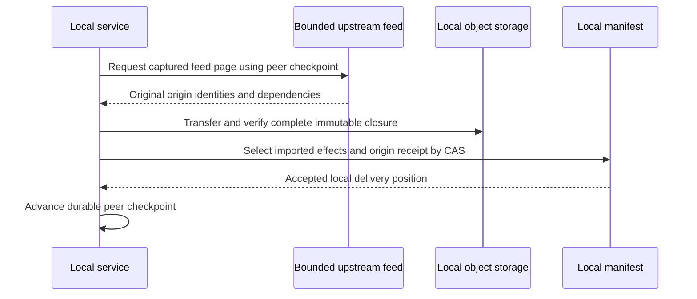

# Replication

Native local-first replication transfers accepted data between explicitly
configured peers. Ordinary reads and mutations use complete local storage, so an
upstream outage does not turn local repository access into a remote request.

## Three separate identities

Content identity names native or domain objects. Origin identity names an
authored publication and its digest. Local delivery position describes where a
receiving replica accepted it into its own WAL. Forwarding preserves the
original origin; it does not pretend the forwarding replica authored the change.

The receiver validates repository identity, format, origin lineage, causal
predecessors and the complete strong dependency closure before selecting
imported state. Replaying an identical origin returns its receipt without
another semantic effect. Reusing an origin key with different bytes is an
integrity error.

## Bounded progress

Transfer pages and peer checkpoints bind a finite feed snapshot. The sender or
receiver advances through acknowledged, already-known or non-exportable entries,
retaining stable origin identities after lost acknowledgements. Retry, backoff,
circuit and byte/object budgets constrain background work. The Sync view reports
local readiness separately from peer acknowledgement.

An explicit wait captures a finite frontier. New writes after capture do not
silently extend the wait forever. Local success is not a claim of remote backup;
only acknowledgement supports that statement. See [sync](../guides/sync.md).

## Semantic boundaries

Code import retains concurrent operation siblings and removes only candidates
proven ancestral by the pinned JJ graph. It does not reconcile during a read.
Agent facts preserve source-owned identities and parent-linked versions;
imported content is data and never triggers a tool, hook or external
publication.

The initial profile supports one explicitly configured upstream per repository.
WorkStore metadata homes preserve and freeze existing origin state until their
reducer is qualified. The code repository reducer and Git-fact path have their
own profile. Expanded pressure/fault and multi-instance qualification remain
separate; see [capabilities](../reference/capabilities.md).
