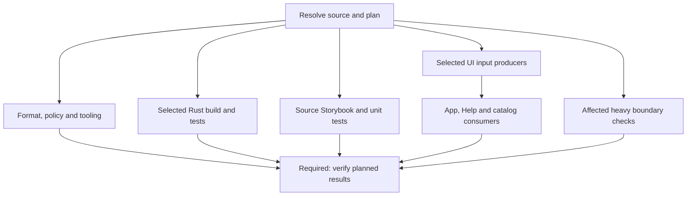

# jj-store: faster CI and reliable targeted validation
**Implementation plan · 2 November 2026**
Repository: [stevejuma/jj-store](https://github.com/stevejuma/jj-store)
## Decision
Keep the existing Cargo dependency planner, Nextest archives, test inventories and artifact verification. Improve the dependency graph of CI jobs, split setup by what a job actually needs, extend selection beyond the current Rust/web booleans, and give the heavy suites a scheduled home.
The first changes should preserve the existing test selection. In particular, source Storybook tests can start without waiting for the shared UI artifact producer. Introduce smaller PR selections only after the replacement main/nightly coverage works and the selector can demonstrate which tests it includes and defers.
**Desired outcome:** ordinary focused PRs usually return a useful, trustworthy result in 5–10 minutes, with an initial p95 target of 12 minutes for warm focused changes. Broad dependency, shared infrastructure and storage changes may legitimately take longer. These are implementation targets, not measured outcomes of changes that have already been made.
This document is a plan. Its findings come from read-only inspection of source, workflow metadata and selected logs; no workflows were changed or rerun during this review.
---
## 1. Evidence and baseline
### 1.1 Revisions inspected
| Repository / source | Revision | Meaning |
| --- | --- | --- |
| jj-store main | `5ba2fdad10f0a4b2008aba1398ef27ff12a07863` | Current default-branch workflow and source baseline at inspection |
| jj-store PR #32 | `ed30546e5e95023794223f1e158b27231d76eb21` | Open test-repair/quarantine PR; latest ordinary CI was green |
| GitButler | `1c681e206036406d985e3d449098e733c2009a80` | `gitbutlerapp/gitbutler`, master |
| Buzz | `d342cf141cb3211c8e5a6c74f881cf1d39ad3b12` | `block/buzz`, Rust/Nostr relay and agent desktop project |
| RustFS | `ed4099ebe1d9be89547f6212a9f39c5e44166018` | `rustfs/rustfs`, main |
Refresh repository state before implementation. Preserve or integrate the repairs in PR #32; do not recreate its already-fixed defects or count its quarantines as repaired coverage. The workflow architecture is unchanged by that PR. [S01] [S02]
### 1.2 Run sample
The 50 most recent Actions runs inspected contained 23 runs of `PR checks`, spanning 31 October–2 November:
- Seven successful first-attempt runs: 23m 20s–27m 06s, median **24m 37s**.
- Fourteen failed runs.
- Two cancelled runs.
The failed-run count is **not a flake rate**. It includes deterministic policy failures, dependency compatibility failures, environment defects and intermittent-looking test failures. Workflow durations above use `run_started_at` to `updated_at`; job and step durations below use their execution timestamps. Older manual/publication runs were inspected separately for heavy-suite failures. [S03]
Representative runs:
| Run | Revision / date | Result | Observation |
| --- | --- | --- | --- |
| `41376538113` | PR #32, `ed30546e`, 2 Nov | Success, 24m 37s | Latest baseline after repairs and four quarantines |
| `41343066051` | Design Core update, `e2f93f73`, 1 Nov | Failure, 24m 19s | Multiple UI compatibility/assertion failures; ordinary Rust green |
| `41329737167` | Main, `5ba2fdad`, 1 Nov | Failure, 23m 52s | WebKit Help test failed; other selected UI/Rust jobs passed |
| `41317434496` | `864b3136`, 1 Nov | Failure after three attempts | Browser connection closure and clipboard-feedback assertion in the latest attempt |
| `41170518695` | Historical package qualification, `1d60503b`, 31 Oct | Failure, 57m 44s | Native Git capability failures, a JJ index panic and cold fixture startup failures |
The last run used an older npm publication workflow that has since been narrowed. Use it as evidence about the shared heavy tests/environment, not as a description of the current npm publication DAG. [S04] [S05] [S06] [S07] [S08]
### 1.3 Where the latest green run spends time
Latest successful PR run: `41376538113`.
| Stage / job | Observed duration | Interpretation |
| --- | ---: | --- |
| Source selection to first producer start | About 4m 29s | Formatting is serialized before policy/tooling; producers wait for the aggregate preflight |
| Formatting | 2m 01s | Includes 46s of shared setup |
| Specification/release policy | 1m 47s | Starts after formatting |
| Tooling regressions | 1m 35s | Starts after formatting |
| Standard Rust producer | 10m 52s | Includes 8m 01s in the Clippy/archive/doctest wrapper |
| UI input producer | 9m 21s | 4m 04s compiling preview tools/capturing fixtures, then 2m 33s building app, Help and static catalog |
| Three Storybook jobs | 9m 25s / 10m 32s / 9m 34s | All start after the UI producer |
| Four ordinary Rust consumer jobs | 3m 01s–4m 42s | Already consume a shared archive; setup and transfer are material |
| App-browser jobs | 4m 44s / 6m 05s | Also start after the UI producer |
| Web types/unit checks | 2m 30s | Much cheaper than the full UI path |
The Rust producer log further separates approximately 2m 03s of Clippy from 5m 24s of test compilation/archiving. It restored an approximately 798 MB dependency cache with a **partial**, not exact, match. The archive contains 200 binaries and 617 files. These facts support optimizing build/setup boundaries; they do not establish a cache correctness defect. [S04] [S09]
**Key dependency error:** `uiLanePayloads.storybook = []`, yet Storybook waits for the complete UI input producer and its success receipt. Storybook executes source through Vitest/Vite and a client build. Removing that dependency can remove roughly nine minutes of waiting from the Storybook path without removing stories. The total workflow will then be limited by another path, so this does not by itself promise a nine-minute reduction in every PR. [S10] [S11] [S12]
### 1.4 Existing mechanisms to retain
The repository already provides:
- Cargo workspace metadata, reverse dependency closure, and additional `include!` / `#[path]` source ownership.
- Twenty-seven workspace packages, with 24 in the ordinary cohort.
- One ordinary Nextest archive reused by four test jobs; one heavy archive reused by eight.
- Checksums, source/package/test inventories and partition validation.
- Separate Rust dependency-cache families.
- `debug = 0` in dev/test and `CARGO_INCREMENTAL=0`.
- Rust `1.99.0` and Nextest `0.9.148` pins.
- Exact source/run/attempt artifact checks and independently runnable heavy workflows.
- A bounded three-pair sccache comparison that requires a 10% median full-job improvement and verifies actual tests/inventories.
Normal jj-store cache jobs use `key` alone. The conflicting `shared-key`/`key` configuration identified in lapis-desktop is not present in these ordinary jj-store jobs. Likewise, jj-store Storybook currently uses one Chromium instance/viewport with file parallelism disabled; there is no equivalent four-combination matrix to remove. [S13] [S14] [S15] [S16] [S17] [S30] [S37] [S39]
---
## 2. Classify failures before changing the gate
| Failure family | Evidence | Classification and implementation action |
| --- | --- | --- |
| Native Git environment | Heavy backend and Git round-trip jobs report `NATIVE_GIT_CAPABILITY: this transport profile requires Git 2.55.0` | Deterministic prerequisite failure. Provide the exact supported Git binary in every relevant hosted consumer and verify its resolved path/version before tests |
| Historical JJ index merge | Heavy shard 3 panics: `index to merge in must be a DefaultReadonlyIndex` | Product defect. PR #32 introduces a merged mutable projection; retain and validate that repair |
| Native journal lock | PR #32 documents a duplicate descriptor retaining a file lock after guard drop | Product defect with deterministic regression. Preserve the explicit unlock fix and the original journal tests; Q-RUST-001 is not an active quarantine |
| TLS provider selection | PR #32 repairs Rustls provider initialization under feature unification | Product/configuration defect. Keep the provider regressions and test both focused and workspace feature profiles where relevant |
| Cold application fixture | `pnpm dev:reset` fails with `agent commands require a JJ workspace` | Fixture startup failure before browser acceptance. Create/validate the required disposable JJ workspace before the reset/agent commands |
| Help WebKit navigation | First expected editing-page heading remains the home heading | Unresolved ordering/navigation failure. Add request-start and commit barriers and diagnostics; do not assume stale content overwrote a successfully rendered newer page |
| Clipboard feedback | `data-copied=true` is not observed after a click | Unresolved; separate actual clipboard write from a transient 1.5-second UI feedback state |
| Storybook browser disconnect | Vitest reports closed browser connection and RPC | Harness/process lifecycle failure of unknown cause. Capture crashes, exit signals, resources and preceding stories before blaming OOM or a specific feature |
| Design Core dependency update | One Storybook shard reports 17 failing tests; several jobs report missing roles/controls | Treat as a dependency compatibility regression until reproduced/classified. Keep full relevant UI validation for shared design changes |
| Four PR #32 quarantines | Two stories, comparison resize geometry and literal-filename pinned history | Documented unresolved coverage. Make the original bodies executable in diagnostics and preserve re-enable criteria |
Sources: native and index failures [S08] [S18]; PR #32 repairs/register [S01] [S19]; Help [S06] [S20]; clipboard/disconnect [S07] [S21]; dependency update [S05].
A passing retry cannot distinguish a harness race from a real intermittent product defect. Do not turn the categories above into blanket retries or blanket quarantines.
---
## 3. What to borrow from the peer projects
| Project | Useful observed mechanism | Apply to jj-store | Qualification |
| --- | --- | --- | --- |
| GitButler | Component/path selection; Nextest plus separate doctests; per-purpose cache namespaces; default-branch cache writers | Refine family selection and cache ownership while retaining explicit doctests | Its Rust selection is often broad; it does not implement jj-store-style dependency closure |
| GitButler | Hermeticity guard fails if tests write to user application data | Add precise guards for accidental global state, leaked processes and fixture ownership | Temporary directories alone do not prove hermeticity |
| GitButler | Stable aggregate checks selected E2E shards; state-aware waits and retained traces | Preserve a single trustworthy required context and better failure evidence | It still has retries and named macOS exclusions |
| Buzz | Separate relay binary, backend archive and database archive producers | Use prerequisites matching the actual consumer; jj-store already has much of this |
| Buzz | Per-test database isolation and resource reservations for global operations | Isolate storage namespaces/ports/processes and serialize only proven shared resources |
| Buzz | Advisory changed-test repetition ten times with retries off | Add a bounded flake-detection lane for changed harnesses and known suspect families | Changed-test sampling does not find all indirectly affected tests |
| RustFS | PR smoke/core contracts, broader main/merge validation, specialized nightly suites | Closest model for the desired tiered policy |
| RustFS | Test-membership checks, exact result aggregation, scheduled freshness monitoring | Every deferred test gets an executable home, and missed/failed nightly runs remain visible |
| RustFS | Nextest groups reserve capacity while preserving races inside tests | Avoid resource contention without deleting concurrency semantics from durability tests |
Peer inspection is of source at the revisions above, not an independent benchmark of their runtime or flake rate. GitButler's scheduled nightly is largely packaging/publication, and Buzz's Linux canary is manual; do not describe either as moving all tests to nightly. RustFS is the most direct example of the proposed test-tier split. [S22] [S23] [S24] [S25] [S26] [S27] [S28] [S29]
---
## 4. Target validation policy
### 4.1 Tiers
| Tier | Trigger | Contents | Gate |
| --- | --- | --- | --- |
| Focused PR | Every PR revision | Policy/format/tooling; selected Rust packages and necessary dependants; relevant UI families; small boundary smoke | Existing stable `required` context |
| Risk escalation | Relevant changed domains or explicit full request | Affected heavy backend tests, storage/identity/authorization proofs, cold/native/contract cases tied to the change | Required for the affected PR |
| Main integration | Push to main | Complete ordinary baseline, full source UI baseline, backend core contract; cache maintenance | Main health, not a substitute for PR checks |
| Nightly full validation | Daily, canonical main | Full heavy backend, external/embedded storage, generated contracts, cold application/restart, existing native matrix and full UI exactly once | Separate nightly status and freshness health |
| Quarantine diagnostics | Nightly and manual; optionally advisory on relevant PRs | Explicit original quarantined cases and bounded repetitions, with retries off | Separate diagnostic status; failures visible |
| Release qualification | Exact release candidate | Complete required release plan for that product/artifact, fresh results and exact bytes | Existing publication gate |
| Weekly extended checks | Optional, once runnable | Longer large-repository/soak/extra feature combinations already supported by the project | Separate status; release-required cases still run for release |
Do not move affected CAS, WAL recovery, stable request identity, durable receipts, authorization or native lock behavior exclusively to nightly. Fast versions of those contracts should block relevant changes. Nightly owns the wider scenario combinations, longer runs and platform breadth.
The three currently excluded heavy packages are `jj-store` (in `crates/jj-store-cli`), `jj-store-server` and `jj-store-capture`. Their changed tests should no longer disappear behind the ordinary/manual boundary. Adding targeted backend checks may increase useful PR work for these packages while reducing unrelated UI work. [S13] [S14]
### 4.2 Initial performance budgets
| Change category | Warm-run target | Scope |
| --- | ---: | --- |
| Documentation/specification only | 2–4 minutes | Required policy checks and affected documentation build/tests |
| Isolated UI component | 5–10 minutes | Types, unit tests, complete affected story/browser families |
| Isolated ordinary Rust package | 5–10 minutes | Selected package/dependants, Clippy, tests, doctests |
| Shared design dependency / broad Rust dependency | 12–20 minutes initially | Full relevant domain; optimize further using measured critical path |
| Nightly heavy | Establish a reliable baseline first | Investigate failures and stage timings before imposing a tight SLO |
Track cold and warm runs separately. Runner queuing, artifact transfer and setup count toward user-visible feedback time. Keep job timeouts generous enough to preserve diagnostics during rollout; an aggressive timeout is not an optimization.
---
## 5. Remove unnecessary waiting before reducing coverage
### 5.1 Parallelize independent validation
The current sequence runs planning, then formatting, then policy/tooling, then the preflight aggregate, before starting the build/test producers. Replace that unnecessary serial ordering with:

Run format, governance and tooling after planning, independently. Start tests/builds after source and plan validation; all policy jobs remain mandatory in the final aggregate. This consciously trades some runner work on invalid PRs for shorter latency on valid PRs.
If runner capacity makes that tradeoff expensive, gate large compilation only on a minimal validation step, not on the full formatter plus all tooling tests. Source Storybook and unit checks can still start early.
Do not replace data dependencies with success dependencies. A consumer needs its actual artifact producer; it does not need an unrelated formatting result before it can test code.
### 5.2 Split UI producers by actual payload use
Current mappings from `ci-artifact-layout.mjs`:
| Consumer | Required payloads | Proposed prerequisite |
| --- | --- | --- |
| Storybook interactions | None | Validated source, Node dependencies and generated client |
| App browser | `ui-tools`, `ui-fixtures`, `ui-web` | Relevant preview binaries/response capture and app/Help assets |
| Help browser | `ui-tools`, `ui-fixtures`, `ui-web` | Help and host assets; refine only after proving the dependency boundary |
| Static catalog browser | `ui-catalog` | Static Storybook build only |
Implement source Storybook first, preserving all current stories and shards. Then make static catalog independent of the Rust preview build. App/Help should not wait for static catalog generation.
Update `ci-ui-producer.mjs` and artifact admission so a source-only job validates source and selection without demanding a producer it never consumes. Artifact-consuming jobs must still validate their required producer and hashes. Add a negative case proving a missing artifact producer cannot be mistaken for source-only execution.
Full qualification must continue to execute each selected UI lane exactly once, including when invoked through the heavy coordinator. [S10] [S11] [S12]
---
## 6. Split setup by capability
Refactor `.github/actions/setup/action.yml` into explicit capabilities or small composites. Prefer extending current actions over creating another general-purpose orchestration framework.
| Capability | Required setup | Remove when unused |
| --- | --- | --- |
| Node/source UI | Pinned Node/pnpm, frozen root install, required client build, pinned browser/runtime libraries | Rust compiler, Cargo fetch, JJ, Python, sibling Rust and AI package installation |
| Policy/tooling | Exact dependencies the policy tests invoke | Native build headers and browser installation; retain offline metadata where tests genuinely need it |
| Rust producer | Toolchain, required sibling sources, native build deps, dependency cache, Nextest | Browser/docs tooling unless this producer builds those artifacts |
| Archived Rust consumer | Matching Nextest, source/fixtures, runtime libraries and test prerequisites | Compiler components and dependency fetch once metadata validation no longer requires them |
| Browser consumer | Node/browser environment and verified lane artifacts | Rust compiler, Cargo registry fetch and build-only dependencies |
| Full/native qualification | Explicit union of required capabilities | Keep target-specific dependencies separate |
Current `build-tools: false` only disables Nextest/mdBook/uv, and `native-dependencies: false` only disables native headers. Both still leave Rust, Python, JJ, sibling installs and Cargo fetch in many JS jobs. [S30]
Implementation details:
1. Separate source/toolchain preparation from dependency fetching.
2. Restore Cargo registry/build caches before `cargo fetch --locked`.
3. For archive consumers, use archive-carried metadata and the verified inventory where possible instead of re-querying a full Cargo dependency graph.
4. Preserve source revisions and fixtures needed by compiled tests. Nextest archives do not include the entire source checkout, nor do they automatically relocate arbitrary absolute fixture paths.
5. Instrument consumer jobs to fail if they unexpectedly invoke compilation during the migration.
6. Preserve lockfiles, checksums, generated client prerequisites and existing managed-Cargo disk/target coordination.
Nextest documents that a compatible archive runner can execute without Cargo installed; jj-store's own wrappers/inventory checks must be adapted and validated before taking advantage of that. [S31]
**Acceptance:** source Storybook and lightweight web checks no longer download/install Rust/JJ or fetch Rust packages; archived execution performs no compilation; the same selected test identities pass on an empty consumer workspace containing only verified required inputs.
---
## 7. Extend the existing selector, rather than replacing it
### 7.1 Proposed plan schema
Replace the two coarse `rust`/`web` decisions with a versioned plan that can express:
- Source SHA, base SHA, event and plan version.
- Selected Rust packages and reverse dependants.
- Selected complete test families/binaries and feature profile.
- UI unit, Storybook, browser, Help and static catalog selections.
- Required backend/storage/native/contract escalations.
- Exact producer capabilities needed by consumers.
- Explicit scheduled/manual coverage and quarantines.
- Human-readable reasons for every selected or deferred family.
Keep compatibility outputs during rollout. The plan is a small validated data object, not shell text.
### 7.2 Ownership rules
| Changed area | PR checks | Escalation / broader coverage |
| --- | --- | --- |
| Spec/release-note Markdown | Relevant formatting, governance and links/evidence checks | No product execution unless a consumed fixture/generated contract changed |
| `docs/site/**` and Help embed code | Documentation build and relevant Help behavior, including affected browser engines | Full Help/embedding tests when shared navigation changes |
| Isolated UI component + its stories | Type/unit checks and complete owning story family plus consumer families | Shared shell/router/state/styles trigger all relevant UI |
| Shared Design Core/Mira/Svelte/Bits UI dependency | Full relevant UI types, stories, accessibility and browser contracts | Keep as a broad UI change; the observed Design Core failures show why |
| Ordinary Rust source | Existing package + reverse dependency closure | Preserve build/dev/optional/target and include-source edges |
| CLI/server/capture source | Affected backend package/binaries and focused integration contract | Cold, transport or storage checks when those behaviors change |
| WAL/core/object/replication/JJ authority | Changed packages/dependants plus core write/read/CAS/recovery/receipt contract | Real RustFS, restart and multi-writer families relevant to the change |
| API model/RPC/HTTP/schema | Rust boundary tests, generated-contract verification and affected clients | Broad clients/UI if contract ownership cannot be narrowed |
| Embedded RustFS workspace | Embedded lifecycle and storage integration against its exact build | Full relevant storage qualification, not only a note saying “manual” |
| Shared CI/selection/toolchain/manifest/unknown input | Conservative broad relevant selection | Never reduce coverage because ownership cannot be determined |
The Design Core update changed only `package.json` and `pnpm-lock.yaml`, but currently selected all 24 ordinary Rust packages. Split lockfile/manifest invalidation by ecosystem **only where the dependency boundary is proven**. A pnpm change involving generation, native package preparation or test orchestration can still require Rust checks; uncertainty keeps broad coverage. [S05] [S14]
### 7.3 Selection correctness
- Base comparison must cover the entire PR, including deletions and both sides of renames. Preserve the existing `--no-renames` approach.
- Use the union of relevant base/head ownership where deletion or dependency-edge removal could otherwise hide affected consumers.
- Retain optional/dev/build/target-specific Rust edges and source-inclusion edges.
- Start with explicit, reviewable UI family maps. Use import graphs only where aliases, virtual/generated modules and shared fixtures are correctly modeled.
- Select tests for affected production code, not only edited test files.
- A family includes setup/teardown and neighboring contract cases necessary to interpret the change.
- On unknown paths, incomplete history, unmodeled sources or planner changes, broaden conservatively; a corrupt/unexecutable plan must fail.
- Run the required workflow for every PR. Perform intentional skips inside it, so a required check does not remain absent.
- If merge queue is enabled later, support `merge_group` explicitly and bind to that event's exact revision.
- Policy-changing PRs must not be able to declare their own checks unnecessary; force broad selection or compare against the trusted base policy.
### 7.4 Give every test an executable home
Extend the existing inventory so the union of PR/core, main/full, nightly and explicit quarantine/manual suites accounts for all expected tests. Check test identity, not only counts.
New heavy tests should land in a full nightly family by default unless deliberately admitted to fast PR coverage. Tests requiring credentials, destructive fixtures or specialized hardware stay explicitly classified; never enable every ignored test with an indiscriminate `--run-ignored all`.
A selected suite returning zero tests must fail unless the plan explicitly proves an empty partition. Keep and extend the existing partition coverage checks. [S15]
---
## 8. Rust compilation, caches and sharding
### 8.1 Preserve the build-once design
The ordinary producer already runs Clippy, builds a Nextest archive and runs doctests. Preserve doctests explicitly; Nextest is not a replacement for them.
Pass the selected package/features/profile identity through production, inventory and execution. A focused package build and a workspace build can unify features differently; the history/Rustls evidence makes this a real concern.
For small selections, allow 1/2/4 consumer shards based on measured test duration and inventory size. Keep four initially for the broad baseline. Update `ci-inventory.mjs` and `ci-tests.mjs` together so partitions remain complete and disjoint; do not simply change the workflow matrix.
### 8.2 Make safe low-cost improvements first
- Set ordinary `.tar.zst` artifact upload to `compression-level: 0`, as the heavy archive upload already does. Measure transfer bytes/time.
- Upload ordinary test evidence independently of archive artifacts.
- Restore dependencies before fetch.
- Keep ordinary, UI tools, heavy backend, embedded RustFS and native target cache identities distinct where profiles/features differ.
- Include toolchain, OS/arch/ABI, Cargo profile, features, flags and relevant build inputs in compatibility decisions.
- Treat dependency caches as replaceable acceleration. Executable artifacts require exact inputs and identity.
- Never reuse a cached successful test result as a fresh nightly or release execution.
### 8.3 Cache ownership and experiments
Start with one trusted main writer per compatible cache family, with PR consumers restoring those caches. If preserving PR-local cache writes proves valuable, keep them explicitly scoped and measure churn. Do not create a separate full target cache for every arbitrary package subset.
Run the existing sccache trial on representative broad and focused workloads before adopting it. Retain the current acceptance standard: unchanged inventories and real test results, at least three matched warm comparisons, and at least 10% median complete-job improvement after setup and transfer.
Only then experiment with:
- Separating Clippy from archive production to overlap their critical paths.
- Caching workspace compilation outputs if size/restore/write costs are worthwhile.
- Different compile parallelism or a larger producer runner.
- A dedicated Cargo CI profile or selective dependency optimization.
Do not copy Buzz's optimized Cargo profile without measuring compilation cost and preserving debug-assertion/overflow semantics. Cargo `--cargo-profile` and Nextest `--profile` are different controls.
The current two Cargo jobs and Nextest four ordinary threads/one heavy thread are known settings, not automatically wrong. More workers on the same machine can worsen memory/IO pressure. Keep current values until a measured experiment addresses a specific bottleneck. [S09] [S16] [S17] [S25]
### 8.4 Restrict serialization to actual resources
Use Nextest groups and slot reservations for shared services, global filesystem/credential fixtures or heavy IO. Group-local `max-threads = 1` only serializes group members; it does not isolate them from every unrelated test.
Preserve two-writer races, fault schedules and production deadlines *inside* concurrency/durability tests. Do not make a race test pass by removing the behavior it is meant to exercise. An in-process mutex does not serialize separate Nextest processes. [S26] [S28]
---
## 9. Concrete reliability workstreams
### 9.1 Make native prerequisites deterministic
Files: shared setup/capabilities, `scripts/ci-setup-*.mjs` as appropriate, heavy backend/cold/storage workflows and fixture helpers.
1. Propagate the exact Git `2.55.0` requirement into hosted native consumers. PR #32 adds it to the Docker validation image, which does not automatically repair hosted Actions setup.
2. Verify the actual binary selected by the test, not just the first `git` on an unrelated process's PATH.
3. Preflight Git version, upstream JJ version, required SSH server capability and runtime libraries before long builds/execution.
4. Create a disposable JJ repository/workspace in the cold fixture, verify it, and only then execute `dev:reset`/agent commands.
5. Use per-test ports, repository roots, object-store prefixes/buckets and child-process groups.
6. Ensure teardown terminates and awaits children before deleting their state; retain diagnostics when teardown fails.
7. Keep the fixture's authentication/host-trust semantics intact.
**Acceptance:** the original Git and cold startup failures execute their intended assertions on hosted runners; an intentionally missing prerequisite fails quickly with an actionable message.
### 9.2 Preserve real product repairs
PR #32 contains graph projection/index merging, Rustls initialization and native journal-lock repairs. Validate those exact regressions plus affected package/family coverage before changing test tiers.
Keep the journal duplicate-descriptor regression. Its fix demonstrates why “intermittent” must not automatically mean “test harness problem.” Do not restore Q-RUST-001 as an ignored case. [S19]
### 9.3 Repair history readiness using the failing build profile
For Q-RUST-002, reproduce `file_history::file_history_keeps_spaces_quotes_and_pattern_characters_literal` with the same workspace feature closure and process/resource conditions as the failure.
Record preparation lifecycle, generation/operation identity, completion publication and path-index admission. Determine whether the fixture queries too early or production publishes readiness incorrectly.
Retain the non-queuing/Busy contract and original literal filename, pinned operation, paging, source-byte and revoked-access assertions. Do not silently retry all Busy responses or change the test into a filename-parser-only check.
Meet the existing register's re-enable requirements, including focused families and complete workspace evidence. [S19]
### 9.4 Help navigation: synchronize requests, not a loading skeleton
The failing WebKit test has not yet released the old response when its first editing-heading assertion fails. Runtime cancellation already exists.
Implement:
- An explicit promise/barrier resolved by the intercepted browsing request.
- Editing request/response observers armed before the second navigation.
- A visible commit/readiness condition for the newer editing document.
- Release of the older request only after that commit.
- `finally` cleanup that releases/unroutes even when an assertion fails.
- An observed old-request termination/discard before the final assertion.
- Timestamped generation, URL, fetch/abort/parse/commit and iframe lifecycle events.
Retain the assertion that older content cannot replace the newer selection. If the new barriers expose a production navigation defect, fix that behavior rather than weakening the assertion. [S20]
### 9.5 Clipboard: separate persistent outcome from transient feedback
Keep the real clipboard integration check, but record:
- Click target identity and whether it was replaced.
- Document focus/visibility.
- Clipboard write arguments, resolution/rejection.
- Copied/failed feedback transitions and component disposal/ID changes.
The component's feedback lasts 1.5 seconds. Verify eventual clipboard content independently; test feedback timing and stale-component behavior cheaply with a controlled clock/service. Keep one actual clipboard smoke in the relevant browser family. The resize quarantine does not cover this distinct failure. [S21]
### 9.6 Storybook disconnect: measure process lifetime and resource use
Capture browser/page crash, close and disconnect events, Chromium exit code/signal, Node and browser RSS, descriptor/page counts and cgroup memory events where available. Include story start/end and its predecessor sequence.
Run the failed story family alone, after the original predecessors and within the original shard. Existing serial file execution and fixture cleanup mean “turn off parallelism” is not a new fix.
If repeated source batches accumulate resources, fix disposal or use bounded fresh browser lifetimes at family boundaries. Benchmark any batching change; never attribute the disconnect to OOM without evidence. [S07] [S17]
### 9.7 Make quarantine executable and time-bound
Keep the current human-readable register and add a small machine-readable mapping, for example `.config/ci-quarantine.json`, containing:
- Stable case ID and exact runner selector.
- Owner and issue/evidence link.
- Platform/features/fixture requirements.
- Original failure signature.
- Disabled contract and expiry/review date.
- Explicit re-enable criteria.
Adapt the existing mechanisms:
- Rust `#[ignore]`: run the exact registered ignored case with the appropriate profile/filter.
- Storybook `quarantined` tags: enable only registered diagnostic selections through configuration.
- Playwright geometry `test.skip`: make the original body executable under an explicit diagnostic selector.
- Require nonzero executed cases and evidence proving the requested bodies ran.
A test-name filter alone does not override a hard skip. Diagnostic execution must not require editing source or removing assertions.
Use zero retries for diagnostic repetitions. Default ordinary tests also retain zero retries. If a later narrowly justified infrastructure retry is introduced, preserve the first failure and classify it as flaky; do not present it as a clean first pass. Nextest supports explicitly failing flaky outcomes if configured. [S19] [S32]
---
## 10. Add scheduled heavy validation correctly
### 10.1 Start with the existing heavy coordinator
Prefer adding `schedule` directly to `.github/workflows/ci-heavy.yml`. It already coordinates the needed suites and has independently runnable consumers. A new wrapper would create another provenance identity to support.
Proposed schedule:
```yaml
on:
  schedule:
    - cron: "17 2 * * *"
  workflow_dispatch:
    # Retain the existing explicit source inputs.
  workflow_call:
    # Retain existing reusable inputs.
```
This is a structural example, not a complete replacement workflow.
02:17 UTC is 02:17 in the UK during winter and 03:17 during British Summer Time. Use a separate concurrency group for scheduled validation, and let an active nightly finish. Keep existing cancellation of superseded PRs.
Resolve the canonical main SHA once at run start and pass it everywhere. Do not let downstream jobs resolve a moving main branch independently.
### 10.2 Update event admission and contracts in the same change
Adding a cron alone will fail existing validators. Coordinate:
- `ci-artifacts.mjs::verifyProducer`: admit the intended schedule event only for canonical repository/main/approved workflow.
- `ci-ui-producer.mjs`: distinguish scheduled/source-only/artifact-consuming paths correctly.
- `ci-source.mjs` and range handling: resolve scheduled main once, without assuming PR fields exist.
- `ci-plan.mjs::cacheWritable`: make an explicit decision for scheduled cache writes.
- `ci-required.mjs`: verify the event's expected lane set and explicit skips.
- `ci-workflows.test.mjs` and producer tests: replace the current “no scheduled heavy trigger” expectations.
- `docs/releases.md`, verification-scope/catalog governance and relevant specification/evidence mappings.
Retain source/run/attempt/checksum validation. A schedule, new workflow name or reusable call must not become an unrestricted producer bypass. [S12] [S33] [S34] [S35]
### 10.3 Nightly contents and prerequisites
Run:
1. Full ordinary baseline and full UI once.
2. Full heavy backend archive/tests, including server/CLI/capture.
3. Real external RustFS and embedded RustFS lifecycle tests.
4. Generated API/consumer contracts.
5. Cold application, profile restart and native Git round-trip.
6. Existing native compatibility matrix.
7. Separate quarantine/stress diagnostics with their own visible outcome.
Run independent producer builds in parallel after source validation. The final full gate must require all selected checks, but a successful ordinary test aggregate is not an input to compiling a heavy binary. Update any admission logic that currently encodes that serial ordering.
Preserve native runtime testing on affected platforms where already required. Cross-compilation only establishes compilation, not native file locking, process shutdown or credential behavior.
Do not schedule publication, signing or release promotion. The nightly workflow produces validation evidence.
### 10.4 Nightly health is part of the design
Publish one compact summary: source SHA, selected suites, passed/failed/flaky/quarantined counts, failed case IDs, artifact links, last successful full run and duration.
Add a read-only freshness check in an independently triggered small workflow, for example `.github/workflows/ci-health.yml` on `43 */6 * * *`, with `actions: read`. It must run independently of the heavy coordinator so it can detect a nightly that never starts or is disabled. An ordinary CI health job can provide an additional independent signal. Expose a separate health result from the heavy suite's test verdict.
The freshness check distinguishes:
- No recent attempt.
- A recent failure.
- A recent complete success.
- Success for only a subset.
Initial health thresholds: an attempt within 30 hours and a complete success within 48 hours, with missing access/artifacts reported separately. Adjust these after observing scheduling and run duration. Expose this through Actions summaries/status; external notifications can be configured separately.
An earlier nightly on another revision must not authorize a release. If same-revision evidence reuse is desired later, extend the existing release trust/retention contract explicitly; do not infer it from a green workflow badge.
Get at least one complete hosted heavy run working on the integrated baseline before moving coverage out of the PR path.
---
## 11. Results, diagnostics and retries
### 11.1 Close the ordinary-report gap
Ordinary Nextest writes JUnit, but ordinary Rust jobs currently do not upload it through the qualification-report path. `ci-report.mjs` scans heavy reports, and the final job cannot read files on other runners. [S16] [S36]
Each selected job should upload on `always()`:
- Source, event, run/attempt, profile/features and plan digest.
- Expected and executed test identities.
- JUnit and complete relevant stdout/stderr.
- Setup, restore, compile, archive, transfer, execute and teardown timings.
- Timeout/cancellation/exit classification.
- Failure-only traces/screenshots/browser logs and fixture/process diagnostics.
- Quarantine and first-attempt/retry distinctions.
Use unique result artifact names per lane/shard/attempt. Aggregate downloaded reports explicitly. A missing report from a cancelled/failed job is not a zero-test success.
### 11.2 Keep the required check truthful
Retain the stable `required` context during migration. It must reject:
- A failed or absent planner.
- Selected jobs that fail, cancel, disappear or unexpectedly skip.
- Missing/duplicate shard results.
- Nonempty planned selections that execute no tests.
- Wrong source, profile or producer identity.
- Incomplete inventory coverage.
An intentionally unselected lane may skip only when the validated plan says so. Keep current branch/ruleset names until the new aggregate has been verified; do not assume that a visible workflow is actually required by the live repository rule.
### 11.3 Make reruns proportionate
Prefer retrying a failed consumer against the same verified build artifact. The existing core UI producer validator binds to the same run and attempt, so consumer-only reuse across attempts needs an explicit contract change.
For any permitted reuse, bind the consumer to the exact successful producer attempt, source, profile and artifact digest. Never choose “latest successful” by name alone. If that cannot be proven, rerun the required producer and consumer family.
Preserve PR fail-fast behavior initially. Diagnostics/nightly should collect independent failures using fail-fast=false where bounded. Change these policies only for a stated evidence or resource need.
### 11.4 Metrics
Track separately:
- PR wall-clock p50/p90/p95 by change category.
- Queue time and runner minutes.
- First-attempt test failure rate, excluding deterministic regressions and cancellations.
- Failures that pass unchanged on a fresh repetition.
- Cache restore/write cost and subsequent compilation time.
- Test and artifact inventory completeness.
- Number/age of quarantines.
- Nightly attempt/success freshness.
Avoid declaring success from seven green runs alone or from cache hit percentage. A useful reliability target is fewer than 1% of ordinary runs disrupted by known test/harness nondeterminism, measured over a stated sample after the rollout.
---
## 12. Implementation sequence
### Slice 0 — Stabilize the starting revision and environment
- Re-read repository/workspace `AGENTS.md` and current owning specification.
- Inspect current PR #32 status and preserve its repairs/quarantine identities.
- Capture the exact source, selected test inventory and representative run timings.
- Repair hosted Git/JJ/SSH/cold-workspace prerequisites.
- Run the exact previously failing environment and product regression families.
**Done when:** prerequisite failures are caught early, original product regression bodies execute, and the baseline explicitly separates enabled coverage from quarantine.
### Slice 1 — Make evidence complete
- Upload ordinary JUnit/inventories/logs/timings on every outcome.
- Extend `ci-report.mjs` to ordinary output and cross-job aggregation.
- Add failure/cancellation/missing-report cases to the existing gate tests.
- Disable redundant compression for the ordinary archive.
**Done when:** a failed ordinary shard has a useful downloadable report and cannot appear as a successful empty selection.
### Slice 2 — Improve the DAG and setup with unchanged selection
- Parallelize format, governance and tooling.
- Introduce minimal Node/browser and archived-Rust setup.
- Start source Storybook independently.
- Separate static catalog from preview/app/Help prerequisites.
- Retain all currently selected test identities.
**Done when:** a same-source comparison preserves selected coverage and demonstrates lower elapsed time; no consumer unexpectedly compiles; required aggregation still rejects every failed selected lane.
### Slice 3 — Establish scheduled full coverage
- Add schedule to the existing heavy coordinator.
- Update producer/event/required/cache policies and contract tests atomically.
- Start independent producers earlier.
- Add separate quarantine diagnostics and freshness summary.
- Complete a hosted full run on the integrated baseline.
**Done when:** the scheduled path is actually executable, produces complete fresh evidence and reports failures accurately. Merely having a cron in YAML is insufficient.
### Slice 4 — Introduce domain selection and targeted backend checks
- Extend the existing planner/schema and ownership maps.
- Add focused PR coverage for affected heavy packages.
- Separate source UI, browser, Help, catalog and contract lanes.
- Test planner output against representative historical changes in shadow mode.
- Keep broad fallback and explicit full selection.
- Enable narrower PR selections only after the corresponding full main/nightly homes work.
**Done when:** representative changes select complete affected families, irrelevant domains skip with reasons, and deferred suites remain accounted for.
### Slice 5 — Repair the remaining failure mechanisms
Run in parallel with scheduling/selection work where changes do not overlap:
- Help request lifecycle.
- Clipboard write/feedback behavior.
- Storybook process/resource diagnosis.
- History readiness under matching feature closure.
- Original geometry and palette/workspace quarantines.
**Done when:** the cause is understood, original assertions are retained, deterministic regressions exist where appropriate, and each register's re-enable criteria are met.
### Slice 6 — Optimize the remaining measured bottleneck
- Evaluate 1/2/4 Rust shards for small selections.
- Reuse the existing sccache experiment.
- Evaluate Clippy/build overlap and build-profile/runner options only if compilation still dominates.
- Bound browser process lifetime if evidence supports that intervention.
**Done when:** the chosen change improves complete-job wall time or runner cost without reducing coverage or worsening first-attempt reliability.
### Slice 7 — Verify qualification and document the operating model
- Exercise the exact release candidate's full required plan.
- Verify consumer reruns, artifact identity and stale/missing evidence rejection.
- Update CI/release documentation and specification evidence.
- Record remaining opt-in/platform/provider/visual gates as outstanding.
- Review actual latency/reliability after a representative period.
**Done when:** ordinary PRs, nightly validation and release qualification have distinct, documented meanings and trustworthy aggregate results.
---
## 13. File-level work map
| Existing file / area | Intended change |
| --- | --- |
| `.github/workflows/ci.yml` | Parallel independent checks; plan outputs; selected lanes; ordinary reporting; dynamic shard count later |
| `.github/workflows/ci-ui.yml` | Remove source Storybook's artifact dependency; split actual UI producers/consumers |
| `.github/actions/setup/action.yml` | Capability-specific setup; restore-before-fetch sequencing |
| `.github/actions/qualification-report/action.yml` | Ordinary evidence support and lane/attempt result identity |
| `scripts/ci-plan.mjs` | Domain outputs, safe fallback, base/head impact handling and schedule cache policy |
| `scripts/ci-packages.mjs` | Retain reverse closure/source edges; add a targeted backend selection mode distinct from full heavy qualification |
| `scripts/ci-build.mjs` | Selected profile/package inputs; avoid accidentally turning targeted backend checks into full qualification |
| `scripts/ci-tests.mjs` / `ci-inventory.mjs` | Selected profile/family/shard membership and complete result checks |
| `scripts/ci-artifact-layout.mjs` | Actual consumer capabilities and producer payload ownership |
| `scripts/ci-ui-producer.mjs` / `ci-artifacts.mjs` | Source-only admission, schedule support and explicit producer-attempt reuse |
| `scripts/ci-source.mjs` / `ci-range.mjs` | Scheduled source resolution and complete event range semantics |
| `scripts/ci-required.mjs` | Validate exact planned outcomes, intentional skips and evidence coverage |
| `scripts/ci-report.mjs` | Ordinary JUnit, first-pass reliability, cross-job summary and timings |
| `.github/workflows/ci-heavy*.yml` | Schedule, independent producer starts and targeted consumer prerequisites |
| `.github/workflows/ci-qualification-build.yml` | Start independent build/runtime producers from validated source; retain actual assets/build dependencies and update matching producer admission |
| `.config/nextest.toml` | Profile membership, diagnostic behavior and measured resource groups |
| `catalog/vitest.config.ts` / Storybook hooks | Explicit quarantine execution; lifecycle/resource diagnostics |
| `web/tests/browser/help.spec.ts` | Request/commit barriers and cleanup |
| `web/tests/browser/comparison-parents.spec.ts` | Separate clipboard outcome/feedback diagnosis; explicit geometry diagnostic path |
| `crates/jj-history-service/tests/file_history/mod.rs` and owning service lifecycle | Same-feature readiness reproduction and actual fix |
| `scripts/validation/**` | Keep local/remote fixture capabilities aligned with hosted CI |
| `scripts/ci*.test.mjs` / `scripts/validation.test.mjs` | Selection, producer, schedule, gate and regression fixtures |
| `docs/releases.md` and owning spec chapters | New scope contract and fresh evidence |
| Proposed `.config/ci-quarantine.json` | Small machine-readable selector registry; reuse human-readable ownership/evidence |
| Proposed `.github/workflows/ci-health.yml` and freshness helper | Independent read-only schedule so a missing nightly attempt is detectable |
| Proposed family map | Add only what existing planner/reporting modules cannot express clearly |
Do not copy this table into a mandate to rewrite every module at once. Each slice should change the minimum compatible set and remain reviewable.
---
## 14. Verification and rollout acceptance
### 14.1 Planner cases
Use historical diffs and synthetic path/graph fixtures to prove:
- A documentation-only change selects only relevant policy/docs work.
- An isolated component selects its complete family and dependent surfaces.
- A shared design update selects full relevant UI.
- A Rust leaf selects its dependants.
- A server/CLI/capture change selects actual backend tests.
- A WAL/storage change selects core durability/recovery and relevant real-storage tests.
- Rename/delete/dependency-edge removal cannot hide work.
- Unknown shared inputs broaden.
- PR, main, manual, schedule and any enabled merge-group event resolve a coherent source.
- Empty/invalid selections fail as specified.
### 14.2 Producer and gate cases
Prove rejection of wrong source, wrong target/profile, missing artifact, unsuccessful producer, foreign workflow/event, mismatched attempt, duplicate/missing shards, unexpected skips, zero selected executions and incomplete JUnit.
Prove source Storybook needs no UI artifact while app/Help still require theirs. A complete success must correspond to every selected lane, not merely all reports that happened to arrive.
### 14.3 Meaningful live validation
- Run focused script/gate regressions first; use the repository's approved managed validation environment.
- For the DAG/setup change, run the same full selected inventory before and after at the same source/input profile where feasible.
- Test a narrow UI change, narrow Rust change and affected heavy/backend change.
- Execute the integrated nightly path on hosted runners.
- Exercise a failed consumer rerun and confirm correct producer binding.
- Verify the release gate separately; a green ordinary PR does not certify a release.
Examples of existing tooling test entry points to extend/reuse, after checking their current scope:
```sh
node --test scripts/ci.test.mjs scripts/ci-workflows.test.mjs
node --test scripts/validation.test.mjs
```
New family/quarantine/freshness modules need regression cases for the failure modes above, not tests that merely restate their implementation. Do not run every product suite for each prose or script iteration; escalate when a slice changes shared execution behavior.
### 14.4 Completion criteria
- [ ] Storybook starts independently of the full UI producer.
- [ ] Lightweight jobs avoid irrelevant Rust/JJ/Python/AI setup.
- [ ] Ordinary JUnit and failure evidence are retained.
- [ ] Existing reverse-dependency/inventory protections remain intact.
- [ ] Affected heavy packages receive blocking targeted coverage.
- [ ] Shared dependency changes retain full relevant coverage.
- [ ] Nightly full validation has completed on the integrated source.
- [ ] Quarantined original bodies execute in their diagnostic lane.
- [ ] Known environment defects fail early or are fixed.
- [ ] Original product and concurrency assertions remain meaningful.
- [ ] Required checks reject missing, cancelled and unexpectedly skipped work.
- [ ] Source/profile/artifact/attempt identity remains enforced.
- [ ] Performance targets are evaluated on cold and warm samples.
- [ ] Release qualification retains its exact-source/artifact meaning.
### 14.5 Rollback
If narrower selection proves incomplete, restore broad relevant selection while keeping the setup/DAG/reporting improvements. Do not repair a false-green gate by ignoring its failed inputs.
If a cache or parallelism experiment regresses performance/reliability, revert that experiment independently. Keep the known-good full workflow callable throughout rollout.
---
## 15. Implementation-agent brief
> Implement this plan in small, reviewable slices against current jj-store. Read the repository/workspace instructions and owning specification first. Preserve PR #32's actual runtime fixes and the identities/assertions of its four quarantines.
>
> Start with hosted prerequisites, ordinary test evidence, minimal setup and the unnecessary Storybook producer dependency. Keep the existing Cargo reverse-dependency planner, managed-Cargo coordination, Nextest archives and inventory/provenance checks.
>
> Extend the plan to select complete UI/backend families, including affected tests in the currently heavy-only CLI/server/capture packages. Retain broad fallback for shared or unknown inputs. Bring full scheduled validation into operation before removing corresponding PR coverage.
>
> Update schedule/source/producer/gate contracts and their negative tests together. Keep retries off by default, make original quarantined cases explicitly executable, and investigate the actual Help, clipboard, browser-lifecycle and history-readiness mechanisms.
>
> Validate each slice at its smallest complete impact surface, record actual commands/results and remaining gaps, then prove the integrated CI and release contracts. Report measured wall time and first-attempt reliability; do not claim a fixed flake or achieved latency target from a timeout increase, skip, cache hit or isolated pass.
---
## Sources
### jj-store source and run evidence
- [S01 — PR #32: repairs, validation and quarantine scope][S01]
- [S02 — Current ordinary workflow][S02]
- [S03 — Actions run history][S03]
- [S04 — Latest green PR run][S04]
- [S05 — Design Core compatibility run][S05]
- [S06 — Main Help failure][S06]
- [S07 — Repeated-run UI failures][S07]
- [S08 — Historical full qualification run][S08]
- [S09 — Latest ordinary Rust build log][S09]
- [S10 — Artifact/consumer layout][S10]
- [S11 — UI coordinator][S11]
- [S12 — Core UI producer admission][S12]
- [S13 — Cargo graph and package cohorts][S13]
- [S14 — Current selector][S14]
- [S15 — Archive/test inventory verification][S15]
- [S16 — Nextest profiles][S16]
- [S17 — Catalog Vitest configuration][S17]
- [S18 — Heavy native/index failures][S18]
- [S19 — PR #32 quarantine and journal repair register][S19]
- [S20 — Help browser regression source][S20]
- [S21 — Clipboard feedback implementation][S21]
- [S30 — Shared setup action][S30]
- [S33 — Full heavy coordinator][S33]
- [S34 — Artifact trust/admission implementation][S34]
- [S35 — Release and CI operating contract][S35]
- [S36 — Reporting implementation][S36]
- [S37 — Existing compiler-cache comparison][S37]
- [S38 — Repository agent and verification policy][S38]
- [S39 — Workspace and Cargo profiles][S39]
### Peer implementations and tool documentation
- [S22 — GitButler job selection, caches and hermeticity][S22]
- [S23 — GitButler E2E orchestration][S23]
- [S24 — Buzz changed-test flake diagnostics][S24]
- [S25 — Buzz artifact producer/consumer workflow][S25]
- [S26 — Buzz isolation and Nextest configuration][S26]
- [S27 — RustFS CI gate contract][S27]
- [S28 — RustFS Nextest configuration][S28]
- [S29 — RustFS replication/nightly workflow][S29]
- [S31 — Nextest archive requirements and limitations][S31]
- [S32 — Nextest retries and flaky-result semantics][S32]
[S01]: https://github.com/stevejuma/jj-store/pull/32
[S02]: https://github.com/stevejuma/jj-store/blob/5ba2fdad10f0a4b2008aba1398ef27ff12a07863/.github/workflows/ci.yml
[S03]: https://github.com/stevejuma/jj-store/actions
[S04]: https://github.com/stevejuma/jj-store/actions/runs/41376538113
[S05]: https://github.com/stevejuma/jj-store/actions/runs/41343066051
[S06]: https://github.com/stevejuma/jj-store/actions/runs/41329737167/job/124920620489
[S07]: https://github.com/stevejuma/jj-store/actions/runs/41317434496
[S08]: https://github.com/stevejuma/jj-store/actions/runs/41170518695
[S09]: https://github.com/stevejuma/jj-store/actions/runs/41376538113/job/125059157877
[S10]: https://github.com/stevejuma/jj-store/blob/5ba2fdad10f0a4b2008aba1398ef27ff12a07863/scripts/ci-artifact-layout.mjs
[S11]: https://github.com/stevejuma/jj-store/blob/5ba2fdad10f0a4b2008aba1398ef27ff12a07863/.github/workflows/ci-ui.yml
[S12]: https://github.com/stevejuma/jj-store/blob/5ba2fdad10f0a4b2008aba1398ef27ff12a07863/scripts/ci-ui-producer.mjs
[S13]: https://github.com/stevejuma/jj-store/blob/5ba2fdad10f0a4b2008aba1398ef27ff12a07863/scripts/ci-packages.mjs
[S14]: https://github.com/stevejuma/jj-store/blob/5ba2fdad10f0a4b2008aba1398ef27ff12a07863/scripts/ci-plan.mjs
[S15]: https://github.com/stevejuma/jj-store/blob/5ba2fdad10f0a4b2008aba1398ef27ff12a07863/scripts/ci-inventory.mjs
[S16]: https://github.com/stevejuma/jj-store/blob/5ba2fdad10f0a4b2008aba1398ef27ff12a07863/.config/nextest.toml
[S17]: https://github.com/stevejuma/jj-store/blob/5ba2fdad10f0a4b2008aba1398ef27ff12a07863/catalog/vitest.config.ts
[S18]: https://github.com/stevejuma/jj-store/actions/runs/41170518695/job/124455593916
[S19]: https://github.com/stevejuma/jj-store/blob/ed30546e5e95023794223f1e158b27231d76eb21/spec/src/current/governance/25-test-quarantines.md
[S20]: https://github.com/stevejuma/jj-store/blob/5ba2fdad10f0a4b2008aba1398ef27ff12a07863/web/tests/browser/help.spec.ts
[S21]: https://github.com/stevejuma/jj-store/blob/5ba2fdad10f0a4b2008aba1398ef27ff12a07863/web/src/lib/ui/community-projects/CommunityProjectsRevisionGraphIds.svelte
[S22]: https://github.com/gitbutlerapp/gitbutler/blob/1c681e206036406d985e3d449098e733c2009a80/.github/workflows/push.yaml
[S23]: https://github.com/gitbutlerapp/gitbutler/blob/1c681e206036406d985e3d449098e733c2009a80/.github/workflows/test-e2e.yml
[S24]: https://github.com/block/buzz/blob/d342cf141cb3211c8e5a6c74f881cf1d39ad3b12/.github/workflows/_ci-flake.yml
[S25]: https://github.com/block/buzz/blob/d342cf141cb3211c8e5a6c74f881cf1d39ad3b12/.github/workflows/_ci-relay.yml
[S26]: https://github.com/block/buzz/blob/d342cf141cb3211c8e5a6c74f881cf1d39ad3b12/.config/nextest.toml
[S27]: https://github.com/rustfs/rustfs/blob/ed4099ebe1d9be89547f6212a9f39c5e44166018/docs/testing/ci-gates.md
[S28]: https://github.com/rustfs/rustfs/blob/ed4099ebe1d9be89547f6212a9f39c5e44166018/.config/nextest.toml
[S29]: https://github.com/rustfs/rustfs/blob/ed4099ebe1d9be89547f6212a9f39c5e44166018/.github/workflows/e2e-replication-nightly.yml
[S30]: https://github.com/stevejuma/jj-store/blob/5ba2fdad10f0a4b2008aba1398ef27ff12a07863/.github/actions/setup/action.yml
[S31]: https://nexte.st/docs/ci-features/archiving/
[S32]: https://nexte.st/docs/features/retries/
[S33]: https://github.com/stevejuma/jj-store/blob/5ba2fdad10f0a4b2008aba1398ef27ff12a07863/.github/workflows/ci-heavy.yml
[S34]: https://github.com/stevejuma/jj-store/blob/5ba2fdad10f0a4b2008aba1398ef27ff12a07863/scripts/ci-artifacts.mjs
[S35]: https://github.com/stevejuma/jj-store/blob/5ba2fdad10f0a4b2008aba1398ef27ff12a07863/docs/releases.md
[S36]: https://github.com/stevejuma/jj-store/blob/5ba2fdad10f0a4b2008aba1398ef27ff12a07863/scripts/ci-report.mjs
[S37]: https://github.com/stevejuma/jj-store/blob/5ba2fdad10f0a4b2008aba1398ef27ff12a07863/scripts/ci-cache-compare.mjs
[S38]: https://github.com/stevejuma/jj-store/blob/5ba2fdad10f0a4b2008aba1398ef27ff12a07863/AGENTS.md
[S39]: https://github.com/stevejuma/jj-store/blob/5ba2fdad10f0a4b2008aba1398ef27ff12a07863/Cargo.toml
