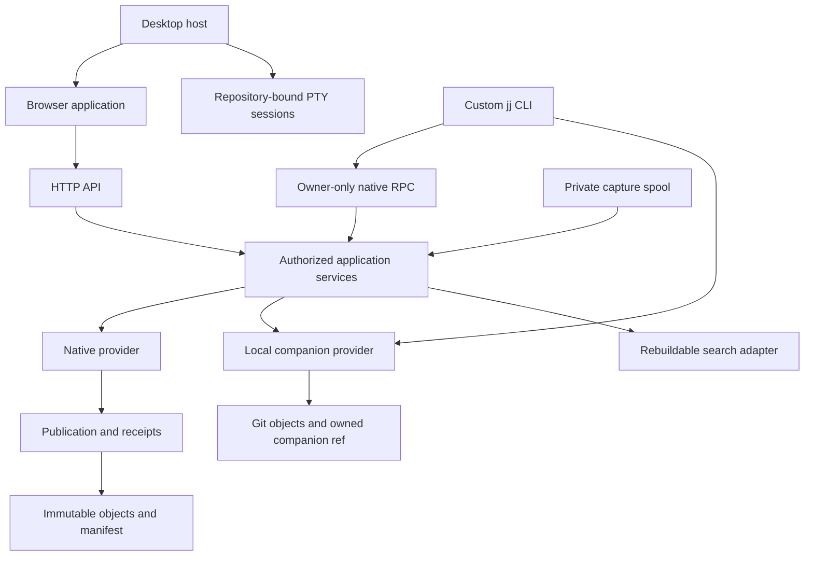

# Architecture

jj-store has two repository providers behind shared application services. Native
repositories publish immutable objects through a manifest. Existing Git-backed
JJ folders keep their code authority and select application metadata through a
companion Git ref. The browser, desktop host and custom CLI expose the
capabilities of the selected provider.

## Ownership boundaries

The model crates own identities, canonical records and pure domain rules. They
do not open browser sessions or run agent tools. `jj-store-object` owns bounded
object-store operations. `jj-store-wal` owns dependency inventories, selected
state, durable receipts and publication. Only the provider can select a new
repository state.

`jj-store-jj` adapts the pinned upstream JJ types and local Git storage.
Upstream JJ imports stay there and in `jj-store-cli`; services consume owned
interfaces. `jj-store-service` authorizes reads and applies typed commands. HTTP
and RPC translate those contracts and retain the same semantic policy.

The Svelte application owns navigation, selections, drafts and request
lifetimes. It does not infer commitment from a successful upload. Committed
responses and refresh events lead to a new selected snapshot. Historical
selections remain pinned until the user changes them.

The read service separates interactive requests from explicitly bounded index
preparation. Verified immutable generations retain the exact operation and
current authorization checks. One preparation worker preserves interactive
capacity; shared disk reservations and resident-index estimates are disposable
resource controls. They do not replace manifest or source-operation authority.
See [reads and refresh](reads.md) for the supported endpoints and remaining
large-repository qualification limits.

Private physical observations join an exact current JJ checkout/sparse/policy
witness to a two-pass bounded file scan. The service verifies identical
metadata, policy and heads before and after the scan and current authorization
before returning. Observation admission survives caller cancellation until the
blocking scan exits. These private reads do not snapshot files, grant staging,
or provide command/checkout authority; transport and named-combination
qualification remain separate steps.

The same registered guard optionally captures a complete original physical
inventory for checkout recovery. It retains sorted file fingerprints and full
directory stamps, reproduces the existing physical digest, and shares scanner
admission through capture and final authorization. Its bounded canonical data
contains neither file contents nor write authority. Durable command linkage and
provider-owned per-path progress must qualify any later installation guard;
ordinary physical validation continues to reject changed editor state.

## What is authoritative?

Managed ACP presentation joins installation-owned captured identities to
repository AgentStore sessions through the capture normalizer's exact committed
aliases. Ready workspace names and operations come from retained workspace
proofs. Status reauthorizes the repository and recomputes these read-only
values, including after restart; saved projections do not become authority. The
browser does not derive native IDs or infer associations from names. This leaves
native AgentStore bytes, publication and ordinary discussion targets unchanged.

| State                         | Authority                                       | Rebuildable or device-local data        |
| ----------------------------- | ----------------------------------------------- | --------------------------------------- |
| Native code and collaboration | Manifest-selected immutable closure             | Search indexes and disposable Git cache |
| Local code                    | Existing JJ operation and Git-backed repository | Browser file listings                   |
| Local application metadata    | Owned companion Git ref                         | Device folder registry                  |
| Device installation           | Private installation identity and configuration | Window layout and session notifications |

The desktop host owns process lifetime and a private installation. It uses the
same HTTP application and bundled documentation as the browser. Its local
terminal bridge owns repository-bound shells separately from repository APIs;
terminal commands are not server mutations. See
[process lifecycle](lifecycle.md).

A metadata home may link to code in another repository. That link does not grant
access, copy code or combine their transactions. See
[projects](../concepts/projects.md).

## Application freshness

One authorization-session QueryClient and transport registry share independent
read leases. Exact immutable snapshots remain cached; events invalidate live
aliases and affected domain families. A single application SSE feed observes
committed native metadata, local heads and companion references, plus accepted
state-owner settlements. Refcounted monitors coalesce filesystem hints and use
bounded metadata checks to cover missed notifications. They do not walk history
or poll storage statistics. Witnesses are hints; every reopened read retains
current authorization and its original pin. Terminal output uses its own stream.

Canceling a read releases that caller's lease before an identical retry starts.
Other active callers retain their shared transport. Targeted reaction
invalidation uses the request arguments independently of snapshot-epoch keys.

## Stacks contract foundation

The service owns versioned local stacks intent, exact file/hunk selection,
preparation and receipt records. These distinguish code publication, device
selection and physical checkout completion. They currently define validated
contracts, with no executable stack commands or HTTP mutation capability.
Recoverable checkout and named-combination execution remain qualification work;
opening a view does not create or snapshot a combination.

Owned recovery records separate stable physical/profile scope from current code,
binding and combination generations. Exact status binds the original request ID
and intent digest. Public results validate the preview and historical receipt
together and exclude installation paths, principal, private execution archives
and retention references. Pending discovery is actor scoped, excludes terminal
outcomes and admits at most 128 records within an eight-MiB response. The server
journal projects these records from existing private state; runtime admission,
HTTP routes and durable cancellation coordination remain separate work.

Current workspace-discovery contracts retain exact repository/registration/
operation input and a complete observed selection separately from those
historical outcomes. Readiness distinguishes absent configuration, ready, stale
selected code and pending recovery. The bounded public catalog includes selected
named combinations, their targets and code, and applied-stack membership. It
excludes proposed after-state and private retention. Catalog projection alone
cannot determine current readiness: the registered runtime must join current
observation and original journal recovery before transport or controller use.
Unreadable state cannot be presented as an empty workspace.

A private physical scanner supplies bounded, revalidated observations for future
checkout preparation. It fingerprints exact bytes, modes, paths and workspace
identity, including ignored and untracked obstacles. It reads symlink targets
without following them and returns no partial observation for unsafe entries,
limits, cancellation or disagreement between its two passes. Current limits are
8,192 cumulative entries, 16 MiB cumulative content across both passes, 2 MiB
per file, 64 directory levels and two seconds. This inventory is not a JJ
snapshot, displayed Unstaged assignment or filesystem CAS.

The private provider baseline selects the named workspace's working-copy commit
at an authorized operation/view. It reads exact raw file/link digests and modes,
bounded to 4,096 file entries, 8 MiB total and 2 MiB per file. The private
service comparison retains tracked ignored changes and every untracked file/link
as a checkout obstacle. JJ's matcher applies explicitly captured global/exclude
and per-directory rules; nested rules do not reinclude an ignored parent
directory. The scan captures regular `.gitignore` bytes within its two-pass
observation. No scan endpoint or active Unstaged assignment is supplied by these
helpers. Current checkout/sparse proof, global/exclude capture, foreground
coordination and fresh apply/checkout checks remain required before commands
become available.

The operation-pinned stack read owner projects real parents and graph
annotations without loading file details with history. Net file summaries and
selected patches compare explicit tree boundaries. It retains unloaded and
unavailable content plus file modes and ordered rename/conflict source terms.
Caller cancellation and view disposal release their own reads. Presentation hunk
IDs grant no execution authority.

The stack controller accepts optional lazy source-file and patch adapters. Each
inline file list and adjacent diff owns its loading, retry and continuation
state. Read-scope changes cancel stale reads and preserve other open diff
origins. Unstaged uses the same authoritative source reads; unavailable text
patches remain explicit. Command controls check individual provider
capabilities, while browsing and Copy remain available without an executor. The
production App explicitly injects a repository-scoped Stacks owner for
LocalTrusted registered Git-backed JJ folders with a matching binding generation
and code-read capability. Bookmark pickers and histories load bounded pages;
conflicted/deleted targets retain an unavailable reason. Stacks route
restoration does not load the ordinary Log graph, and graph preparation uses the
existing application notice and explicit action. Failed refresh retains the
previous complete read owner; valid loaded history and adjacent diffs are
revalidated without retaining obsolete cursors. Teardown cancels discovery and
Stacks-owned reads without closing the shared transport. Controller,
production-bootstrap Storybook and cold real-folder tests cover this boundary.
Physical scans and the recoverable command executor remain separate
implementation work.

A checkout without explicit setup retains an absent target and combination. The
Settings-style target picker selects only an exact advertised bookmark/head in
the current read scope. Refresh and disposal reject late choices. Choosing a
read target enables branch browsing but leaves Workspace empty and does not
initialize, snapshot or publish code. Missing combinations cannot imply applied
membership or expose an Unstaged file list.

The complete registered physical inventory also supplies a private
unchanged-tree checkout guard. It shares scan admission, checks binding/current
authorization, and retains admission through actual cancellation exit. No scan
snapshots code or grants command authority. Pinned native read snapshots retain
their existing membership, epoch and deadline rules; their private allocation
does not change public DTOs or publication boundaries.

The private physical guard also supplies a complete fresh inventory to the JJ
provider's interrupted file installer. It shares registered access, scanner
admission, cancellation and deadlines with ordinary validation. The provider
alone interprets exact saved progress; fresh data neither normalizes editor
changes nor grants a transport write capability.

## Interactive agents

The service defines typed installation-local execution and workspace interfaces;
the server composes its optional supervisor with a configured ACP executable
over inherited stdio. ACP implementation is not imported by service, model or
WAL. Code-repository access is checked independently of project/task homes. See
[agent sessions](../guides/agent-execution.md).

Installation agent setups are separate from repository AgentStore evidence.
Session views retain the original setup ID and project a live connection only
from the supervised process and completed ACP handshake. Legacy journals default
the association to unassigned and descriptions to empty. Optional last activity
time belongs to the private execution journal and advances only when an event is
retained; it neither establishes live presence nor changes repository authority.

Execution-event observation times are optional private journal metadata. New
captures preserve the same value through AgentStore's existing observation-time
field without changing source-sequence identities, native object formats or
manifest authority.
