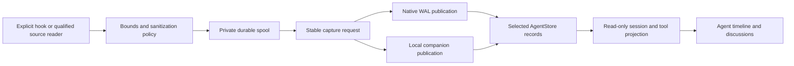

# Capture pipeline

Capture records agent evidence; it does not execute the recorded tools. The
private capture layer normalizes and sanitizes admitted evidence before
publishing it through the same authorized domain services used by other clients.

## Private source state

`jj-store-capture` owns source registration, leases, spool state and
receipt-aware drainers. A source ID combines installation identity with a
durable ordinal. A registration supplies discovery information; it does not
grant repository access or prove that a session is active. Production control
paths stay outside checkouts.

The drainer retains its original sanitized batch, profile and request identity
across retries and unknown outcomes. Publishing is authorized against the target
repository. A recorded diagnostic or gap is not silently converted into a tool
result or invented lifecycle transition.

## Projection and binding

Evidence uses exact native source identities. Alias resolution requires
complete, unambiguous matches; ambiguous parent sessions or tool targets retain
diagnostics without editing a guessed logical entity. Result-only capture can
replace a verified existing session cumulatively while preserving its prior
snapshots and receipts.

An explicitly bound capture retains the observed Thread version and assignment.
The publisher selects the Agent and Thread changes together, or neither when the
binding is stale. Legacy unlinked capture retains its interpretation. Display
projection reads sanitized records and never reopens the original agent
database.

## Integration profiles

Explicit hook/API/export capture and automatic local discovery have distinct
qualification. Automatic Codex reading is restricted to its qualified CLI/source
profile and supported native installation context. Local Git folder support for
explicit capture does not enable automatic discovery there. Unsupported
harnesses remain unavailable even if a similarly named JSON field exists.

See [agent capture](../guides/capture.md) for setup and verification, and
[configuration](../reference/configuration.md) for spool and discovery limits.
Treat a capture preview as potentially sensitive even after sanitization; review
its contents before intentionally publishing evidence.
