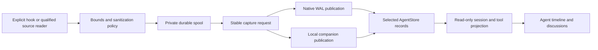

# Capture pipeline

Capture records agent evidence; it does not execute the recorded tools. The
private capture layer normalizes and sanitizes admitted evidence before
publishing it through the same authorized domain services used by other clients.

## Private source state

`jj-store-capture` owns source registration, leases, spool state and
receipt-aware drainers. A source ID combines installation identity with a
durable ordinal. A registration supplies discovery information; it does not
grant repository access or prove that a session is active. Production control
paths stay outside checkouts.

The drainer retains its original sanitized batch, profile and request identity
across retries and unknown outcomes. Publishing is authorized against the target
repository. A recorded diagnostic or gap is not silently converted into a tool
result or invented lifecycle transition.

## Projection and binding

Evidence uses exact native source identities. Alias resolution requires
complete, unambiguous matches; ambiguous parent sessions or tool targets retain
diagnostics without editing a guessed logical entity. Result-only capture can
replace a verified existing session cumulatively while preserving its prior
snapshots and receipts.

An explicitly bound capture retains the observed Thread version and assignment.
The publisher selects the Agent and Thread changes together, or neither when the
binding is stale. Legacy unlinked capture retains its interpretation. Display
projection reads sanitized records and never reopens the original agent
database.

## Integration profiles

Explicit hook/API/export capture and automatic local discovery have distinct
qualification. Automatic reading is restricted to qualified Codex CLI, Cursor
transcript and OpenCode read-only API profiles in a writable native LocalTrusted
installation. Cursor binding hooks provide activity hints without replaying hook
messages alongside transcript records. OpenCode uses the configured loopback
API; source status reads consume cached observations rather than making live
endpoint requests. Qualified native timestamps supply session/tool timing;
missing timing stays unknown. Local Git folder support for explicit capture does
not enable automatic discovery there. Unsupported harnesses remain unavailable
even if a similarly named JSON field exists.

See [agent capture](../guides/capture.md) for setup and verification, and
[configuration](../reference/configuration.md) for spool and discovery limits.
Treat a capture preview as potentially sensitive even after sanitization; review
its contents before intentionally publishing evidence.

## App-owned controller observations

The execution supervisor sanitizes live frames before browser delivery and
journal durability. It publishes stable sequence batches through the existing
native WAL/manifest or local companion capture receipt path. The controller-v2
normalizer preserves app session/turn/tool identities and one final assistant
message. Reconnect/restart retries exact publication intents, never prompts.
Privacy path rebinding reuses the immutable compiled scanner. Managed execution
workspaces are excluded from automatic transcript capture to avoid duplicates.

Assistant and reasoning text retains possible privacy-root prefixes in bounded
memory across streamed chunks. Message, tool and terminal boundaries flush that
text through the same scanner before journal durability or browser delivery.
Workspace, home and temporary paths use their symbolic labels even when the
adapter splits a path across updates. Exact registered secrets share this
buffer; failure never falls back to raw text or replays an inference.

Resolved agent credentials are registered as exact in-memory redactions before
any journal or repository capture, and survive workspace rebinding. Keychain and
sensitive environment references require values of at least eight bytes.
Ordinary short environment values remain usable. Credential values never enter
saved configuration or diagnostic responses. Captured context envelopes retain
sanitized historical content and delivery status through canonical AgentStore
publication.

Application-owned OAuth redaction allows bounded JWTs up to 16 KiB while keeping
ordinary environment-secret input at 4 KiB. Access, refresh and ID tokens are
registered for exact in-memory redaction before worker delivery, including
rotated tokens and JSON object keys. Provider replay state is not part of
canonical transcript serialization. This preserves the existing Kingfisher scan
and publication boundary.

Native scanning and prefix replacement are owned by the independently reusable
`lapis-agent-redaction` Rust crate. The JJ adapter retains domain payload
bounds, host cache-path admission and canonical observation identities. The
library has no JJ or application dependencies; the TypeScript redaction policy
is separate.

Public builds use released Kingfisher scanner 1.4.0 with rules 1.2.1 and core
1.0.3. The sanitization policy and compiled-cache namespace include the scanner
version, so earlier caches cannot silently stand in for this rule set. A scan
failure still withholds publication; distribution never bypasses sanitization.

Read-only root selection, bounded metadata discovery and Codex header inspection
are provided by `lapis-ai-capture`. JJ preserves exact profile versions,
raw-header witnesses, Cursor sidecar admission and acknowledged progress.
Discovery does not authorize ingestion. Automatic capture for ordinary local
Git-backed folders still requires separate qualification.

The `jj-store-capture` default `application` feature provides the original
private spool and native/local publication recovery. A headless Rust host can
select `default-features = false` to use bounded source readers, privacy,
leases, progress types and exact acknowledgements without service, RPC, WAL,
object-store or upstream JJ dependencies. The host supplies admission, durable
sanitized journaling and publication. A reader acknowledgement follows durable
acceptance of the exact batch and cursor; it is not a publication receipt.
Existing application spools require the application feature and keep their
original schemas, identities, reservations and unknown-outcome behavior.

## Native managed capture evidence

`NormalizerProfileV1::native_capture_v1()` accepts the exact sanitized schema-1
batch emitted by `jj-store-conversations` as one AgentStore observation.
`NativeCaptureEnvelopeV1` checks the native binding, policy, processing ordinal
and bounded complete frame group. The processing ordinal orders observations;
publication cursors and original frame sequences stay unchanged in the retained
envelope. Projection reuses controller session/turn/message/tool identities,
including one final assistant message. Native closure and uncertain errors stay
distinct. This profile does not provide a durable journal or select a backend;
hosts must retain exact requests and verify publication receipts separately.
