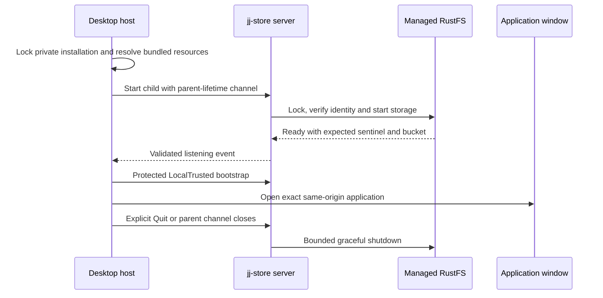

# Process lifecycle

The browser connects to an application server. The desktop distribution owns
that server as a child, with explicit bundled paths for the custom CLI, server,
embedded-storage runtime and generated browser resources.

## Startup and shutdown

The desktop installation lives outside repository checkouts and retains its
origin across restart. Occupied ports or incompatible state fail explicitly.
Startup does not attach to an arbitrary existing listener or reset data. The
host validates the child's listening event and LocalTrusted bootstrap before
loading the window. The child and storage runtime have bounded startup and
shutdown.

Closing the macOS main window hides it; the managed service remains alive. Dock
or tray actions reopen the window. Explicit Quit ends the owning process
lifetime. An interrupted command retains normal unknown-outcome semantics—window
closure cannot prove that a mutation was rejected.

## Documentation resources

The build generates one static MkDocs site and stages it under the browser
root's `help/` directory. Desktop resource staging copies the same independent
manifest and file closure. The HTTP server preloads only admitted files; request
paths do not select arbitrary disk paths.

Help opens in a full-screen dialog with a same-origin iframe. The current
application view remains mounted, preserving drafts and selections. Search
assets, fonts and pre-rendered Mermaid SVGs are local. External reference links
open separately. Escape first dismisses documentation search, then closes Help;
the close control restores focus to its opener.

Only documentation responses permit same-origin framing. The main application
retains its frame-ancestor restriction. Help scripts are external assets rather
than executable inline markup, and the documentation has no repository token or
mutation endpoint of its own. See [security](../reference/security.md).

## Development versus release

Vite HMR uses a development policy and an existing backend. A successful warm UI
check cannot establish production CSP, resource staging or native host behavior.
Cold built-site browser and platform-specific desktop checks provide that
evidence. The [development guide](../contributing/development.md) lists the
relevant lanes.
