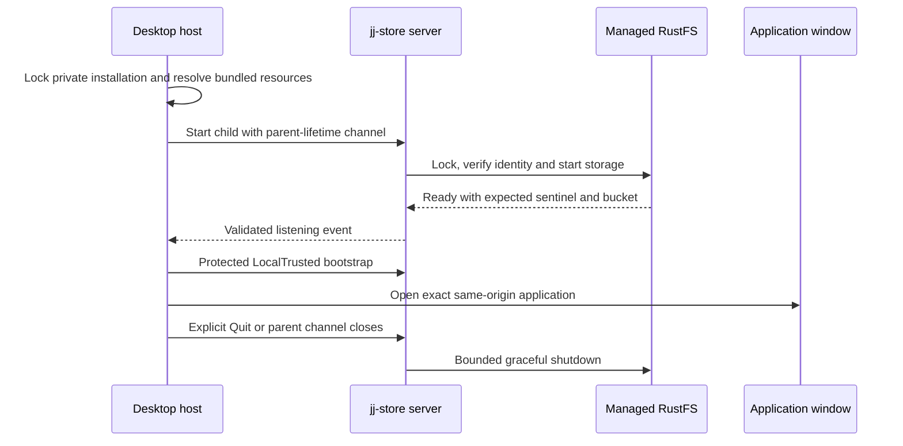

# Process lifecycle

The browser connects to an application server. The desktop distribution owns
that server as a child, with explicit bundled paths for the custom CLI, server,
embedded-storage runtime and generated browser resources.

## Startup and shutdown

The desktop installation lives outside repository checkouts and retains its
origin across restart. Occupied ports or incompatible state fail explicitly.
Startup does not attach to an arbitrary existing listener or reset data. The
host validates the child's listening event and LocalTrusted bootstrap before
loading the window. The child and storage runtime have bounded startup and
shutdown.

Closing the macOS main window hides it; the managed service remains alive. Dock
or tray actions reopen the window. Explicit Quit ends the owning process
lifetime. An interrupted command retains normal unknown-outcome semantics—window
closure cannot prove that a mutation was rejected.

## Stack command recovery foundation

The server now has a private journal primitive for exact stack preparations and
historical receipts. Its bounded file lives outside checkouts and binds the
installation, repository, physical JJ workspace, profile and authenticated
actor. Opening it or discovering pending requests never initializes missing
state. Exact retries retain the original preview and outcome; conflicting reuse
is rejected. Capacity admission reserves room for later receipt states rather
than evicting earlier requests.

Public journal projections preserve original status across live generation
changes. They authenticate the original actor and stable physical/profile scope
before returning a validated preview/receipt pair. Pending discovery includes
prepared, publication-unknown and required/blocked checkout states, and excludes
terminal results. Exact status retains terminal history. Neither read creates
private state or changes code, disk or combination selection. The registered
runtime must separately admit folder access before exposing these projections;
HTTP composition and coordinated unpublished cancellation remain unimplemented.

The combination owner now exposes a validated public selected catalog from
existing authenticated private state. It preserves selected combinations while
an update is pending, reports that coordination flag and strips proposed
after-state and retention keys. Scope/actor mismatch and corrupted state fail;
reads do not create missing state. The versioned workspace response contract
separates absent, ready, stale and pending readiness. Real initial-setup
evidence checks the public selected code against the observed native checkout,
but the registered discovery runtime and production picker remain unwired.

Atomic replacement and sync select journal state. Loss after replacement leaves
an unknown outcome; reopen and exact replay recover the selected receipt. A
publication-unknown or incomplete-checkout receipt prevents another publication
in that physical scope. Verified checkout, rejection and retirement cannot
return to executable preparation.

Actual local reword preparation now composes this journal with the owning JJ
provider. It selects the exact preview, recovery witness and full candidate
archive as pending before reserved-ref retention. Acknowledgement records the
identical retained commit/digest and removes only the pending archive body. The
128-record/8-MiB capacity includes pending archives and receipt-growth
allowance. Interrupted preparation resumes the original archive rather than
creating a replacement operation. Legacy metadata-only records retain their
encoding and cannot be upgraded to execution evidence. This composition
currently uses a trusted authority seam; installed command/combination
authority, publication and guarded checkout still need qualification before
production writable controls.

Registered preparation is limited to the configured LocalTrusted Admin principal
and currently verified device folders. It reuses bounded physical observation
and resolves active combination/immutable policy through a separate trusted
owner. Exact retained replay requires current authorization but does not
revalidate live combination/physical selection. Production combination ownership
and command transport/publication/checkout still require qualification.

This primitive does not retain JJ objects, publish operation heads or coordinate
physical checkout. The production Stacks page continues to expose qualified
reads while those provider execution and recovery gates are implemented.

## Desktop terminal lifetime

The native host owns repository-bound PTY sessions with an Alacritty grid. The
exact managed window and origin are required for the typed terminal bridge;
targets are revalidated local registrations or native workspace links, never
arbitrary renderer-supplied paths or commands. Child environments exclude
service credentials. Terminal output cannot invoke the clipboard or other host
bridges through escape sequences.

Sessions, scrollback, input, parser work and frame delivery are bounded. A
subscription retains at most one in-flight frame and one replacement snapshot.
Hiding the dock, navigating or reloading its renderer preserves sessions;
closing a tab ends its shell. Quit cleans up terminal processes before the
managed service. Only dock geometry persists; restart creates no replacement
shells.

## Documentation resources

The build generates one static MkDocs site and stages it under the browser
root's `help/` directory. Desktop resource staging copies the same independent
manifest and file closure. The HTTP server preloads only admitted files; request
paths do not select arbitrary disk paths.

Help opens in a full-screen dialog with a same-origin iframe. The current
application view remains mounted, preserving drafts and selections. Search
assets, fonts and pre-rendered Mermaid SVGs are local. External reference links
open separately. Escape first dismisses documentation search, then closes Help;
the close control restores focus to its opener.

Only documentation responses permit same-origin framing. The main application
retains its frame-ancestor restriction. Help scripts are external assets rather
than executable inline markup, and the documentation has no repository token or
mutation endpoint of its own. See [security](../reference/security.md).

## Development versus release

Vite HMR uses a development policy and an existing backend. A successful warm UI
check cannot establish production CSP, resource staging or native host behavior.
Cold built-site browser and platform-specific desktop checks provide that
evidence. The [development guide](../contributing/development.md) lists the
relevant lanes.

Private combination state separates pending provider effects from the selected
active pointer. It retains the exact original preview, complete proposed state
and acknowledged code-retention anchor before execution. Current preparation is
unavailable while the update is pending. The original journal must report the
matching verified checkout before device selection; rejected unpublished input
can be discarded without advancing the selected revision. Reopen and exact
replay preserve the outcome without replacing later active state. This metadata
owner does not execute publication, switching, merge/WIP creation or checkout.

## Agent execution lifetime

An optional bundled regular `jj-acp` and the paired custom JJ are passed to the
owned LocalTrusted service by absolute path. Agent privacy rules prepare in the
background before launching is admitted. One warm process owns each active
isolated workspace. Closing the parent pipe stops publication scheduling, closes
agents within twenty seconds, and bounds final publication to three seconds
before HTTP/RPC and RustFS stop. The desktop allows forty seconds for service
shutdown. Pending publication receipts and interrupted workspaces survive;
prompts are never replayed. See [agent sessions](../guides/agent-execution.md).

Agent restart preserves setup associations, avatar/configuration snapshots and
history and last observed activity time while clearing live connection state.
Legacy sessions without timing remain unknown until new activity; reopening or
refreshing status never invents a timestamp. Resume remains explicit. Validated
avatars are bounded together across setups and retained sessions to 8 MiB,
within the existing 32 MiB private execution journal.

Submitted agent chats first enter the installation's private execution journal.
The publisher then captures sanitized events into the selected repository's
AgentStore using durable spool receipts and the existing native or local
companion publication path. The inbox reads retained journal activity;
repository agent history reads committed captures. Saved agent configurations
stay installation-local, and unsent composer drafts stay in browser memory. New
events retain their device observation time through restart and publication,
carrying it into the existing captured occurred_at_millis field. Legacy untimed
events stay unknown; publication and refresh do not invent times.
