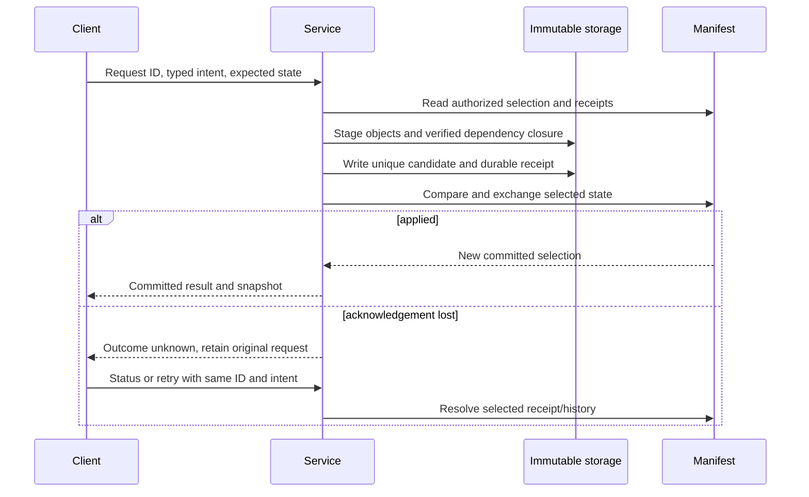

# Publication and recovery

A native mutation becomes visible when a conditional manifest update selects its
complete candidate. Upload completion, a WAL filename or an HTTP timeout cannot
establish that outcome by itself.

## Stable request identity

The service binds a request identity to canonical intent. A matching receipt
returns the original result across restart and checkpoint compaction. Reusing an
identity for different intent is an error. Retrying a timed-out command with a
new ID may create a second semantic operation, so the UI retains the exact
pending request and resolves it before offering another attempt.

Authorization precedes receipt lookup. Receipt replay then precedes entity
preconditions: an already committed request remains recognizable even if the
entity has subsequently changed. Typed review commands reapply intent after a
manifest race while retaining their per-thread and per-comment checks.

## Concurrent state

Code, AgentStore, ReviewStore and other collaboration domains have independent
selected roots and versions. Publishing one domain preserves the others. Strict
commands reject stale selections; native operation updates retain concurrent
siblings when required. A GET does not reconcile those siblings. Reconciliation
is an explicit write with its own authorization and result.

## Recovery after interruption

Candidates have attempt-unique immutable keys. Unselected candidates remain
invisible to readers and adapters. After a crash, the server follows manifest
references and selected catalogs, verifies the closure and reconstructs its
local state. A lost acknowledgement is resolved through committed receipts or
retained history where possible. Absence alone is not proof of rejection;
unresolved requests remain `OUTCOME_UNKNOWN`.

Checkpoints retain newer tails, durable receipts and evolution dependencies.
Empty local caches may be rebuilt from acknowledged object-store authority.
Search freshness is separate: a mutation may be durable while its index still
catches up. See [reads and refresh](reads.md).

## Conversation submissions

A comment submission publishes its new ThreadStore discussions, exact comment
revisions and batch record together. A comments-only submission needs no dummy
human message. Native manifest selection and the local companion reference each
retain their existing receipt authority. Agent dispatch follows publication and
context preparation; publication, delivery to each agent and a linked answer are
separate outcomes. Retry uses the original request and frozen payload.
