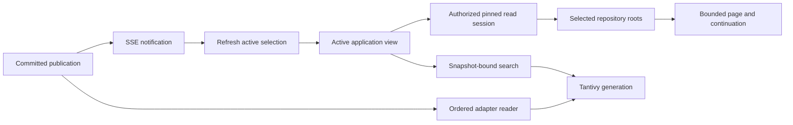

# Reads, search and refresh

A read session pins an explicit code operation and the relevant domain
selections. Pages and cursors continue within that selection. This keeps a file,
its history and its surrounding metadata interpretable even while other clients
publish.

## Pagination

Continuations are bounded and bound to their issuer and selected state. They are
not general-purpose offsets that can be transplanted to another repository or
new snapshot. If a cursor is stale, start a fresh query or session instead of
concatenating pages from incompatible selections. APIs retain exact identity
widths and lossless integer values; see
[transport semantics](../reference/transport.md).

## Search as a projection

Tantivy indexes are rebuildable adapters. The ordered committed reader follows
selected publication records and durable checkpoints. Replaying a record must
produce the same projection without selecting repository state or executing
captured tools. Search reports freshness against the requested snapshot and
index generation. A current-looking result list is not proof that a just-saved
object is indexed.

Index preparation is explicit and bounded. Unavailable, warming and stale states
belong beside the search controls. Native and filesystem repositories have
different capability gates; local browsing does not imply indexed local search.
[Search](../guides/search.md) describes the user workflow and supported queries.

## Keeping active views current

Committed saves, live events, reconnect and bounded periodic checks refresh
active views. An explicit historical selection stays pinned. Draft text and
exact pending commands survive refresh. This distinction lets users read old
state deliberately without losing unsaved input when current state changes.

SSE is a freshness signal, not a mutation acknowledgement or authority channel.
After a signal, the client obtains an authorized selected state. Reconnection
cannot safely infer the contents of missed events, so it triggers a bounded
refresh. Session-only notices report operational conditions and clear on actual
recovery, rather than treating a retry as success.
