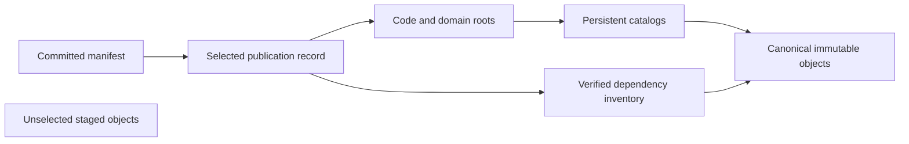

# Object storage and identity

Native storage separates immutable content from the small mutable selection that
makes it visible. The object API supplies bounded reads, immutable creation,
range reads and conditional compare-exchange. Ordinary graph reads follow
committed references; bucket listing is not a source of repository truth.

## Native identities

Commit, tree, operation and view data retain native JJ identities and fields.
Conflict terms remain structured instead of being flattened into a text file.
Evolution dependencies are retained even when they are not reachable through an
ordinary parent walk. Object envelopes bind records to the repository and kind;
readers check that framing before decoding payloads.

Immutable creation is not permission to replace existing bytes. Existing content
must match its expected identity and checksum. Large file transfer uses bounded
streaming and temporary storage rather than loading an entire arbitrary file in
memory. The transport and dependency walker enforce independent size and graph
limits; a limit failure leaves the candidate unpublished.

## Embedded storage

The native local installation owns a persistent embedded RustFS runtime, volume,
bucket and sentinel. Startup checks identity and ownership before recovering the
repository. Losing credentials, the sentinel or the expected volume is an error,
not a reason to initialize an empty replacement. The installation lock prevents
two managed owners from silently sharing the same runtime state.

RustFS qualification is tied to the exact tested image and topology. Passing an
in-memory object-store test does not establish the same durability or
conditional write semantics for another deployment. See
[capabilities](../reference/capabilities.md).

## Retention and maintenance

Storage inspection reports bounded progress. An incomplete scan is not proof of
integrity. Checkpoints compact selected history while preserving required tails,
receipts and dependencies. Destructive garbage collection and automatic
promotion are disabled in the supported profile.

Do not edit bucket keys, manifests or private Git refs manually. They encode
cross-object relationships that normal file copying cannot validate. Use the
application's explicit maintenance controls and retain unknown outcomes for
recovery. [Publication](publication.md) explains the commit point.
